# OOPs in C++ Master Notes: From Fundamentals to LLD Interviews

## Introduction

**Intended audience:** A B.Tech CSE student who knows basic C++ syntax and is preparing for LLD rounds, machine-coding rounds, C++/OOPs technical interviews and internship/placement interviews.

**Learning objectives.** After these notes you should be able to:

- Explain each OOP concept with intuition, a C++ example and its trade-offs.
- Predict the output of tricky constructor, virtual-function, slicing and overload-resolution snippets.
- Manage ownership and lifetime correctly (RAII, Rule of Zero/Three/Five, smart pointers).
- Apply SOLID, composition and dependency injection to design extensible systems.
- Implement the standard LLD examples (payment, notification, parking lot, library, logger, strategy, factory, observer) cleanly in C++17.

**How to use these notes**

1. Read Parts 1 to 8 in order the first time. They build on each other.
2. Type out every `RUN` example yourself and compile with `g++ -std=c++17 -Wall -Wextra`.
3. Cover the expected-output block, predict the output, then compare.
4. Use Parts 16 to 18 (question bank, output questions, comparisons) for revision, and Part 20 the night before.

**Conventions used**

- Blocks tagged with `// RUN` are complete programs that compile under C++17. Their expected output is in the `text` block that follows. All of them were compiled and executed while preparing these notes.
- Blocks without `// RUN` are **illustrative snippets** (not standalone programs).
- > **Interview tip:** blockquotes like this mark what interviewers look for.
- > **Warning:** blockquotes starting with Warning mark common mistakes.
- Behavior that depends on the compiler or ABI is explicitly labelled *implementation-defined* or *implementation detail*.

## Table of Contents

- [Introduction](#introduction)
- [Recommended Learning Sequence](#recommended-learning-sequence)
- [Part 1: OOP Fundamentals](#part-1-oop-fundamentals)
  - [1.1 What OOP Is and Why It Exists](#11-what-oop-is-and-why-it-exists)
  - [1.2 Procedural Programming vs OOP](#12-procedural-programming-vs-oop)
  - [1.3 Advantages and Disadvantages](#13-advantages-and-disadvantages)
  - [1.4 Classes, Objects, State, Behavior, Identity](#14-classes-objects-state-behavior-identity)
  - [1.5 Access Specifiers and `struct` vs `class`](#15-access-specifiers-and-struct-vs-class)
  - [1.6 Encapsulation](#16-encapsulation)
  - [1.7 Abstraction](#17-abstraction)
  - [1.8 Encapsulation vs Abstraction (in Depth)](#18-encapsulation-vs-abstraction-in-depth)
  - [1.9 Inheritance (Introduction)](#19-inheritance-introduction)
  - [1.10 Polymorphism (Introduction)](#110-polymorphism-introduction)
  - [1.11 Part 1 Interview Questions and Revision](#111-part-1-interview-questions-and-revision)
- [Part 2: Classes, Objects and Object Lifecycle](#part-2-classes-objects-and-object-lifecycle)
  - [2.1 Members, `this`, `const`, `mutable`, `static`, Inline](#21-members-this-const-mutable-static-inline)
  - [2.2 Nested Classes and `friend`](#22-nested-classes-and-friend)
  - [2.3 Object Size, Padding and Alignment](#23-object-size-padding-and-alignment)
  - [2.4 Storage Duration and Object Lifetime](#24-storage-duration-and-object-lifetime)
  - [2.5 Passing and Returning Objects](#25-passing-and-returning-objects)
  - [2.6 Object Slicing](#26-object-slicing)
- [Part 3: Constructors and Destructors](#part-3-constructors-and-destructors)
  - [3.1 Constructor Basics](#31-constructor-basics)
  - [3.2 Member Initializer Lists, Order and Default Member Initializers](#32-member-initializer-lists-order-and-default-member-initializers)
  - [3.3 Execution-Order Example: Base, Members, Derived](#33-execution-order-example-base-members-derived)
  - [3.4 Converting Constructors and `explicit`](#34-converting-constructors-and-explicit)
  - [3.5 Delegating, Defaulted, Deleted](#35-delegating-defaulted-deleted)
  - [3.6 Aggregate Initialization vs Constructor Initialization](#36-aggregate-initialization-vs-constructor-initialization)
  - [3.7 Constructor Exceptions and Partially Constructed Objects](#37-constructor-exceptions-and-partially-constructed-objects)
  - [3.8 Destructors, Destruction Order and RAII](#38-destructors-destruction-order-and-raii)
  - [3.9 Virtual Destructors](#39-virtual-destructors)
  - [3.10 Why Constructors Cannot Be Virtual; Virtual Calls in Constructors/Destructors](#310-why-constructors-cannot-be-virtual-virtual-calls-in-constructorsdestructors)
  - [3.11 Interview Traps](#311-interview-traps)
- [Part 4: Copy Semantics, Move Semantics and Resource Management](#part-4-copy-semantics-move-semantics-and-resource-management)
  - [4.1 Shallow Copy vs Deep Copy and Why Raw Owning Pointers Are Hard](#41-shallow-copy-vs-deep-copy-and-why-raw-owning-pointers-are-hard)
  - [4.2 A Correct Rule-of-Five Class (for Understanding)](#42-a-correct-rule-of-five-class-for-understanding)
  - [4.3 Lvalues, Rvalues, References, `std::move`, Forwarding](#43-lvalues-rvalues-references-stdmove-forwarding)
  - [4.4 Rule of Zero: the Modern Answer](#44-rule-of-zero-the-modern-answer)
  - [4.5 Smart Pointers](#45-smart-pointers)
  - [4.6 Exception Safety of Assignment](#46-exception-safety-of-assignment)
- [Part 5: Inheritance](#part-5-inheritance)
  - [5.1 What Inheritance Is and Access Transformations](#51-what-inheritance-is-and-access-transformations)
  - [5.2 Kinds of Inheritance](#52-kinds-of-inheritance)
  - [5.3 Construction Order and Inheriting Constructors](#53-construction-order-and-inheriting-constructors)
  - [5.4 Name Hiding, Overriding and `using`](#54-name-hiding-overriding-and-using)
  - [5.5 Multiple Inheritance, Ambiguity, Diamond and Virtual Inheritance](#55-multiple-inheritance-ambiguity-diamond-and-virtual-inheritance)
  - [5.6 Casting in Hierarchies and RTTI](#56-casting-in-hierarchies-and-rtti)
  - [5.7 Liskov Substitution and "Is-a" vs "Has-a"](#57-liskov-substitution-and-is-a-vs-has-a)
  - [5.8 When Inheritance Becomes Harmful](#58-when-inheritance-becomes-harmful)
- [Part 6: Polymorphism](#part-6-polymorphism)
  - [6.1 Meaning and Kinds](#61-meaning-and-kinds)
  - [6.2 Static Binding vs Dynamic Binding](#62-static-binding-vs-dynamic-binding)
  - [6.3 Virtual, Pure Virtual, Abstract Classes, Interfaces, `override`, `final`, Covariance](#63-virtual-pure-virtual-abstract-classes-interfaces-override-final-covariance)
  - [6.4 How Virtual Dispatch Works (Conceptual; Implementation Detail)](#64-how-virtual-dispatch-works-conceptual-implementation-detail)
  - [6.5 Why Runtime Polymorphism Matters for LLD: Payment Processing](#65-why-runtime-polymorphism-matters-for-lld-payment-processing)
- [Part 7: Operator Overloading](#part-7-operator-overloading)
  - [7.1 What It Is and Why It Exists](#71-what-it-is-and-why-it-exists)
  - [7.2 Member vs Non-Member vs Friend](#72-member-vs-non-member-vs-friend)
  - [7.3 `ComplexNumber` Walkthrough](#73-complexnumber-walkthrough)
  - [7.4 Increment/Decrement, Subscript and Function-Call Operators](#74-incrementdecrement-subscript-and-function-call-operators)
  - [7.5 A Custom Value Type: `Money`](#75-a-custom-value-type-money)
  - [7.6 Restrictions and Good Practice](#76-restrictions-and-good-practice)
- [Part 8: Overloading, Overriding, Hiding and Casting](#part-8-overloading-overriding-hiding-and-casting)
  - [8.1 Master Comparison](#81-master-comparison)
  - [8.2 Implicit vs Explicit Conversions](#82-implicit-vs-explicit-conversions)
  - [8.3 The Four C++ Casts](#83-the-four-c-casts)
- [Part 9: Abstraction, Interfaces and Dependency Management](#part-9-abstraction-interfaces-and-dependency-management)
  - [9.1 Concepts](#91-concepts)
  - [9.2 Extensible Notification System](#92-extensible-notification-system)
- [Part 10: The SOLID Principles in C++](#part-10-the-solid-principles-in-c)
  - [10.1 S: Single Responsibility Principle](#101-s-single-responsibility-principle)
  - [10.2 O: Open/Closed Principle](#102-o-openclosed-principle)
  - [10.3 L: Liskov Substitution Principle](#103-l-liskov-substitution-principle)
  - [10.4 I: Interface Segregation Principle](#104-i-interface-segregation-principle)
  - [10.5 D: Dependency Inversion Principle](#105-d-dependency-inversion-principle)
  - [10.6 Summary Table](#106-summary-table)
- [Part 11: Association, Aggregation, Composition](#part-11-association-aggregation-composition)
  - [11.1 Definitions](#111-definitions)
  - [11.2 UML and C++ Mapping](#112-uml-and-c-mapping)
  - [11.3 Runnable Example: University, Departments, Professors, Car/Engine](#113-runnable-example-university-departments-professors-carengine)
  - [11.4 More Domain Mappings](#114-more-domain-mappings)
- [Part 12: Advanced C++ OOP Concepts](#part-12-advanced-c-oop-concepts)
  - [12.1 `const` Correctness [Core]](#121-const-correctness-core)
  - [12.2 Exception Safety Guarantees [Core]](#122-exception-safety-guarantees-core)
  - [12.3 Templates vs OOP; Static vs Dynamic Polymorphism; CRTP [Core + Plus]](#123-templates-vs-oop-static-vs-dynamic-polymorphism-crtp-core--plus)
  - [12.4 Type Erasure (Conceptual) [Plus]](#124-type-erasure-conceptual-plus)
  - [12.5 Pimpl Idiom (Conceptual) [Plus]](#125-pimpl-idiom-conceptual-plus)
  - [12.6 Interfaces, Destructors and Polymorphic Copying [Core]](#126-interfaces-destructors-and-polymorphic-copying-core)
  - [12.7 Strategy for Learning This Part](#127-strategy-for-learning-this-part)
- [Part 13: Memory Model and Object Layout](#part-13-memory-model-and-object-layout)
  - [13.1 Where Objects Live](#131-where-objects-live)
  - [13.2 What Counts Toward an Object's Size](#132-what-counts-toward-an-objects-size)
  - [13.3 Base and Derived Subobjects, Slicing](#133-base-and-derived-subobjects-slicing)
  - [13.4 Pointer vs Reference](#134-pointer-vs-reference)
  - [13.5 Lifetime Errors (Undefined Behavior)](#135-lifetime-errors-undefined-behavior)
- [Part 14: OOP Design Examples for LLD](#part-14-oop-design-examples-for-lld)
  - [14.1 Example 1: Payment Processing System](#141-example-1-payment-processing-system)
  - [14.2 Example 2: Notification System with Fan-out and Fallback](#142-example-2-notification-system-with-fan-out-and-fallback)
  - [14.3 Example 3: Parking Lot (OOP Foundations)](#143-example-3-parking-lot-oop-foundations)
  - [14.4 Example 4: Library Management System](#144-example-4-library-management-system)
  - [14.5 Example 5: Logger with a Sink Abstraction](#145-example-5-logger-with-a-sink-abstraction)
  - [14.6 Example 6: Strategy Pattern (Pricing)](#146-example-6-strategy-pattern-pricing)
  - [14.7 Example 7: Factory Pattern](#147-example-7-factory-pattern)
  - [14.8 Example 8: Observer Pattern](#148-example-8-observer-pattern)
- [Part 15: OOP Design Patterns Relevant to LLD](#part-15-oop-design-patterns-relevant-to-lld)
  - [15.1 Strategy](#151-strategy)
  - [15.2 Factory Method](#152-factory-method)
  - [15.3 Simple Factory (an idiom, not a GoF pattern)](#153-simple-factory-an-idiom-not-a-gof-pattern)
  - [15.4 Abstract Factory](#154-abstract-factory)
  - [15.5 Observer](#155-observer)
  - [15.6 Decorator](#156-decorator)
  - [15.7 Adapter](#157-adapter)
  - [15.8 Singleton](#158-singleton)
  - [15.9 Builder](#159-builder)
  - [15.10 State](#1510-state)
  - [15.11 Template Method](#1511-template-method)
  - [15.12 Command](#1512-command)
  - [15.13 Dependency Injection (a technique)](#1513-dependency-injection-a-technique)
- [Part 16: Technical Interview Question Bank](#part-16-technical-interview-question-bank)
  - [Level 1: Fundamentals](#level-1-fundamentals)
  - [Level 2: Intermediate](#level-2-intermediate)
  - [Level 3: Advanced C++](#level-3-advanced-c)
  - [Level 4: LLD and Design](#level-4-lld-and-design)
- [Part 17: Output-Based C++ Interview Questions](#part-17-output-based-c-interview-questions)
  - [Q1. Multiple inheritance: constructor and destructor order](#q1-multiple-inheritance-constructor-and-destructor-order)
  - [Q2. Temporaries and local destruction order](#q2-temporaries-and-local-destruction-order)
  - [Q3. Constructor overload selection](#q3-constructor-overload-selection)
  - [Q4. How many copies?](#q4-how-many-copies)
  - [Q5. Copy constructor or copy assignment?](#q5-copy-constructor-or-copy-assignment)
  - [Q6. `std::move` on a `const` object](#q6-stdmove-on-a-const-object)
  - [Q7. A "missing const" that is not an override](#q7-a-missing-const-that-is-not-an-override)
  - [Q8. Function hiding](#q8-function-hiding)
  - [Q9. Object slicing in containers](#q9-object-slicing-in-containers)
  - [Q10. Static member shared state](#q10-static-member-shared-state)
  - [Q11. `const` overloads](#q11-const-overloads)
  - [Q12. Ambiguity across multiple bases](#q12-ambiguity-across-multiple-bases)
  - [Q13. Virtual inheritance and construction](#q13-virtual-inheritance-and-construction)
  - [Q14. Overload resolution with built-in types](#q14-overload-resolution-with-built-in-types)
  - [Q15. Ambiguous overloads (no run)](#q15-ambiguous-overloads-no-run)
  - [Q16. Name lookup: member hides global](#q16-name-lookup-member-hides-global)
  - [Q17. Private virtual function](#q17-private-virtual-function)
  - [Q18. Implicit conversion vs `explicit`](#q18-implicit-conversion-vs-explicit)
  - [Q19. Smart pointer ownership and counts](#q19-smart-pointer-ownership-and-counts)
  - [Q20. Virtual call inside a destructor](#q20-virtual-call-inside-a-destructor)
  - [Q21. Delegating constructor order](#q21-delegating-constructor-order)
  - [Q22. Guaranteed copy elision (C++17)](#q22-guaranteed-copy-elision-c17)
  - [Q23. Parentheses vs braces](#q23-parentheses-vs-braces)
  - [Q24. Static local variable](#q24-static-local-variable)
  - [Q25. Lifetime extension of a temporary](#q25-lifetime-extension-of-a-temporary)
  - [Q26. Default member initializer vs constructor initializer list](#q26-default-member-initializer-vs-constructor-initializer-list)
  - [Q27. Pure virtual function with a body](#q27-pure-virtual-function-with-a-body)
  - [Q28. Member initialization order with dependent members (no run)](#q28-member-initialization-order-with-dependent-members-no-run)
  - [Q29. Layout questions are implementation-defined (no run)](#q29-layout-questions-are-implementation-defined-no-run)
  - [Q30. Initialization trap: default-initialized built-ins (no run)](#q30-initialization-trap-default-initialized-built-ins-no-run)
- [Part 18: Common OOP Interview Comparisons](#part-18-common-oop-interview-comparisons)
  - [18.1 Class vs Object](#181-class-vs-object)
  - [18.2 Struct vs Class](#182-struct-vs-class)
  - [18.3 Encapsulation vs Abstraction](#183-encapsulation-vs-abstraction)
  - [18.4 Abstraction vs Interface](#184-abstraction-vs-interface)
  - [18.5 Inheritance vs Composition](#185-inheritance-vs-composition)
  - [18.6 Association vs Aggregation vs Composition](#186-association-vs-aggregation-vs-composition)
  - [18.7 Overloading vs Overriding](#187-overloading-vs-overriding)
  - [18.8 Overriding vs Name Hiding](#188-overriding-vs-name-hiding)
  - [18.9 Compile-time vs Runtime Polymorphism](#189-compile-time-vs-runtime-polymorphism)
  - [18.10 Static Binding vs Dynamic Binding](#1810-static-binding-vs-dynamic-binding)
  - [18.11 Virtual vs Pure Virtual Functions](#1811-virtual-vs-pure-virtual-functions)
  - [18.12 Abstract Class vs Concrete Class](#1812-abstract-class-vs-concrete-class)
  - [18.13 Constructor vs Destructor](#1813-constructor-vs-destructor)
  - [18.14 Default Constructor vs Defaulted Constructor](#1814-default-constructor-vs-defaulted-constructor)
  - [18.15 Copy Constructor vs Copy Assignment](#1815-copy-constructor-vs-copy-assignment)
  - [18.16 Copy Semantics vs Move Semantics](#1816-copy-semantics-vs-move-semantics)
  - [18.17 Shallow Copy vs Deep Copy](#1817-shallow-copy-vs-deep-copy)
  - [18.18 Pointer vs Reference](#1818-pointer-vs-reference)
  - [18.19 `unique_ptr` vs `shared_ptr` vs `weak_ptr`](#1819-unique_ptr-vs-shared_ptr-vs-weak_ptr)
  - [18.20 `static_cast` vs `dynamic_cast`](#1820-static_cast-vs-dynamic_cast)
  - [18.21 Public vs Protected vs Private Inheritance](#1821-public-vs-protected-vs-private-inheritance)
  - [18.22 Dependency Injection vs Direct Construction](#1822-dependency-injection-vs-direct-construction)
  - [18.23 Tight vs Loose Coupling](#1823-tight-vs-loose-coupling)
  - [18.24 Cohesion vs Coupling](#1824-cohesion-vs-coupling)
  - [18.25 Rule of Three vs Five vs Zero](#1825-rule-of-three-vs-five-vs-zero)
  - [18.26 OOP vs Procedural Programming](#1826-oop-vs-procedural-programming)
  - [18.27 Runtime Polymorphism vs Static Polymorphism (design view)](#1827-runtime-polymorphism-vs-static-polymorphism-design-view)
  - [18.28 `override` vs `final`](#1828-override-vs-final)
  - [18.29 Virtual Inheritance vs Virtual Functions](#1829-virtual-inheritance-vs-virtual-functions)
  - [18.30 Simple Factory vs Factory Method vs Abstract Factory](#1830-simple-factory-vs-factory-method-vs-abstract-factory)
- [Part 19: Common Mistakes and Interview Traps](#part-19-common-mistakes-and-interview-traps)
- [Part 20: Quick Revision Sheets](#part-20-quick-revision-sheets)
  - [20.1 One-Page OOP Revision](#201-one-page-oop-revision)
  - [20.2 C++ Syntax Cheat Sheet](#202-c-syntax-cheat-sheet)
  - [20.3 LLD-Oriented OOP Checklist](#203-lld-oriented-oop-checklist)
  - [20.4 Interview Answer Framework](#204-interview-answer-framework)
  - [20.5 Last-Minute Revision Checklist](#205-last-minute-revision-checklist)
  - [20.6 Must Know vs Advanced](#206-must-know-vs-advanced)
  - [20.7 Seven-Session Practice Plan](#207-seven-session-practice-plan)

## Progress Checklist

- [ ] Part 1: OOP Fundamentals
- [ ] Part 2: Classes, Objects and Object Lifecycle
- [ ] Part 3: Constructors and Destructors
- [ ] Part 4: Copy Semantics, Move Semantics and Resource Management
- [ ] Part 5: Inheritance
- [ ] Part 6: Polymorphism
- [ ] Part 7: Operator Overloading
- [ ] Part 8: Overloading, Overriding, Hiding and Casting
- [ ] Part 9: Abstraction, Interfaces and Dependency Management
- [ ] Part 10: The SOLID Principles in C++
- [ ] Part 11: Association, Aggregation, Composition
- [ ] Part 12: Advanced C++ OOP Concepts
- [ ] Part 13: Memory Model and Object Layout
- [ ] Part 14: OOP Design Examples for LLD
- [ ] Part 15: OOP Design Patterns Relevant to LLD
- [ ] Part 16: Technical Interview Question Bank
- [ ] Part 17: Output-Based C++ Interview Questions
- [ ] Part 18: Common OOP Interview Comparisons
- [ ] Part 19: Common Mistakes and Interview Traps
- [ ] Part 20: Quick Revision Sheets


## Recommended Learning Sequence

| Stage | Parts | Goal |
|---|---|---|
| 1. Foundations | 1, 2 | Classes, objects, access control, lifetime |
| 2. Object lifecycle | 3, 4 | Constructors, destructors, copy/move, smart pointers |
| 3. Reuse and dispatch | 5, 6, 7, 8 | Inheritance, polymorphism, operators, casts |
| 4. Design | 9, 10, 11, 12 | Abstraction, DI, SOLID, relationships, advanced C++ |
| 5. Internals | 13 | Object layout and memory model |
| 6. Practice | 14, 15 | LLD examples and patterns |
| 7. Revision | 16 to 20 | Questions, traps, cheat sheets |

---

## Part 1: OOP Fundamentals

### 1.1 What OOP Is and Why It Exists

**Intuition.** Early programs were a list of functions operating on shared global data. As programs grew, any function could modify any data, so a bug anywhere could corrupt state everywhere. OOP was introduced to **bundle data with the operations that are allowed to change it**, and to model programs as collaborating objects.

**Definition.** *Object-Oriented Programming* is a paradigm in which a program is organized as objects. Each object has **state** (data), **behavior** (functions) and **identity**. Objects interact by sending messages (calling member functions).

**Analogy.** A coffee machine. You press buttons (public interface). You do not reach inside and rotate the heating element (private state). Different machines (espresso, drip) respond to "make coffee" in their own way.

### 1.2 Procedural Programming vs OOP

| Aspect | Procedural | Object-Oriented |
|---|---|---|
| Unit of organization | Functions | Classes and objects |
| Data and behavior | Separate | Bundled together |
| Data protection | Weak (globals, open structs) | Access control, invariants |
| Extension | Edit functions or add `if/switch` | Add new types behind an interface |
| Reuse | Copy or call functions | Inheritance, composition, templates |
| Typical C++ style | C-style `struct` + free functions | `class` with private state |
| Best fit | Small scripts, algorithms | Large systems with evolving requirements |

### 1.3 Advantages and Disadvantages

**Advantages:** encapsulated invariants, modularity, easier extension through polymorphism, natural domain modeling, testability through substitutable dependencies.

**Disadvantages:** more boilerplate, risk of over-engineering (deep hierarchies, needless abstraction), indirect calls (virtual dispatch) have a small runtime cost, tight coupling if inheritance is misused.

> **Interview tip:** Never claim OOP is "always better". Say that OOP helps when requirements change often and many variations of a concept exist. For a pure algorithm, free functions are fine. C++ is multi-paradigm.

### 1.4 Classes, Objects, State, Behavior, Identity

- **Class:** a user-defined type; a blueprint describing data members and member functions.
- **Object:** an instance of a class occupying storage.
- **State:** the current values of the data members.
- **Behavior:** what the object can do (member functions), usually depending on or changing state.
- **Identity:** what distinguishes one object from another, even if their state is equal. In C++ identity is essentially the object's address.
- **Attributes / methods:** data members / member functions.

```cpp
// RUN
#include <iostream>
#include <string>
#include <utility>

class Student {
public:
    Student(std::string name, int rollNo) : name_(std::move(name)), rollNo_(rollNo) {}

    void addMarks(int marks) { totalMarks_ += marks; ++subjects_; }   // behavior that changes state

    double average() const {                                           // const: does not change state
        return subjects_ == 0 ? 0.0 : static_cast<double>(totalMarks_) / subjects_;
    }
    const std::string& name() const { return name_; }
    int rollNo() const { return rollNo_; }

private:                       // state is hidden; only the member functions can touch it
    std::string name_;
    int rollNo_;
    int totalMarks_ = 0;
    int subjects_ = 0;
};

int main() {
    Student a("Asha", 1);
    Student b("Asha", 1);      // same state as a, but a different object
    a.addMarks(80);
    a.addMarks(90);
    std::cout << a.name() << " avg=" << a.average() << "\n";
    std::cout << std::boolalpha << "same object? " << (&a == &b) << "\n";   // identity = address
    std::cout << "b avg=" << b.average() << "\n";                           // state differs now
}
```

```text
Asha avg=85
same object? false
b avg=0
```

**Execution flow.** Two objects are created on the stack; each runs the constructor. `a`'s state changes through `addMarks`; `b` is unaffected, so equal construction arguments do not mean the same identity.

### 1.5 Access Specifiers and `struct` vs `class`

| Specifier | Accessible from the class itself | Derived classes | Outside code |
|---|---|---|---|
| `public` | Yes | Yes | Yes |
| `protected` | Yes | Yes | No |
| `private` | Yes | No | No |

`friend` declarations are the controlled exception (Part 2).

**`struct` vs `class` in C++:** the **only** language differences are defaults: members of a `struct` are `public` by default and `struct` inheritance is `public` by default; for `class` both default to `private`. Convention: `struct` for passive data bundles with no invariants, `class` for types that maintain invariants.

> **Warning:** Access control works per *class*, not per *object*. A member function can access the private members of *another* object of the same class. Access control is a compile-time check and is not a security boundary.

### 1.6 Encapsulation

**Definition.** Encapsulation bundles data with the functions that operate on it **and restricts direct access so that the class can protect its invariants**.

An **invariant** is a condition that must always hold for a valid object (for example, `balance >= 0`).

```cpp
// RUN
#include <iostream>
#include <stdexcept>

class BankAccount {
public:
    explicit BankAccount(long long openingPaise) : balancePaise_(openingPaise) {
        if (openingPaise < 0) throw std::invalid_argument("opening balance < 0");
    }
    void deposit(long long paise) {
        if (paise <= 0) throw std::invalid_argument("deposit must be positive");
        balancePaise_ += paise;
    }
    bool withdraw(long long paise) {                 // invariant: balance never negative
        if (paise <= 0 || paise > balancePaise_) return false;
        balancePaise_ -= paise;
        return true;
    }
    long long balance() const { return balancePaise_; }
private:
    long long balancePaise_;                          // invariant: >= 0
};

int main() {
    BankAccount acc(1000);
    std::cout << std::boolalpha << acc.withdraw(5000) << " " << acc.balance() << "\n";
    acc.deposit(500);
    std::cout << acc.withdraw(300) << " " << acc.balance() << "\n";
    try { acc.deposit(-1); } catch (const std::exception& e) { std::cout << "error: " << e.what() << "\n"; }
}
```

```text
false 1000
true 1200
error: deposit must be positive
```

With a public `balance` field, any caller could write a negative value and every function would have to re-check it. Encapsulation keeps the check in **one place**.

### 1.7 Abstraction

**Definition.** Abstraction exposes **what** an object does through a small, stable contract and hides **how** it does it, so that callers depend only on the contract.

**Analogy.** A `Payment` button: the checkout code asks to "pay 500". It does not care whether UPI, a card or a wallet does the work.

### 1.8 Encapsulation vs Abstraction (in Depth)

The slogan "encapsulation hides data, abstraction hides implementation" is true but not useful. The real distinction:

| | Encapsulation | Abstraction |
|---|---|---|
| Question answered | "How do I protect this object's **invariants**?" | "What is the **minimal contract** callers need, so that implementations can vary?" |
| Mechanism in C++ | `private` data, validating member functions, no leaking references | Abstract classes (pure virtual), templates/concepts, narrow public APIs |
| Level | Inside **one class** | **Between** classes or modules |
| Failure symptom | Callers corrupt state; invariants broken | Callers depend on concrete details; changing one class breaks many |
| Main benefit | Correctness | Flexibility, substitutability |

They are **independent**. A class can have either one without the other:

```cpp
// RUN
#include <iostream>
#include <memory>
#include <vector>

// (1) Encapsulated but NOT abstract: invariants protected, yet callers are coupled to this concrete class.
class SortedBag {
public:
    void insert(int x) {
        auto it = data_.begin();
        while (it != data_.end() && *it < x) ++it;
        data_.insert(it, x);                         // invariant: data_ always sorted
    }
    int smallest() const { return data_.front(); }   // precondition: not empty
private:
    std::vector<int> data_;
};

// (2) Leaky encapsulation: member is private, but a mutable reference escapes. Invariant can now break.
class LeakyBag {
public:
    void insert(int x) { data_.push_back(x); }
    std::vector<int>& items() { return data_; }      // BAD: returns mutable access to internals
private:
    std::vector<int> data_;
};

// (3) Abstraction: callers depend only on the contract IdGenerator.
class IdGenerator {
public:
    virtual ~IdGenerator() = default;
    virtual int next() = 0;
};
class SequentialIdGenerator : public IdGenerator {
public:
    int next() override { return ++last_; }
private:
    int last_ = 0;
};
class FixedIdGenerator : public IdGenerator {         // handy for tests
public:
    int next() override { return 42; }
};

class OrderService {
public:
    explicit OrderService(IdGenerator& gen) : gen_(gen) {}   // depends on abstraction
    int placeOrder() { return gen_.next(); }
private:
    IdGenerator& gen_;
};

int main() {
    SortedBag bag;
    bag.insert(5); bag.insert(1); bag.insert(3);
    std::cout << "smallest=" << bag.smallest() << "\n";

    LeakyBag leaky;
    leaky.insert(1);
    leaky.items().push_back(-7);                      // caller mutates internals freely
    std::cout << "leaky size=" << leaky.items().size() << "\n";

    SequentialIdGenerator seq; FixedIdGenerator fixed;
    OrderService prod(seq), test(fixed);
    std::cout << prod.placeOrder() << " " << prod.placeOrder() << " " << test.placeOrder() << "\n";
}
```

```text
smallest=1
leaky size=2
1 2 42
```

**Reading the example.** `SortedBag` is well encapsulated (callers cannot break sorting) but has no abstraction: swapping its implementation for another container type still forces callers to keep using `SortedBag`. `LeakyBag` shows that `private` alone is not encapsulation. `OrderService` demonstrates abstraction: it works with any `IdGenerator`.

> **Interview tip:** Give the answer as "Encapsulation protects invariants inside a class; abstraction defines a contract so that implementations are replaceable. I use `private` data for the first and abstract interfaces for the second."

### 1.9 Inheritance (Introduction)

**Definition.** A derived class acquires the members of a base class and may add or specialise behavior. It models an **is-a** relationship when public inheritance is used.

**Analogy.** A `Smartphone` *is a* `Phone`: it makes calls like any phone and adds apps.

```cpp
class Vehicle { public: virtual ~Vehicle() = default; virtual int wheels() const = 0; };
class Bike : public Vehicle { public: int wheels() const override { return 2; } };
class Car  : public Vehicle { public: int wheels() const override { return 4; } };
```

LLD use: `Vehicle` types in a parking lot, `Account` types in a bank. **Trade-off:** inheritance couples derived classes to base class details; prefer composition when the relation is not truly "is-a" (Part 5).

### 1.10 Polymorphism (Introduction)

**Definition.** One interface, many forms. C++ has two broad kinds:

- **Compile-time (static):** function/operator overloading, templates. Resolved by the compiler.
- **Runtime (dynamic):** virtual functions called through a base pointer/reference. Resolved at run time.

**Analogy.** "Draw" on a `Shape*` draws a circle or a square depending on the real object.

LLD use: a `PaymentMethod` interface with UPI, card and wallet implementations; the checkout code never changes when a new method is added (Part 6, Part 14).

### 1.11 Part 1 Interview Questions and Revision

1. **Difference between class and object?** Class is a type (blueprint); object is an instance occupying memory.
2. **Difference between `struct` and `class` in C++?** Only default access and default inheritance mode.
3. **Is `private` a security feature?** No. It is a compile-time design check.
4. **Encapsulation vs abstraction?** See 1.8.
5. **Can a class be abstract and also hold data and constructors?** Yes (Part 19).

**Revision summary**

- Object = state + behavior + identity.
- Encapsulation protects invariants; abstraction offers a replaceable contract.
- Inheritance = reuse + is-a; polymorphism = one interface, many behaviors.
- Default access: `class` private, `struct` public.

---


## Part 2: Classes, Objects and Object Lifecycle

### 2.1 Members, `this`, `const`, `mutable`, `static`, Inline

- A member function can be defined **inside** the class (implicitly `inline`) or **outside** using `ClassName::`. Outside definitions keep headers readable and reduce recompilation.
- `inline` is a linkage hint ("multiple identical definitions are allowed"), not a promise that the call is expanded. The optimizer decides.
- `this` is a pointer to the current object. It exists **only in non-static member functions**. A static function belongs to the class, not to an object, so it has no `this`.
- In a `const` member function, `this` has type `const T*`, so ordinary members cannot be modified. `mutable` members are the exception and are meant for caches, counters and mutexes that are not part of the logical state.
- A `static` data member has **one copy shared by all objects**. Before C++17 it needed an out-of-class definition; in C++17 you may write `inline static int x = 0;` in the class.

```cpp
// RUN
#include <iostream>

class Counter {
public:
    Counter() { ++instances_; }
    ~Counter() { --instances_; }

    Counter& increment();                         // defined outside the class below

    int value() const { ++reads_; return value_; } // const function, but mutable member may change
    int reads() const { return reads_; }

    static int instances() { return instances_; } // no 'this' available here

private:
    int value_ = 0;
    mutable int reads_ = 0;                        // bookkeeping, not logical state
    static int instances_;                         // declaration; shared by all Counters
};

int Counter::instances_ = 0;                       // the one definition (one .cpp file)

Counter& Counter::increment() {
    ++value_;
    return *this;                                   // returning *this enables chaining
}

int main() {
    Counter c;
    c.increment().increment().increment();
    int v = c.value();
    std::cout << "value=" << v << "\n";
    std::cout << "reads=" << c.reads() << "\n";
    std::cout << "instances=" << Counter::instances() << "\n";
    {
        Counter temp;
        std::cout << "instances in scope=" << Counter::instances() << "\n";
    }
    std::cout << "instances after scope=" << Counter::instances() << "\n";
}
```

```text
value=3
reads=1
instances=1
instances in scope=2
instances after scope=1
```

> **Interview tip:** "Why make a getter `const`?" So it can be called on `const` objects and through `const&`, and so the compiler enforces that it does not modify state. Make every member function `const` unless it must mutate.

### 2.2 Nested Classes and `friend`

A **nested class** is declared inside another class's scope. It is a separate type with its own members; it can access the enclosing class's private members only if given access (a nested class is a member, so in C++11+ it has the same access rights as any other member). Use it to keep helper types (iterators, nodes) private to the outer class.

A **friend** function or class is granted access to private members. It is *not* a member. Friendship is **not inherited, not transitive and not mutual**. Typical legitimate uses: `operator<<`, tightly coupled helper classes. Overuse breaks encapsulation.

```cpp
// RUN
#include <iostream>
#include <string>
#include <vector>

class Playlist {
public:
    void add(std::string song) { songs_.push_back(std::move(song)); }

    class Iterator {                                    // nested helper type
    public:
        Iterator(const Playlist& p, std::size_t i) : p_(p), i_(i) {}
        const std::string& operator*() const { return p_.songs_[i_]; } // can see Playlist's private data
        Iterator& operator++() { ++i_; return *this; }
        bool operator!=(const Iterator& o) const { return i_ != o.i_; }
    private:
        const Playlist& p_;
        std::size_t i_;
    };
    Iterator begin() const { return Iterator(*this, 0); }
    Iterator end() const { return Iterator(*this, songs_.size()); }

    friend std::ostream& operator<<(std::ostream& os, const Playlist& p);   // friend, not a member

private:
    std::vector<std::string> songs_;
};

std::ostream& operator<<(std::ostream& os, const Playlist& p) {
    return os << "Playlist(" << p.songs_.size() << " songs)";
}

int main() {
    Playlist p;
    p.add("Alpha"); p.add("Beta");
    for (auto it = p.begin(); it != p.end(); ++it) std::cout << *it << "\n";
    std::cout << p << "\n";
}
```

```text
Alpha
Beta
Playlist(2 songs)
```

### 2.3 Object Size, Padding and Alignment

`sizeof(T)` is the number of bytes of an object of type `T`. The compiler inserts **padding** so that each member sits at an address aligned to its alignment requirement. Exact sizes depend on the platform and ABI (**implementation-defined**). The standard only guarantees that sizeof of a complete object is at least 1 and that members of the same access level are laid out in declaration order.

```cpp
// RUN
#include <iostream>

struct Padded   { char a; int b; char c; };   // padding after a and after c
struct Reordered{ int b; char a; char c; };   // same members, smaller layout
struct Empty {};

int main() {
    std::cout << std::boolalpha;
    std::cout << "Empty size >= 1: " << (sizeof(Empty) >= 1) << "\n";     // guaranteed
    std::cout << "Reordered <= Padded: " << (sizeof(Reordered) <= sizeof(Padded)) << "\n";
    std::cout << "Padded: " << sizeof(Padded) << ", Reordered: " << sizeof(Reordered) << "\n";
}
```

```text
Empty size >= 1: true
Reordered <= Padded: true
Padded: 12, Reordered: 8
```

The last line is typical for common 64-bit ABIs (x86-64 Linux/Windows, `int` aligned to 4). Do not hard-code it in real code.

### 2.4 Storage Duration and Object Lifetime

| Storage duration | Where it typically lives | Created | Destroyed |
|---|---|---|---|
| Automatic | Stack | Declaration | End of enclosing scope |
| Dynamic | Heap (free store) | `new` / `make_unique` | `delete` / owner's destructor |
| Static | Static data area | Before `main` or first use | End of program |
| Thread | Per-thread storage | Thread start | Thread end |

"Stack" and "heap" are implementation vocabulary; the standard talks about storage duration. **Scope** (where a name is visible) is different from **lifetime** (when the object exists). A local object's name goes out of scope when its block ends; a `new`-ed object outlives the pointer variable's scope until deleted.

**Lifecycle events**

| Event | What happens | C++ mechanism |
|---|---|---|
| Created | Storage is obtained | `new`, declaration |
| Initialized | A constructor establishes the invariants | Constructor |
| Copied | A new object is initialized from an existing one, original unchanged | Copy constructor |
| Moved | A new object takes over the resources of another | Move constructor |
| Destroyed | Destructor runs, then storage is released | Destructor |

### 2.5 Passing and Returning Objects

- **By value:** a copy (or move) is made. Safe from aliasing but may be expensive.
- **By `const&`:** no copy. Preferred for read-only large objects.
- **Return by value:** since C++17, returning a prvalue (`return Tracer("x");`) is **guaranteed copy elision**: no copy or move occurs. Returning a named local (NRVO) is *allowed* to be elided but not guaranteed.

```cpp
// RUN
#include <iostream>
#include <string>
#include <utility>

struct Tracer {
    std::string name;
    explicit Tracer(std::string n) : name(std::move(n)) { std::cout << "ctor " << name << "\n"; }
    Tracer(const Tracer& o) : name(o.name + "_copy") { std::cout << "copy " << o.name << "\n"; }
    Tracer(Tracer&& o) noexcept : name(std::move(o.name)) { std::cout << "move\n"; }
    ~Tracer() { std::cout << "dtor " << name << "\n"; }
};

void byValue(Tracer t)        { std::cout << "in byValue " << t.name << "\n"; }
void byConstRef(const Tracer& t) { std::cout << "in byConstRef " << t.name << "\n"; }
Tracer make()                  { return Tracer("made"); }   // guaranteed elision in C++17

int main() {
    Tracer a("a");
    byValue(a);          // copy constructed into the parameter
    byConstRef(a);       // no copy
    Tracer b = make();   // no copy, no move: constructed directly in b
    std::cout << "end\n";
}
```

```text
ctor a
copy a
in byValue a_copy
dtor a_copy
in byConstRef a
ctor made
end
dtor made
dtor a
```

> **Warning:** Never return a reference or pointer to a local variable. The local is destroyed at function exit and the caller holds a dangling reference (undefined behavior on use).

### 2.6 Object Slicing

Copying a derived object into a base **object** copies only the base subobject. The derived part (and the dynamic type) is lost, so virtual calls behave as the base.

```cpp
// RUN
#include <iostream>
#include <string>

struct Animal {
    virtual ~Animal() = default;
    virtual std::string sound() const { return "..."; }
};
struct Dog : Animal {
    std::string sound() const override { return "Woof"; }
};

void byValue(Animal a)           { std::cout << "byValue: " << a.sound() << "\n"; }   // slices
void byRef(const Animal& a)      { std::cout << "byRef:   " << a.sound() << "\n"; }   // preserves

int main() {
    Dog d;
    byValue(d);
    byRef(d);
    Animal copy = d;                      // slicing on initialization
    std::cout << "copy:    " << copy.sound() << "\n";
}
```

```text
byValue: ...
byRef:   Woof
copy:    ...
```

**Preventing slicing:** pass polymorphic objects by reference or pointer; store them via `unique_ptr<Base>`; make the base's copy operations `protected` or `= delete` (and offer a virtual `clone()` if copying is needed).

**Part 2 revision**

- `this` only in non-static members; `const` member means `const T*`.
- `static` = one per class; `mutable` = bypasses `const` for non-logical state.
- Friendship is granted, not inherited, not transitive.
- `sizeof` and padding are implementation-defined.
- By value copies; by reference slices nothing; guaranteed elision for prvalues in C++17.

---

## Part 3: Constructors and Destructors

### 3.1 Constructor Basics

A **constructor** has the class name, no return type, and runs when an object is created. Its job is to **establish the class invariants**. Kinds:

- **Default:** callable with no arguments. The compiler generates one only if you declare no constructors.
- **Parameterized:** takes arguments.
- **Overloaded:** several constructors with different parameter lists.

```cpp
class Rectangle {
public:
    Rectangle() : w_(1), h_(1) {}                       // default
    Rectangle(double side) : w_(side), h_(side) {}      // square (also a converting ctor!)
    Rectangle(double w, double h) : w_(w), h_(h) {}     // general
private:
    double w_, h_;
};
```

### 3.2 Member Initializer Lists, Order and Default Member Initializers

**Initialization vs assignment.** Members are initialized *before* the constructor body runs. Writing `x = v;` in the body is assignment to an already default-initialized member. For class types this means default-construct then assign (wasteful), and for `const` and reference members it is **impossible**. Use the initializer list.

**Initialization order** is fixed by the language:

1. Virtual base classes (most-derived class initializes them).
2. Direct base classes, in **declaration order** of the base list.
3. Non-static data members, in **declaration order in the class**, regardless of how the initializer list is written.
4. The constructor body.

Reason: destruction must run exactly in reverse, and a class can have many constructors. The compiler needs one order independent of any particular constructor's list.

**Default member initializers** (`int count_ = 0;`) provide a value used by any constructor that does not mention that member.

### 3.3 Execution-Order Example: Base, Members, Derived

```cpp
// RUN
#include <iostream>
#include <string>

class Part {
public:
    explicit Part(std::string n) : name_(std::move(n)) { std::cout << "  Part " << name_ << " ctor\n"; }
    ~Part() { std::cout << "  Part " << name_ << " dtor\n"; }
private:
    std::string name_;
};

class Base {
public:
    Base() { std::cout << "  Base ctor\n"; }
    ~Base() { std::cout << "  Base dtor\n"; }
};

class Derived : public Base {
public:
    // The list order is second_, first_ but members are built in DECLARATION order (first_, second_).
    Derived() : second_("second"), first_("first") { std::cout << "  Derived ctor body\n"; }
    ~Derived() { std::cout << "  Derived dtor body\n"; }
private:
    Part first_;     // declared first, constructed first
    Part second_;
};

int main() {
    std::cout << "enter scope\n";
    {
        Derived d;
    }
    std::cout << "left scope\n";
}
```

```text
enter scope
  Base ctor
  Part first ctor
  Part second ctor
  Derived ctor body
  Derived dtor body
  Part second dtor
  Part first dtor
  Base dtor
left scope
```

`-Wall` warns with `-Wreorder` about the mismatched list order. Destruction is the exact reverse: derived body, members in reverse declaration order, then base.

### 3.4 Converting Constructors and `explicit`

A constructor callable with one argument is a **converting constructor**: it allows implicit conversion from the argument type. This causes surprising conversions, so mark single-argument constructors `explicit` unless implicit conversion is desired (as for `std::string` from `const char*`).

```cpp
// RUN
#include <iostream>

class Seconds {
public:
    explicit Seconds(int s) : s_(s) {}   // explicit: no silent conversion from int
    int count() const { return s_; }
private:
    int s_;
};

class Meters {
public:
    Meters(double v) : v_(v) {}          // implicit conversion allowed (deliberate here)
    double value() const { return v_; }
private:
    double v_;
};

void wait(Seconds s)   { std::cout << "waiting " << s.count() << "s\n"; }
void walk(Meters m)    { std::cout << "walking " << m.value() << "m\n"; }

int main() {
    walk(5.5);            // OK: implicit Meters(5.5)
    // wait(5);           // error: no implicit int -> Seconds because the constructor is explicit
    wait(Seconds(5));     // OK: explicit construction
}
```

```text
walking 5.5m
waiting 5s
```

### 3.5 Delegating, Defaulted, Deleted

- **Delegating constructor:** one constructor calls another in its initializer list to avoid duplicate logic.
- `= default` asks the compiler to generate the special member (also makes the intent explicit).
- `= delete` forbids a function; calling it is a compile error. Used to make types non-copyable or to forbid unwanted conversions.

```cpp
// RUN
#include <iostream>
#include <string>
#include <utility>

class Connection {
public:
    Connection() : Connection("localhost", 8080) {}                 // delegating
    Connection(std::string host, int port) : host_(std::move(host)), port_(port) {}

    Connection(const Connection&) = delete;                        // non-copyable
    Connection& operator=(const Connection&) = delete;
    Connection(Connection&&) = default;                            // movable
    Connection& operator=(Connection&&) = default;

    void print() const { std::cout << host_ << ":" << port_ << "\n"; }
private:
    std::string host_;
    int port_;
};

int main() {
    Connection a;
    Connection b("example.org", 443);
    // Connection c = a;           // error: copy constructor is deleted
    Connection c = std::move(b);   // OK: move
    a.print();
    c.print();
}
```

```text
localhost:8080
example.org:443
```

### 3.6 Aggregate Initialization vs Constructor Initialization

An **aggregate** (C++17) is a class with no user-provided constructors, no private/protected non-static data members, no virtual functions, and no virtual/private/protected base classes. Brace initialization initializes members directly in order; omitted members are value-initialized (zero). A class with a constructor is initialized by calling that constructor, never aggregate-style.

```cpp
// RUN
#include <iostream>
#include <vector>

struct Point { int x; int y; };                 // aggregate

class Rect {                                    // NOT an aggregate: has a constructor and private data
public:
    Rect(int w, int h) : w_(w), h_(h) { std::cout << "Rect ctor\n"; }
    int area() const { return w_ * h_; }
private:
    int w_, h_;
};

int main() {
    Point p{1, 2};
    Point q{5};                                  // y value-initialized to 0
    // Point bad{1.5, 2};                        // error: narrowing conversion in braces
    Rect r{3, 4};                                // calls the constructor
    std::cout << p.x << "," << p.y << " " << q.x << "," << q.y << " area=" << r.area() << "\n";

    std::vector<int> a(3, 7);                    // parentheses: 3 elements of value 7
    std::vector<int> b{3, 7};                    // braces prefer initializer_list: 2 elements
    std::cout << a.size() << " " << b.size() << "\n";
}
```

```text
Rect ctor
1,2 5,0 area=12
3 2
```

> **Interview tip:** The `vector<int>{3,7}` vs `vector<int>(3,7)` difference is a classic trap. Brace-init prefers an `initializer_list` constructor when one is viable.

### 3.7 Constructor Exceptions and Partially Constructed Objects

If a constructor throws, the object **never finishes construction**: its destructor is **not** called, but every base and member subobject that was *already fully constructed* is destroyed (in reverse order). This is why resources should be owned by member objects (RAII), not by raw pointers acquired in the body.

```cpp
// RUN
#include <iostream>
#include <stdexcept>
#include <string>

class Resource {
public:
    explicit Resource(std::string n) : n_(std::move(n)) { std::cout << "acquire " << n_ << "\n"; }
    ~Resource() { std::cout << "release " << n_ << "\n"; }
private:
    std::string n_;
};

class Holder {
public:
    Holder() : a_("A"), b_("B") { throw std::runtime_error("failed in body"); }
    ~Holder() { std::cout << "~Holder (never printed)\n"; }
private:
    Resource a_;
    Resource b_;
};

int main() {
    try {
        Holder h;
    } catch (const std::exception& e) {
        std::cout << "caught: " << e.what() << "\n";
    }
}
```

```text
acquire A
acquire B
release B
release A
caught: failed in body
```

### 3.8 Destructors, Destruction Order and RAII

A **destructor** (`~ClassName()`) runs automatically when an object's lifetime ends (scope exit, `delete`, owner destroyed, stack unwinding). Order: destructor body, then members in reverse declaration order, then bases in reverse order.

**RAII (Resource Acquisition Is Initialization):** acquire a resource in a constructor and release it in the destructor. Since destructors run during stack unwinding, cleanup happens even when exceptions are thrown. Standard examples: `std::unique_ptr`, `std::lock_guard`, `std::fstream`, `std::vector`.

```cpp
// RUN
#include <iostream>
#include <stdexcept>
#include <string>

class DbConnection {                                   // RAII wrapper for a "resource"
public:
    explicit DbConnection(std::string name) : name_(std::move(name)) { std::cout << "open " << name_ << "\n"; }
    ~DbConnection() { std::cout << "close " << name_ << "\n"; }   // always runs, even on exceptions
    DbConnection(const DbConnection&) = delete;
    DbConnection& operator=(const DbConnection&) = delete;
private:
    std::string name_;
};

void process() {
    DbConnection conn("orders-db");
    std::cout << "working\n";
    throw std::runtime_error("query failed");          // conn is still closed during unwinding
}

int main() {
    try { process(); }
    catch (const std::exception& e) { std::cout << "handled: " << e.what() << "\n"; }
}
```

```text
open orders-db
working
close orders-db
handled: query failed
```

> **Warning:** A destructor must not let an exception escape. Destructors are implicitly `noexcept`; an escaping exception calls `std::terminate`.

### 3.9 Virtual Destructors

If a class is meant to be **deleted through a base pointer**, its destructor must be `virtual`. Otherwise `delete basePtr;` on a derived object is **undefined behavior** (typically the derived destructor is skipped, leaking resources).

```cpp
// RUN
#include <iostream>
#include <memory>

class Shape {
public:
    virtual ~Shape() { std::cout << "~Shape\n"; }     // virtual: derived destructor runs too
    virtual double area() const = 0;
};

class Circle : public Shape {
public:
    explicit Circle(double r) : r_(r) {}
    ~Circle() override { std::cout << "~Circle\n"; }
    double area() const override { return 3.14159 * r_ * r_; }
private:
    double r_;
};

int main() {
    std::unique_ptr<Shape> s = std::make_unique<Circle>(2.0);   // owns Circle through Shape
    std::cout << "area=" << s->area() << "\n";
}   // unique_ptr deletes via Shape*; correct only because ~Shape is virtual
```

```text
area=12.5664
~Circle
~Shape
```

Rule of thumb: a class with any virtual function should have a `virtual` public destructor, or a `protected` non-virtual one if it is never deleted polymorphically.

### 3.10 Why Constructors Cannot Be Virtual; Virtual Calls in Constructors/Destructors

- **Constructors cannot be virtual:** virtual dispatch needs an existing object whose dynamic type is known; the constructor is what creates that object. You must name the concrete type at construction. (Factories and `clone()` provide "virtual construction".)
- **Virtual calls inside constructors/destructors do not reach derived overrides.** While `Base`'s constructor runs, the object's dynamic type *is* `Base`; the derived part does not exist yet. The same applies in `Base`'s destructor because the derived part has already been destroyed.

```cpp
// RUN
#include <iostream>

struct Base {
    Base() { who(); }                                  // calls Base::who, not Derived::who
    virtual void who() const { std::cout << "Base::who\n"; }
    virtual ~Base() = default;
};
struct Derived : Base {
    void who() const override { std::cout << "Derived::who\n"; }
};

int main() {
    Derived d;       // Base ctor prints Base::who
    d.who();         // now the full object is a Derived
}
```

```text
Base::who
Derived::who
```

### 3.11 Interview Traps

**Reference and `const` members** must be initialized in the initializer list. They also make the implicitly generated **copy assignment deleted**, since a reference cannot be reseated and a `const` cannot be reassigned.

```cpp
class Widget {
public:
    Widget(int& r, int id) : ref_(r), id_(id) {}   // mandatory: no default init possible
private:
    int& ref_;
    const int id_;
};
// Widget a(x, 1), b(y, 2);  a = b;   // error: copy assignment is implicitly deleted
```

**Non-copyable members** (e.g., `std::unique_ptr`, `std::mutex`) make the enclosing class non-copyable automatically (move-only for `unique_ptr`).

**Overload ambiguity:**

```cpp
struct Foo { Foo(int) {} Foo(long) {} };
// Foo f(3.5);   // error: ambiguous (double -> int and double -> long are equally ranked conversions)
Foo g(3);        // OK: exact match with int
```

**Rule of Three / Five / Zero**

| Rule | Statement | When it applies |
|---|---|---|
| Three | If you define one of destructor, copy ctor, copy assignment, define all three | Class manages a resource manually (pre-C++11 style) |
| Five | Add move ctor and move assignment | Resource-owning class that should be efficiently movable |
| Zero | Define none; compose members that already manage themselves (`vector`, `string`, `unique_ptr`) | **Default choice** in modern C++ |

**Copy elision.** Since C++17, `T t = T(args);` and `return T(args);` construct directly into the destination: no copy/move constructor is even required (guaranteed). Eliding the copy of a named local variable (NRVO) or of a thrown/caught object remains an *optional* optimization.

**Part 3 revision**

- Members are initialized before the constructor body, in **declaration order**.
- Destruction is the exact reverse. Throwing constructors do not run their own destructor.
- Mark single-argument constructors `explicit`. Prefer the member initializer list.
- Polymorphic base => virtual destructor. No virtual dispatch to derived in ctor/dtor.
- Prefer the Rule of Zero.

---


## Part 4: Copy Semantics, Move Semantics and Resource Management

### 4.1 Shallow Copy vs Deep Copy and Why Raw Owning Pointers Are Hard

By default the compiler-generated copy constructor copies each member. For a pointer member that copies the **address**, not the pointee. This is a **shallow copy**: two objects now point to the same memory.

```cpp
class BadBuffer {                       // illustrative: do not write classes like this
public:
    explicit BadBuffer(std::size_t n) : data_(new int[n]) {}
    ~BadBuffer() { delete[] data_; }    // owns the memory...
private:                                // ...but no copy constructor/assignment was written
    int* data_;
};
// BadBuffer a(3);
// BadBuffer b = a;   // shallow copy: a.data_ == b.data_
// At scope end both destructors run delete[] on the same address: DOUBLE DELETION (undefined behavior).
```

Consequences of shallow-copying an owning pointer: **double deletion**, **dangling pointers** (one object frees the memory the other still uses), and unclear ownership. A **deep copy** allocates new storage and copies the contents so each object owns its own resource.

A raw owning pointer forces you to hand-write the destructor, copy constructor, copy assignment, move constructor and move assignment (Rule of Five), handle self-assignment and exceptions, and still risks leaks when an exception is thrown between `new` and the assignment of its result. That is why modern C++ avoids owning raw pointers.

### 4.2 A Correct Rule-of-Five Class (for Understanding)

The version below uses the **copy-and-swap idiom**: the assignment operator takes its parameter by value (so the copy or move happens *before* the function body, which gives the strong exception guarantee) and swaps. It is automatically **self-assignment safe**.

```cpp
// RUN
#include <algorithm>
#include <cstddef>
#include <iostream>
#include <utility>

class Buffer {
public:
    explicit Buffer(std::size_t n) : size_(n), data_(new int[n]()) { std::cout << "ctor(" << n << ")\n"; }
    ~Buffer() { delete[] data_; std::cout << "dtor\n"; }

    Buffer(const Buffer& other)                       // deep copy
        : size_(other.size_), data_(new int[other.size_]) {
        std::copy(other.data_, other.data_ + size_, data_);
        std::cout << "copy\n";
    }
    Buffer(Buffer&& other) noexcept                   // steal resources, leave source empty
        : size_(other.size_), data_(other.data_) {
        other.size_ = 0;
        other.data_ = nullptr;
        std::cout << "move\n";
    }
    Buffer& operator=(Buffer other) noexcept {        // by value: copy OR move happens in the parameter
        swap(other);                                  // old state goes into 'other' and dies with it
        std::cout << "assign\n";
        return *this;
    }
    void swap(Buffer& other) noexcept {
        std::swap(size_, other.size_);
        std::swap(data_, other.data_);
    }
    int& operator[](std::size_t i) { return data_[i]; }
    std::size_t size() const { return size_; }

private:
    std::size_t size_;
    int* data_;
};

int main() {
    Buffer a(3);
    a[0] = 10;
    Buffer b = a;                      // copy constructor
    b[0] = 99;
    std::cout << "a0=" << a[0] << " b0=" << b[0] << "\n";   // independent storage
    Buffer c(1);
    c = a;                             // copy assignment: copy into parameter, then swap
    Buffer d = std::move(a);           // move constructor
    std::cout << "a.size=" << a.size() << " d.size=" << d.size() << "\n";
}
```

```text
ctor(3)
copy
a0=10 b0=99
ctor(1)
copy
assign
dtor
move
a.size=0 d.size=3
dtor
dtor
dtor
dtor
```

**Walkthrough.** `c = a` copies `a` into the by-value parameter (`copy`), swaps so `c` owns the copy, prints `assign`, and the parameter (holding `c`'s old 1-element data) is destroyed (`dtor`). At the end of `main`, `d`, `c`, `b`, `a` are destroyed in reverse order (four `dtor` lines); `a`'s destructor deletes a null pointer, which is safe.

### 4.3 Lvalues, Rvalues, References, `std::move`, Forwarding

- **lvalue:** has a name and persistent identity (`x`, `*p`). You can take its address.
- **rvalue:** a temporary or an expression about to expire (`5`, `f()`, `std::move(x)`).
- `T&` binds to lvalues; `const T&` binds to anything; `T&&` (rvalue reference) binds to rvalues.
- A function overloaded on `T&&` can **steal** from its argument because nobody else will use it.

**What `std::move` really does:** it is just a `static_cast<T&&>`. It performs **no move**. It only marks the object as "may be moved from" so that an overload taking `T&&` (a move constructor/assignment) is chosen. The actual moving happens in that constructor/assignment.

A **moved-from object** is left in a *valid but unspecified* state: you may destroy it or assign to it; do not assume it is empty (some types make stronger guarantees, such as `unique_ptr` becoming null).

**Perfect forwarding** (conceptual): in `template<class T> void wrapper(T&& arg)`, `T&&` is a *forwarding reference*. It binds to both lvalues and rvalues. `std::forward<T>(arg)` re-applies the original value category when passing `arg` on, so wrappers like `make_unique`, `emplace_back` do not add copies.

```cpp
// RUN
#include <iostream>
#include <string>
#include <utility>

void f(int&)  { std::cout << "lvalue\n"; }
void f(int&&) { std::cout << "rvalue\n"; }

template <class T>
void forwardingWrapper(T&& arg) { f(std::forward<T>(arg)); }   // preserves value category

template <class T>
void plainWrapper(T&& arg) { f(arg); }                          // 'arg' has a name => always an lvalue

int main() {
    int x = 1;
    f(x);                          // lvalue
    f(2);                          // rvalue
    f(std::move(x));               // rvalue (std::move only casts)
    forwardingWrapper(x);          // lvalue
    forwardingWrapper(3);          // rvalue
    plainWrapper(3);               // lvalue: named rvalue reference is itself an lvalue

    std::string s = "hello";
    std::string&& r = std::move(s);                      // just a cast: nothing has moved yet
    std::cout << "after cast: " << s << "\n";
    std::string t = std::move(s);                        // now the move constructor runs
    std::cout << "t=" << t << "\n";                      // s is valid but unspecified: don't rely on it
    (void)r;
}
```

```text
lvalue
rvalue
rvalue
lvalue
rvalue
lvalue
after cast: hello
t=hello
```

> **Warning:** `std::move` on a `const` object yields `const T&&`, which cannot bind to a move constructor, so the **copy** constructor is used silently. Also, never use an object after moving from it except to assign or destroy it.

### 4.4 Rule of Zero: the Modern Answer

Let standard types own resources. Then the compiler-generated destructor, copy and move operations are all correct.

```cpp
// RUN
#include <iostream>
#include <string>
#include <utility>
#include <vector>

class Document {                          // no destructor, no copy/move operations written
public:
    Document(std::string title, std::vector<int> pages) : title_(std::move(title)), pages_(std::move(pages)) {}
    std::size_t pageCount() const { return pages_.size(); }
    const std::string& title() const { return title_; }
private:
    std::string title_;                   // owns its characters
    std::vector<int> pages_;              // owns its elements
};

int main() {
    Document a("Notes", {1, 2, 3});
    Document b = a;                       // deep copy, correct automatically
    Document c = std::move(a);            // cheap move, correct automatically
    std::cout << b.title() << " " << b.pageCount() << " " << c.pageCount() << "\n";
}
```

```text
Notes 3 3
```

### 4.5 Smart Pointers

| Feature | `unique_ptr` | `shared_ptr` | `weak_ptr` |
|---|---|---|---|
| Ownership | Exclusive, one owner | Shared, many owners | **None** (observes) |
| Copyable | No (move-only) | Yes | Yes |
| Cost | Same as raw pointer (default deleter) | Control block, atomic ref-count | Control block access |
| Lifetime control | Owner's scope ends | Last `shared_ptr` ends | Cannot extend; `lock()` to get temporary `shared_ptr` |
| Use for | **Default** owning pointer, factories, polymorphic ownership | Genuinely shared lifetime (caches, graph nodes, async tasks) | Break cycles, back-pointers, optional observation |
| Typical danger | Using after move (it is null) | Cycles leak; overuse hides design | Forgetting to check `lock()` result |

```cpp
// RUN
#include <iostream>
#include <memory>

struct Engine { explicit Engine(int hp) : hp(hp) {} int hp; };

std::unique_ptr<Engine> buildEngine() { return std::make_unique<Engine>(150); }  // caller receives ownership
void inspect(const Engine& e)          { std::cout << "engine hp=" << e.hp << "\n"; }  // borrows, no ownership
void consume(std::unique_ptr<Engine> e){ std::cout << "consumed " << e->hp << "\n"; }  // sink: takes ownership

int main() {
    auto engine = buildEngine();
    inspect(*engine);
    // consume(engine);              // error: unique_ptr is not copyable
    consume(std::move(engine));      // ownership transferred explicitly
    std::cout << (engine ? "still owns" : "empty") << "\n";   // moved-from unique_ptr is guaranteed null

    auto s1 = std::make_shared<int>(5);
    auto s2 = s1;                                  // shared ownership
    std::weak_ptr<int> w = s1;                     // observer, does not keep it alive
    std::cout << "use_count=" << s1.use_count() << "\n";
    s1.reset(); s2.reset();
    std::cout << "expired=" << std::boolalpha << w.expired() << " lock null=" << (w.lock() == nullptr) << "\n";
}
```

```text
engine hp=150
consumed 150
empty
use_count=2
expired=true lock null=true
```

**Reference counting.** Each `shared_ptr` copy increments a count in a shared *control block*; the object is destroyed when the count reaches zero. `weak_ptr` increments a separate weak count so the control block outlives the object, letting `expired()`/`lock()` work safely.

**Cyclic ownership.** If `A` holds a `shared_ptr<B>` and `B` holds a `shared_ptr<A>`, neither count ever reaches zero: a **leak**. Fix: make the back-reference a `weak_ptr` (or a plain non-owning pointer/reference when lifetimes are guaranteed).

```cpp
// RUN
#include <iostream>
#include <memory>

struct Leaky {
    inline static int alive = 0;                 // C++17 inline static member
    std::shared_ptr<Leaky> other;                // strong link in both directions
    Leaky() { ++alive; }
    ~Leaky() { --alive; }
};

struct Safe {
    inline static int alive = 0;
    std::shared_ptr<Safe> child;                 // owning link downwards
    std::weak_ptr<Safe> parent;                  // non-owning link upwards
    Safe() { ++alive; }
    ~Safe() { --alive; }
};

int main() {
    {
        auto a = std::make_shared<Leaky>();
        auto b = std::make_shared<Leaky>();
        a->other = b;
        b->other = a;                            // cycle: counts never reach 0
    }
    std::cout << "Leaky alive after scope: " << Leaky::alive << "\n";
    {
        auto a = std::make_shared<Safe>();
        auto b = std::make_shared<Safe>();
        a->child = b;
        b->parent = a;                           // weak: no cycle
    }
    std::cout << "Safe alive after scope: " << Safe::alive << "\n";
}
```

```text
Leaky alive after scope: 2
Safe alive after scope: 0
```

(The leaky half intentionally leaks two objects; a leak checker would report them.)

**Which to use in LLD**

- **Default to value members and `unique_ptr`.** Clear single ownership makes lifetimes obvious and destruction deterministic. `shared_ptr` everywhere hides who really owns what, adds atomic overhead, and invites cycles.
- Use `unique_ptr<Base>` for owned polymorphic objects (strategies, handlers) and for factory return types.
- Use `shared_ptr` only for **genuinely shared lifetime** (for example, a cache entry referenced by many requests).
- Use `weak_ptr` for observers/back-references where the observer must not keep the subject alive.
- Use a raw pointer or reference only as a **non-owning** parameter or member whose referent is guaranteed to outlive the user.

### 4.6 Exception Safety of Assignment

Naive assignment `delete[] data_; data_ = new int[n];` destroys the old state before the allocation that may throw, leaving the object broken. Copy-and-swap does the risky work (copy) first, then swaps with `noexcept` operations, giving the **strong guarantee**: either the assignment fully succeeds or the object is unchanged (Part 12).

**Part 4 revision**

- Shallow copy of an owning raw pointer causes double delete; deep copy fixes it, but prefer the **Rule of Zero**.
- `std::move` is a cast; the move constructor/assignment does the work.
- Moved-from = valid but unspecified (`unique_ptr` becomes null).
- `unique_ptr` by default; `shared_ptr` for real sharing; `weak_ptr` to break cycles.

---


## Part 5: Inheritance

### 5.1 What Inheritance Is and Access Transformations

**Definition.** Inheritance lets a **derived class** reuse and extend a **base class**. With `public` inheritance it models **is-a**: a `Car` *is a* `Vehicle`, so a `Car` can be used wherever a `Vehicle` is expected (substitutability).

**Why useful:** reuse of common state/behavior, polymorphic use through a base interface, and a natural taxonomy. **Why dangerous:** the derived class is tightly coupled to the base's implementation (Section 5.8).

`protected` members are accessible in the class and its derived classes, but not by outside code. Prefer `private` data with `protected` *functions* if derived classes need controlled access.

**How the inheritance mode changes the base's member access inside the derived class**

| Base member is | `public` inheritance | `protected` inheritance | `private` inheritance |
|---|---|---|---|
| `public` | public | protected | private |
| `protected` | protected | protected | private |
| `private` | inaccessible | inaccessible | inaccessible |

| | Public inheritance | Private inheritance |
|---|---|---|
| Meaning | is-a | "implemented-in-terms-of" |
| Implicit conversion `Derived*` to `Base*` | Allowed everywhere | Only inside the derived class (and friends) |
| Base's public API visible to clients | Yes | No |
| Typical alternative | n/a | **Composition** (usually preferred) |

```cpp
// RUN
#include <iostream>

class Base {
public:    int pub = 1;
protected: int prot = 2;
private:   int priv = 3;     // never accessible from derived classes
public:    int privValue() const { return priv; }
};

class PubDerived : public Base {
public:
    int sum() const { return pub + prot; }      // pub and prot accessible
};

class PrivDerived : private Base {               // Base's public API is now private here
public:
    int sum() const { return pub + prot; }
};

int main() {
    PubDerived p;
    PrivDerived q;
    std::cout << p.pub << " " << p.sum() << " " << q.sum() << "\n";
    Base* ok = &p;                                // fine: public inheritance
    // Base* bad = &q;                            // error: 'Base' is an inaccessible base of 'PrivDerived'
    // q.pub;                                     // error: 'pub' is private within PrivDerived
    std::cout << ok->privValue() << "\n";
}
```

```text
1 3 3
3
```

### 5.2 Kinds of Inheritance

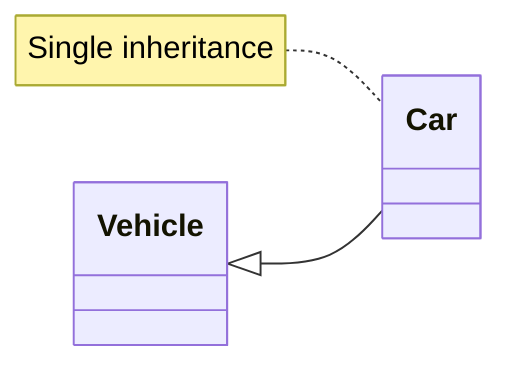

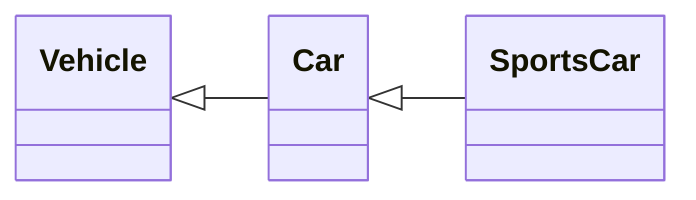

*Multilevel: `SportsCar` derives from `Car`, which derives from `Vehicle`.*

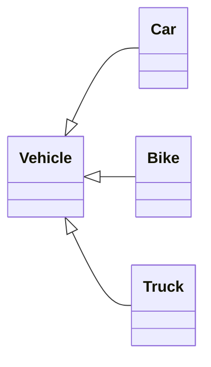

*Hierarchical: several classes derive from one base (the most common shape in LLD).*

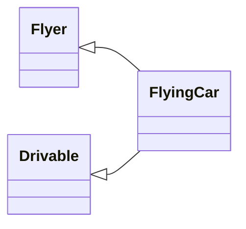

*Multiple: one class has several bases. Safe and common when the bases are pure interfaces.*

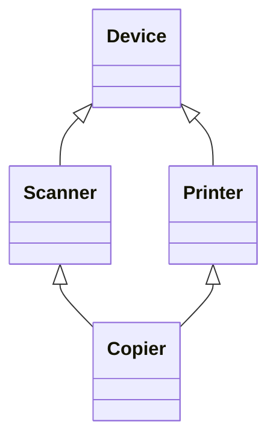

*Hybrid (diamond): multiple + hierarchical. Needs virtual inheritance to share one `Device` (Section 5.5).*

### 5.3 Construction Order and Inheriting Constructors

Bases are constructed before derived members and the derived body (Part 3, Section 3.3). A base class without a default constructor must be initialized explicitly in the derived constructor's initializer list.

**Inheriting constructors (C++11):** `using Base::Base;` makes the base's constructors available to the derived class. Members added in the derived class are initialized by their default member initializers.

```cpp
// RUN
#include <iostream>
#include <string>
#include <utility>

class Account {
public:
    Account(std::string id, double balance) : id_(std::move(id)), balance_(balance) {}
    const std::string& id() const { return id_; }
    double balance() const { return balance_; }
private:
    std::string id_;
    double balance_;
};

class SavingsAccount : public Account {
public:
    using Account::Account;                 // inherit Account(std::string, double)
    double rate() const { return rate_; }
private:
    double rate_ = 0.04;                    // default member initializer covers inherited-constructor use
};

int main() {
    SavingsAccount s("S-1", 1000.0);
    std::cout << s.id() << " " << s.balance() << " " << s.rate() << "\n";
}
```

```text
S-1 1000 0.04
```

### 5.4 Name Hiding, Overriding and `using`

A name declared in a derived class **hides every base-class function with the same name**, whatever the parameter list. This is *hiding*, not overloading (different scopes) and not overriding (no virtual dispatch). Bring the hidden overloads back with a `using` declaration, or call them with qualification.

```cpp
// RUN
#include <iostream>
#include <string>

struct Base {
    void f(int)    { std::cout << "Base::f(int)\n"; }
    void f(double) { std::cout << "Base::f(double)\n"; }
};

struct Hiding : Base {
    void f(const std::string&) { std::cout << "Hiding::f(string)\n"; }   // hides both Base::f
};

struct Exposing : Base {
    using Base::f;                                                       // re-expose Base::f overloads
    void f(const std::string&) { std::cout << "Exposing::f(string)\n"; }
};

int main() {
    Hiding h;
    h.f(std::string("x"));
    // h.f(1);            // error: only Hiding::f(const string&) is visible
    h.Base::f(1);         // qualified call reaches the hidden function

    Exposing e;
    e.f(1);               // Base::f(int) found through the using declaration
    e.f(2.5);
    e.f(std::string("y"));
}
```

```text
Hiding::f(string)
Base::f(int)
Base::f(int)
Base::f(double)
Exposing::f(string)
```

| Term | Same scope? | Same signature? | Needs `virtual`? | Resolved |
|---|---|---|---|---|
| Overloading | Yes | No (differs in parameters) | No | Compile time |
| Overriding | No (base/derived) | Yes | Yes (base function) | Run time |
| Hiding | No (base/derived) | Irrelevant (same name) | No | Compile time |

### 5.5 Multiple Inheritance, Ambiguity, Diamond and Virtual Inheritance

With multiple inheritance, a name found in two bases is **ambiguous** and must be qualified. In a diamond without `virtual`, the most-derived object contains **two** `Device` subobjects, so `copier.id` is ambiguous and the data is duplicated.

**Virtual inheritance** makes all paths share **one** `Device` subobject. The **most-derived class** is responsible for constructing the virtual base; the `Device(...)` calls in `Scanner` and `Printer` are ignored when constructing a `Copier`.

```cpp
// RUN
#include <iostream>

struct Device {
    explicit Device(int id) : id(id) { std::cout << "Device(" << id << ")\n"; }
    int id;
};
struct Scanner : virtual Device {
    Scanner() : Device(1) { std::cout << "Scanner\n"; }
};
struct Printer : virtual Device {
    Printer() : Device(2) { std::cout << "Printer\n"; }
};
struct Copier : Scanner, Printer {
    Copier() : Device(99) { std::cout << "Copier\n"; }   // most-derived initializes the virtual base
};

int main() {
    Copier c;
    std::cout << "id=" << c.id << "\n";                    // unambiguous: one shared Device
}
```

```text
Device(99)
Scanner
Printer
Copier
id=99
```

**Virtual inheritance vs virtual functions:** unrelated mechanisms. Virtual functions defer *which function runs* to run time. Virtual inheritance decides *how many copies of a base subobject* exist. Virtual inheritance adds indirection and cost, so prefer designs where multiple bases are pure interfaces with no data, which avoids the diamond problem.

### 5.6 Casting in Hierarchies and RTTI

- **Upcasting** (derived to base) is implicit and always safe with public inheritance.
- **Downcasting** (base to derived) is unsafe unless the dynamic type really is the target. Use `dynamic_cast` (checked, needs a polymorphic base) or `static_cast` (unchecked; only when you are certain).
- `dynamic_cast<T*>` returns `nullptr` on failure; `dynamic_cast<T&>` throws `std::bad_cast`.
- **RTTI** (`typeid`, `dynamic_cast`) works for polymorphic types (those with at least one virtual function).

```cpp
// RUN
#include <iostream>
#include <typeinfo>

struct Animal { virtual ~Animal() = default; };       // polymorphic base
struct Dog : Animal { void bark() const { std::cout << "Woof\n"; } };
struct Cat : Animal {};

int main() {
    Dog dog; Cat cat;
    Animal* a1 = &dog;                                 // upcast: implicit
    Animal* a2 = &cat;

    if (auto* d = dynamic_cast<Dog*>(a1)) d->bark();   // succeeds
    std::cout << "cat as Dog: " << (dynamic_cast<Dog*>(a2) == nullptr ? "nullptr" : "valid") << "\n";
    try {
        (void)dynamic_cast<Dog&>(*a2);                 // reference form throws on failure
    } catch (const std::bad_cast&) {
        std::cout << "bad_cast\n";
    }
    std::cout << std::boolalpha << (typeid(*a1) == typeid(Dog)) << "\n";
    Dog* risky = static_cast<Dog*>(a1);                // OK only because we know a1 is really a Dog
    risky->bark();
}
```

```text
Woof
cat as Dog: nullptr
bad_cast
true
Woof
```

> **Interview tip:** Frequent `dynamic_cast` is a design smell: it usually means the base interface is missing a virtual operation. `typeid(...).name()` output is implementation-defined, so compare `type_info` objects instead of printing names.

### 5.7 Liskov Substitution and "Is-a" vs "Has-a"

**LSP:** code written against the base must keep working for any derived object. Inheritance is justified by *behavioral* is-a, not by a noun relationship. A `Square` "is a" `Rectangle` in geometry, but if `Rectangle` promises that width and height can be set independently, `Square` breaks that promise. (Full treatment in Part 10.)

`has-a` (composition) means the object *contains* another and delegates. Example: a `Stack` has a `vector`; it is not a `vector` (inheriting would expose `insert`, `erase` and break the stack's invariant).

```cpp
// RUN
#include <iostream>
#include <stdexcept>
#include <vector>

template <class T>
class Stack {                                      // composition + delegation: only stack operations exposed
public:
    void push(T value) { items_.push_back(std::move(value)); }
    T pop() {
        if (items_.empty()) throw std::out_of_range("empty stack");
        T top = std::move(items_.back());
        items_.pop_back();
        return top;
    }
    bool empty() const { return items_.empty(); }
private:
    std::vector<T> items_;                         // implementation detail can change freely
};

int main() {
    Stack<int> s;
    s.push(1); s.push(2);
    std::cout << s.pop() << s.pop() << "\n";
}
```

```text
21
```

### 5.8 When Inheritance Becomes Harmful

- **Tight coupling:** a derived class depends on the base's internals; changing the base can silently break all derived classes (the **fragile base class** problem, for example a base method that starts calling another overridable method).
- **Deep hierarchies** are hard to reason about; each level adds assumptions.
- **Wrong is-a** (`Penguin` derives `Bird` with `fly()` throwing) violates LSP.
- **Reuse-only inheritance** (inherit just to reuse code) exposes unwanted API.

**Guideline:** use public inheritance for interface substitutability (pure abstract bases), otherwise prefer composition.

**Part 5 revision**

- Public = is-a; private = implemented-in-terms-of (prefer members).
- Derived name hides all base overloads; `using Base::f;` restores them.
- Virtual inheritance: one shared base, constructed by the most-derived class.
- `dynamic_cast` needs a polymorphic type; `nullptr` (pointer) vs `bad_cast` (reference).
- Prefer composition unless true substitutability is needed.

---

## Part 6: Polymorphism

### 6.1 Meaning and Kinds

**Polymorphism** = one interface, many implementations. It is **not** only virtual functions.

| Kind | Mechanism | Resolved | Cost | Example |
|---|---|---|---|---|
| Compile-time (static) | Function/operator overloading, templates, (CRTP) | Compile time | Zero dispatch cost, code per instantiation | `std::sort` with any comparator |
| Runtime (dynamic) | Virtual functions via base pointer/reference | Run time | Indirect call, usually no inlining | `PaymentMethod::pay` |

**Function overloading** (compile-time polymorphism): same name, different parameter lists; the compiler picks via overload resolution. Return type alone cannot distinguish overloads.

```cpp
void print(int);  void print(double);  void print(const std::string&);
template <class T> T maxOf(T a, T b) { return a < b ? b : a; }   // generic, static polymorphism
```

### 6.2 Static Binding vs Dynamic Binding

- **Static (early) binding:** the function is chosen at compile time from the *static type* (the declared type of the expression). Used for non-virtual functions, overloads, and default arguments.
- **Dynamic (late) binding:** a virtual function is chosen at run time from the *dynamic type* (the actual object).

```cpp
// RUN
#include <iostream>

struct Base {
    virtual ~Base() = default;
    void nonVirtual()          { std::cout << "Base::nonVirtual\n"; }
    virtual void virt()        { std::cout << "Base::virt\n"; }
    virtual void show(int x = 10) { std::cout << "Base::show x=" << x << "\n"; }
};
struct Derived : Base {
    void nonVirtual()          { std::cout << "Derived::nonVirtual\n"; }   // hides, not overrides
    void virt() override       { std::cout << "Derived::virt\n"; }
    void show(int x = 20) override { std::cout << "Derived::show x=" << x << "\n"; }
};

int main() {
    Derived d;
    Base* p = &d;
    p->nonVirtual();     // static binding: static type is Base
    p->virt();           // dynamic binding: dynamic type is Derived
    d.nonVirtual();
    p->show();           // Derived::show is called, but the default argument comes from the STATIC type
}
```

```text
Base::nonVirtual
Derived::virt
Derived::nonVirtual
Derived::show x=10
```

> **Warning:** Default arguments are bound statically. Do not give an overriding function different default arguments.

### 6.3 Virtual, Pure Virtual, Abstract Classes, Interfaces, `override`, `final`, Covariance

- A **virtual function** can be overridden; calls through a base pointer/reference dispatch dynamically.
- A **pure virtual function** (`= 0`) has no required implementation in the base; the class becomes **abstract** and cannot be instantiated. (A pure virtual may still have a body, callable via qualified name; a pure virtual *destructor* must have one.)
- C++ has no `interface` keyword. An **interface** is conventionally an abstract class with only pure virtual functions, no data, and a virtual destructor.
- An abstract class **may** have constructors, data members and non-virtual functions.
- `override` makes the compiler verify that you really override something (catches typos and signature drift). Always write it.
- `final` on a function forbids further overriding; on a class forbids inheriting from it.
- **Covariant return types:** an overriding function may return a pointer/reference to a *more derived* type than the base declaration. This works with raw pointers and references only, not smart pointers. The pattern below keeps ownership safe by wrapping a protected covariant raw-pointer hook inside a public `unique_ptr` function.

```cpp
// RUN
#include <iomanip>
#include <iostream>
#include <memory>
#include <string>
#include <vector>

class Shape {                                          // abstract base with data, constructor and non-virtual API
public:
    explicit Shape(std::string name) : name_(std::move(name)) {}
    virtual ~Shape() = default;                        // required for deletion through Shape*
    virtual double area() const = 0;                   // pure virtual: derived classes must implement
    const std::string& name() const { return name_; }

    std::unique_ptr<Shape> clone() const {             // owning, safe public API
        return std::unique_ptr<Shape>(cloneImpl());
    }
protected:
    Shape(const Shape&) = default;                     // protected copy prevents slicing by accident
    virtual Shape* cloneImpl() const = 0;              // raw pointer, ownership taken immediately above
private:
    std::string name_;
};

class Circle final : public Shape {                    // final: no further derivation
public:
    explicit Circle(double r) : Shape("Circle"), r_(r) {}
    double area() const override { return 3.14159265 * r_ * r_; }
protected:
    Circle* cloneImpl() const override { return new Circle(*this); }   // covariant: Circle* instead of Shape*
private:
    double r_;
};

class Rect : public Shape {
public:
    Rect(double w, double h) : Shape("Rect"), w_(w), h_(h) {}
    double area() const override { return w_ * h_; }
protected:
    Rect* cloneImpl() const override { return new Rect(*this); }
private:
    double w_, h_;
};

int main() {
    std::vector<std::unique_ptr<Shape>> shapes;
    shapes.push_back(std::make_unique<Circle>(2.0));
    shapes.push_back(std::make_unique<Rect>(2.0, 3.0));
    shapes.push_back(shapes[0]->clone());              // copy through the base interface

    std::cout << std::fixed << std::setprecision(2);
    for (const auto& s : shapes)
        std::cout << s->name() << " area=" << s->area() << "\n";
    // Shape s("x");                                   // error: Shape is abstract
}
```

```text
Circle area=12.57
Rect area=6.00
Circle area=12.57
```

### 6.4 How Virtual Dispatch Works (Conceptual; Implementation Detail)

The C++ standard specifies *behavior*, not mechanism. In practice, major compilers implement dynamic dispatch like this:

- Each polymorphic class has a **virtual table (vtable)**: an array of pointers to that class's final overriders.
- Each polymorphic object carries a hidden **virtual pointer (vptr)** to its class's vtable, set during construction (which is exactly why virtual calls inside constructors resolve to the class being constructed).
- A virtual call `p->virt()` loads the vptr, indexes the vtable, and makes an indirect call.

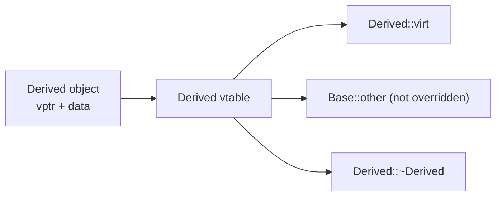

Consequences (typical, not guaranteed): polymorphic objects are larger by roughly one pointer; virtual calls are indirect and are rarely inlined unless the compiler can devirtualize; with multiple inheritance an object may hold several vptrs and `this` is adjusted when casting between bases.

**Performance:** the cost of one virtual call is small (an extra memory load and an unpredictable branch). It matters in very hot loops over millions of tiny objects; it is irrelevant for typical LLD code. Prefer clarity first; use templates/static polymorphism if profiling shows a problem.

**Multiple inheritance and dispatch:** calling a virtual through any base-class pointer still reaches the final overrider; the compiler adjusts the pointer to the right subobject and uses the right vtable.

### 6.5 Why Runtime Polymorphism Matters for LLD: Payment Processing

The caller depends on an abstraction (`PaymentMethod`), so a new method needs **no change** to the checkout code (Open/Closed Principle).

```cpp
// RUN
#include <iostream>
#include <memory>
#include <string>
#include <vector>

struct PaymentResult {
    bool success;
    std::string message;
};

class PaymentMethod {                                   // interface
public:
    virtual ~PaymentMethod() = default;
    virtual PaymentResult pay(long long amountPaise) = 0;
    virtual std::string name() const = 0;
};

class UpiPayment : public PaymentMethod {
public:
    explicit UpiPayment(std::string vpa) : vpa_(std::move(vpa)) {}
    PaymentResult pay(long long amount) override { return {true, "UPI " + vpa_ + " paid " + std::to_string(amount)}; }
    std::string name() const override { return "UPI"; }
private:
    std::string vpa_;
};

class WalletPayment : public PaymentMethod {
public:
    explicit WalletPayment(long long balance) : balance_(balance) {}
    PaymentResult pay(long long amount) override {
        if (amount > balance_) return {false, "Wallet: insufficient balance"};
        balance_ -= amount;
        return {true, "Wallet paid " + std::to_string(amount)};
    }
    std::string name() const override { return "Wallet"; }
private:
    long long balance_;
};

// Added later: Checkout below is NOT modified.
class NetBankingPayment : public PaymentMethod {
public:
    PaymentResult pay(long long amount) override { return {true, "NetBanking paid " + std::to_string(amount)}; }
    std::string name() const override { return "NetBanking"; }
};

class Checkout {                                        // high-level code knows only the interface
public:
    void run(PaymentMethod& method, long long amount) const {
        PaymentResult r = method.pay(amount);
        std::cout << "[" << method.name() << "] " << (r.success ? "OK: " : "FAILED: ") << r.message << "\n";
    }
};

int main() {
    std::vector<std::unique_ptr<PaymentMethod>> methods;
    methods.push_back(std::make_unique<UpiPayment>("sonam@bank"));
    methods.push_back(std::make_unique<WalletPayment>(500));
    methods.push_back(std::make_unique<NetBankingPayment>());

    Checkout checkout;
    for (auto& m : methods) checkout.run(*m, 700);
}
```

```text
[UPI] OK: UPI sonam@bank paid 700
[Wallet] FAILED: Wallet: insufficient balance
[NetBanking] OK: NetBanking paid 700
```

**Part 6 revision**

- Static binding: non-virtual, overloads, default arguments. Dynamic binding: virtual via pointer/reference.
- Always `override`; polymorphic base needs a `virtual` destructor.
- Interface = abstract class with pure virtuals (C++ has no `interface` keyword).
- vtable/vptr is a typical implementation, not a language rule.
- Compile-time polymorphism (overloads/templates) is polymorphism too.

---


## Part 7: Operator Overloading

### 7.1 What It Is and Why It Exists

**Operator overloading** lets user-defined types work with built-in operator syntax (`a + b`, `os << x`, `v[i]`). It is syntactic sugar for calling a function named `operator+`, `operator<<`, and so on. It exists so that value-like types (complex numbers, money, matrices, big integers, smart pointers, iterators) read naturally.

**Design principle:** an overloaded operator must keep the *intuitive meaning* of the operator. `+` should add, `==` should compare, and `operator+` should not modify its operands. If the meaning is not obvious, use a named function.

Three things that look similar but are different:

| Concept | What it means | Resolved |
|---|---|---|
| Operator overloading | Giving an operator a meaning for your type (`operator+`) | Compile time |
| Function overloading | Same function name, different parameter lists | Compile time |
| Overriding | Derived class replaces a **virtual** base function | Run time |

(Operators can also be virtual and overridden, but that is rare and not "overloading".)

### 7.2 Member vs Non-Member vs Friend

| Form | Use when | Notes |
|---|---|---|
| Member | Operator must modify `*this` (`+=`, `++`, `=`) or must be a member (`=`, `[]`, `()`, `->`) | Left operand must be your class |
| Non-member | Symmetric binary operators (`+`, `==`, `<`): allows implicit conversion on **both** operands | Preferred, implement via public API or `+=` |
| Friend non-member | Needs private access (`<<`, `>>` often) | Defined in-class or out-of-class; keep minimal |

`operator<<` and `operator>>` cannot be members of your class because the left operand is the stream.

### 7.3 `ComplexNumber` Walkthrough

```cpp
// RUN
#include <iostream>
#include <sstream>

class ComplexNumber {
public:
    ComplexNumber(double re = 0.0, double im = 0.0) : re_(re), im_(im) {}   // implicit: 2 + z works

    // Compound assignment as a member: modifies *this, returns reference for chaining
    ComplexNumber& operator+=(const ComplexNumber& rhs) { re_ += rhs.re_; im_ += rhs.im_; return *this; }
    ComplexNumber& operator-=(const ComplexNumber& rhs) { re_ -= rhs.re_; im_ -= rhs.im_; return *this; }

    ComplexNumber operator-() const { return ComplexNumber(-re_, -im_); }    // unary minus

    // Binary arithmetic as non-members built on the compound forms (take lhs by value = free copy)
    friend ComplexNumber operator+(ComplexNumber lhs, const ComplexNumber& rhs) { lhs += rhs; return lhs; }
    friend ComplexNumber operator-(ComplexNumber lhs, const ComplexNumber& rhs) { lhs -= rhs; return lhs; }
    friend ComplexNumber operator*(const ComplexNumber& a, const ComplexNumber& b) {
        return ComplexNumber(a.re_ * b.re_ - a.im_ * b.im_, a.re_ * b.im_ + a.im_ * b.re_);
    }

    // Comparison: define == then derive !=
    friend bool operator==(const ComplexNumber& a, const ComplexNumber& b) { return a.re_ == b.re_ && a.im_ == b.im_; }
    friend bool operator!=(const ComplexNumber& a, const ComplexNumber& b) { return !(a == b); }

    // Stream operators must be non-members (left operand is the stream)
    friend std::ostream& operator<<(std::ostream& os, const ComplexNumber& z) {
        return os << z.re_ << (z.im_ < 0 ? "-" : "+") << (z.im_ < 0 ? -z.im_ : z.im_) << "i";
    }
    friend std::istream& operator>>(std::istream& is, ComplexNumber& z) { return is >> z.re_ >> z.im_; }

private:
    double re_, im_;
};

int main() {
    ComplexNumber a(1, 2), b(3, -1);
    std::cout << (a + b) << " " << (a - b) << " " << (a * b) << " " << (-a) << "\n";
    std::cout << (2 + a) << "\n";                       // works because of the implicit converting constructor
    std::cout << std::boolalpha << (a == ComplexNumber(1, 2)) << " " << (a != b) << "\n";

    std::istringstream in("7 8");
    ComplexNumber c;
    in >> c;                                           // operator>>
    std::cout << c << "\n";
}
```

```text
4+1i -2+3i 5+5i -1-2i
3+2i
true true
7+8i
```

### 7.4 Increment/Decrement, Subscript and Function-Call Operators

- **Prefix `++x`** : member `T& operator++()`; modifies and returns the object by reference.
- **Postfix `x++`** : member `T operator++(int)` (the dummy `int` is only a tag); returns the **old** value by value. It is slower (makes a copy), so prefer prefix in loops.
- **`operator[]`** : provide `T&` (mutable) and `const T&` (const) overloads.
- **`operator()`** : makes an object callable (a *functor*), used with STL algorithms and for stateful strategies.

```cpp
// RUN
#include <iostream>
#include <stdexcept>
#include <vector>

class Counter {
public:
    explicit Counter(int v = 0) : v_(v) {}
    Counter& operator++()   { ++v_; return *this; }               // prefix: return new state by reference
    Counter  operator++(int) { Counter old = *this; ++v_; return old; }  // postfix: return old copy
    int value() const { return v_; }
private:
    int v_;
};

class ScoreBoard {
public:
    explicit ScoreBoard(std::size_t n) : scores_(n, 0) {}
    int& operator[](std::size_t i) {                               // mutable access
        if (i >= scores_.size()) throw std::out_of_range("bad index");
        return scores_[i];
    }
    const int& operator[](std::size_t i) const {                   // const access for const objects
        if (i >= scores_.size()) throw std::out_of_range("bad index");
        return scores_[i];
    }
private:
    std::vector<int> scores_;
};

class Multiplier {                                                 // functor with state
public:
    explicit Multiplier(int factor) : factor_(factor) {}
    int operator()(int x) const { return x * factor_; }
private:
    int factor_;
};

int main() {
    Counter c(5);
    Counter before = c++;                 // postfix returns the old value
    Counter after  = ++c;                 // prefix returns the new value
    std::cout << before.value() << " " << after.value() << " " << c.value() << "\n";

    ScoreBoard sb(3);
    sb[1] = 42;
    const ScoreBoard& view = sb;
    std::cout << view[1] << "\n";
    try { sb[9] = 1; } catch (const std::out_of_range& e) { std::cout << e.what() << "\n"; }

    Multiplier triple(3);
    std::cout << triple(7) << "\n";
}
```

```text
5 7 7
42
bad index
21
```

### 7.5 A Custom Value Type: `Money`

```cpp
// RUN
#include <algorithm>
#include <iostream>
#include <vector>

class Money {                                                      // stores paise to avoid floating-point error
public:
    explicit Money(long long paise) : paise_(paise) {}
    Money& operator+=(const Money& o) { paise_ += o.paise_; return *this; }
    friend Money operator+(Money a, const Money& b) { a += b; return a; }
    friend bool operator==(const Money& a, const Money& b) { return a.paise_ == b.paise_; }
    friend bool operator<(const Money& a, const Money& b)  { return a.paise_ < b.paise_; }   // enables std::sort
    friend std::ostream& operator<<(std::ostream& os, const Money& m) {
        return os << "Rs " << m.paise_ / 100 << "." << (m.paise_ % 100 < 10 ? "0" : "") << m.paise_ % 100;
    }
private:
    long long paise_;
};

int main() {
    std::vector<Money> prices{Money(1999), Money(505), Money(10000)};
    std::sort(prices.begin(), prices.end());                       // uses operator<
    Money total(0);
    for (const auto& p : prices) total += p;
    std::cout << prices.front() << " .. " << prices.back() << " total " << total << "\n";
}
```

```text
Rs 5.05 .. Rs 100.00 total Rs 125.04
```

### 7.6 Restrictions and Good Practice

- **Cannot be overloaded:** `::` (scope), `.` (member access), `.*`, `?:` (ternary), `sizeof`, `typeid`, and the cast keywords. You cannot invent new operators, change precedence/associativity or arity, or redefine operators for built-in types only.
- `=`, `[]`, `()`, `->` **must** be members.
- `&&`, `||` and `,` lose their short-circuit/ordering guarantees when overloaded, so avoid overloading them. Overloading unary `&` is almost always a mistake.
- **Do:** keep semantics natural; make `operator+` non-mutating and `+=` the primitive; return `*this` by reference from assignment-like operators; make comparison operators consistent (`==` with `!=`, `<` with others); mark them `const`.
- **Do not:** use `operator+` for "append to database", return references to temporaries, or make `operator==` non-reflexive.
- C++20 adds `operator<=>`, but these notes target C++17.

**Part 7 revision**

- Operators are functions with special names; keep intuitive semantics.
- Symmetric binary ops as non-members; modifying ops as members; `<<`/`>>` as non-member friends.
- Prefix returns reference, postfix (`int` tag) returns old value by copy.
- Not overloadable: `:: . .* ?: sizeof typeid`.

---

## Part 8: Overloading, Overriding, Hiding and Casting

### 8.1 Master Comparison

| Concept | Main purpose | Compile-time or runtime | Inheritance required? | Key interview point |
|---|---|---|---|---|
| Function overloading | Same name, different parameter types | Compile time | No | Return type alone cannot differ; resolution uses conversions ranking |
| Operator overloading | Natural syntax for user types | Compile time | No | Preserve intuitive meaning; some operators cannot be overloaded |
| Function overriding | Replace base behavior in derived class | Runtime (if `virtual`) | **Yes** | Needs `virtual`; use `override`; same signature |
| Name hiding | (Side effect) derived name shadows base names | Compile time | Yes | Hides **all** base overloads; fix with `using` |
| Virtual dispatch | Choose function by dynamic type | Runtime | Yes | Through pointer/reference only; vtable is typical mechanism |
| Static binding | Choose function by static type | Compile time | No | Non-virtual calls, default arguments |
| Dynamic binding | Choose function by dynamic type | Runtime | Yes | Not in constructors/destructors to derived |
| Implicit conversion | Convenience conversions | Compile time | No | `explicit` stops accidental ones |
| Explicit conversion (casts) | Programmer-requested conversion | Compile (all but `dynamic_cast`) | `dynamic_cast` needs polymorphic types | Use the narrowest cast that works |

### 8.2 Implicit vs Explicit Conversions

Implicit conversions include numeric promotions (`int` to `double`), derived-to-base pointer/reference conversion, and user-defined conversions through non-`explicit` converting constructors and conversion operators. Prefer `explicit` for constructors and conversion operators unless implicit conversion is the point.

### 8.3 The Four C++ Casts

| Cast | Intended use | Checked | Typical misuse |
|---|---|---|---|
| `static_cast` | Well-defined conversions: numeric, base/derived when you know the type, `void*` back to original type | Compile time only | Downcasting to the wrong type (UB) |
| `dynamic_cast` | Safe downcast/crosscast in polymorphic hierarchies | **Run time** (needs RTTI) | Overuse as a substitute for virtual functions |
| `const_cast` | Add or remove `const`/`volatile` | No | Modifying an object that was originally `const` (UB) |
| `reinterpret_cast` | Low-level reinterpretation of bits (pointer/integer, hardware, serialization) | No | Treating unrelated types as each other (aliasing UB) |

```cpp
// RUN
#include <cstdint>
#include <iostream>

void legacyPrint(char* text) { std::cout << "legacy: " << text << "\n"; }   // old API, never writes to text

struct Base { virtual ~Base() = default; };
struct Derived : Base { int extra = 7; };

int main() {
    // static_cast: ordinary, well-defined conversion
    int total = 7, count = 2;
    double avg = static_cast<double>(total) / count;
    std::cout << avg << "\n";

    // const_cast: only to call an API that is const-incorrect and does not modify the data
    char buffer[] = "hello";                       // non-const array: even modifying it would be legal
    const char* view = buffer;
    legacyPrint(const_cast<char*>(view));
    // const char* lit = "abc"; const_cast<char*>(lit)[0] = 'x';   // UB: string literal is truly const

    // dynamic_cast: checked downcast (source type must be polymorphic)
    Derived d;
    Base* b = &d;
    if (auto* p = dynamic_cast<Derived*>(b)) std::cout << "extra=" << p->extra << "\n";

    // reinterpret_cast: pointer <-> integer round trip is well-defined
    std::uintptr_t addr = reinterpret_cast<std::uintptr_t>(&total);
    int* back = reinterpret_cast<int*>(addr);
    std::cout << std::boolalpha << (back == &total) << "\n";
}
```

```text
3.5
legacy: hello
extra=7
true
```

**Why `dynamic_cast` needs a polymorphic source type:** it reads the object's run-time type information, which implementations store alongside the virtual-dispatch data. A class with no virtual functions carries no such information, so `dynamic_cast<Derived*>(nonPolymorphicBasePtr)` does not compile.

> **Warning:** `reinterpret_cast` is not a routine type converter. Do not use it to convert between unrelated object types (`float*` to `int*` and reading through it violates strict aliasing). If you want to reinterpret bytes, use `std::memcpy` (or `std::byte`/`unsigned char` access). Prefer C++ casts to C-style `(T)x`, which can silently pick the most dangerous cast.

**Part 8 revision**

- Overloading = compile time, same scope. Overriding = virtual, runtime. Hiding = name shadowing.
- Casts: `static_cast` (default), `dynamic_cast` (checked polymorphic), `const_cast` (rare), `reinterpret_cast` (low-level only).

---

## Part 9: Abstraction, Interfaces and Dependency Management

### 9.1 Concepts

- **Abstraction / abstract class / pure virtual / interface:** see Parts 1 and 6. An interface-like class has only pure virtual functions and a virtual destructor.
- **Programming to an interface:** declare variables, parameters and members using the abstraction (`Notifier&`), not the concrete class (`EmailNotifier`).
- **Dependency Inversion:** high-level policy (`AlertService`) must not depend on low-level detail (`EmailNotifier`); both depend on an abstraction owned by the high-level side.
- **Dependency Injection (DI):** a class receives its dependencies from outside instead of creating them with `new`/by value inside. Forms:

| Form | How | Good for | Caveat |
|---|---|---|---|
| Constructor injection | Pass dependency to the constructor | **Required** dependencies; object is always valid | Default choice |
| Setter injection | `setX(...)` after construction | Optional or swappable dependencies | Object may be used before set; null checks |
| Method injection | Pass dependency into the one method that needs it | Dependency varies per call | Repeated at each call site |

- **Coupling** = how much one module knows about another (want low). **Cohesion** = how closely a module's responsibilities relate (want high). **Separation of concerns:** each class has one concern (formatting, delivery, storage).
- **Delegation:** an object forwards work to a helper it holds. **Composition over inheritance:** combine small collaborators instead of building deep hierarchies.
- **Ownership and lifetime:** decide who owns each dependency. Owned: `std::unique_ptr<Interface>` member. Borrowed: reference/pointer to an object guaranteed to outlive the user.
- **Testability:** with DI you can inject a **mock/fake** that records calls, avoiding real emails or network.

### 9.2 Extensible Notification System

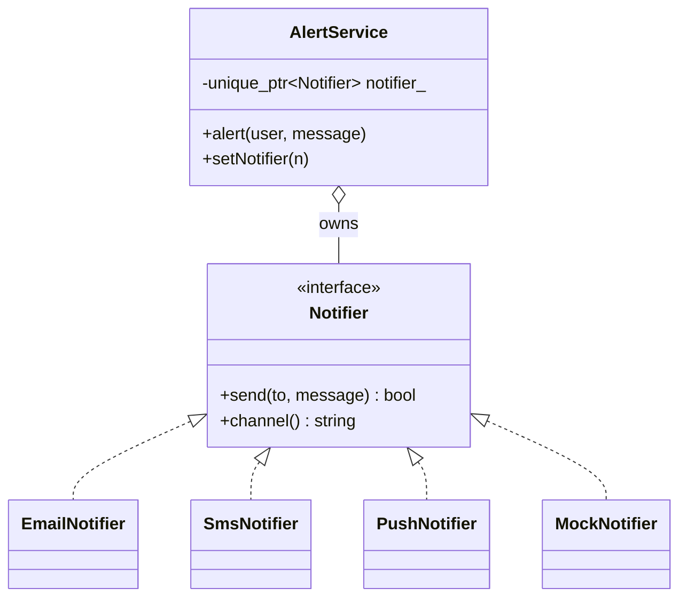

```cpp
// RUN
#include <iostream>
#include <memory>
#include <string>
#include <utility>
#include <vector>

// ---- Abstraction (owned by the high-level side) ----
class Notifier {
public:
    virtual ~Notifier() = default;
    virtual bool send(const std::string& to, const std::string& message) = 0;
    virtual std::string channel() const = 0;
};

// ---- Low-level details implement the abstraction ----
class EmailNotifier : public Notifier {
public:
    bool send(const std::string& to, const std::string& message) override {
        std::cout << "[Email] to=" << to << " msg=" << message << "\n";
        return true;
    }
    std::string channel() const override { return "Email"; }
};

class SmsNotifier : public Notifier {
public:
    bool send(const std::string& to, const std::string& message) override {
        if (message.size() > 40) { std::cout << "[SMS] message too long\n"; return false; }
        std::cout << "[SMS] to=" << to << " msg=" << message << "\n";
        return true;
    }
    std::string channel() const override { return "SMS"; }
};

// ---- High-level policy: depends only on Notifier ----
class AlertService {
public:
    explicit AlertService(std::unique_ptr<Notifier> notifier)          // constructor injection, takes ownership
        : notifier_(std::move(notifier)) {}

    void alert(const std::string& user, const std::string& message) {
        if (!notifier_->send(user, "ALERT: " + message))
            std::cout << "delivery failed via " << notifier_->channel() << "\n";
    }
    void setNotifier(std::unique_ptr<Notifier> n) { notifier_ = std::move(n); }   // setter injection (swap at run time)
private:
    std::unique_ptr<Notifier> notifier_;                                // owned dependency
};

// ---- New channel added later: AlertService is untouched (Open/Closed) ----
class PushNotifier : public Notifier {
public:
    bool send(const std::string& to, const std::string& message) override {
        std::cout << "[Push] device=" << to << " msg=" << message << "\n";
        return true;
    }
    std::string channel() const override { return "Push"; }
};

// ---- Test double: records messages into a log the TEST owns ----
class MockNotifier : public Notifier {
public:
    explicit MockNotifier(std::vector<std::string>& log) : log_(log) {}
    bool send(const std::string& to, const std::string& message) override {
        log_.push_back(to + ":" + message);
        return true;
    }
    std::string channel() const override { return "Mock"; }
private:
    std::vector<std::string>& log_;                                     // non-owning reference; log outlives mock
};

int main() {
    AlertService service(std::make_unique<EmailNotifier>());
    service.alert("a@x.com", "Server down");

    service.setNotifier(std::make_unique<SmsNotifier>());
    service.alert("+91-90000", "Disk almost full");
    service.alert("+91-90000", "This message is intentionally far too long to fit in a single SMS");

    service.setNotifier(std::make_unique<PushNotifier>());              // new channel, zero edits to AlertService
    service.alert("device-7", "Deployment finished");

    // Unit test without side effects
    std::vector<std::string> log;
    AlertService testable(std::make_unique<MockNotifier>(log));
    testable.alert("u1", "hello");
    std::cout << "test log size=" << log.size() << " first=" << log[0] << "\n";
}
```

```text
[Email] to=a@x.com msg=ALERT: Server down
[SMS] to=+91-90000 msg=ALERT: Disk almost full
[SMS] message too long
delivery failed via SMS
[Push] device=device-7 msg=ALERT: Deployment finished
test log size=1 first=u1:ALERT: hello
```

**Why this follows OCP and DIP**

- **Open/Closed:** `PushNotifier` was added by writing a new class. `AlertService` was neither edited nor recompiled logically.
- **Dependency Inversion:** `AlertService` includes only the `Notifier` abstraction; concrete classes depend on (implement) it, so source dependencies point toward the abstraction.
- **Ownership:** `AlertService` owns its notifier through `unique_ptr`, destroying it via the virtual destructor. The mock borrows the test's log by reference, which is safe because the log outlives the service in `main`.
- **No unnecessary patterns:** no factory or singleton was introduced; plain constructor injection is enough.

**Part 9 revision**

- Depend on abstractions; inject dependencies through the constructor by default.
- Decide ownership explicitly: `unique_ptr` for owned, reference for borrowed.
- DI makes mocks trivial, which is the practical payoff in tests and LLD interviews.

---


## Part 10: The SOLID Principles in C++

> SOLID principles are **design guidelines, not rigid laws**. They exist to keep change cheap. Applying them to code that never changes only adds indirection. Apply them where requirements genuinely vary.

### 10.1 S: Single Responsibility Principle

**Definition.** A class should have **one reason to change**. A *responsibility* is a cluster of behavior that changes for one stakeholder or one kind of requirement (business rules, formatting, persistence, delivery).

**Signs of a class doing too much:** its name contains "And/Manager/Utils", it includes unrelated headers (file I/O and UI and math), tests need many unrelated mocks, and different features force edits to the same class.

**Bad design**

```cpp
class Invoice {
public:
    double total() const;                  // business rule
    void printToConsole() const;           // presentation
    void saveToFile(const std::string&) const;   // persistence
};
// Changing the print layout, the file format or the tax rule all edit Invoice.
```

**Why it is a problem:** three unrelated reasons to change, so edits risk each other and testing `total()` drags in I/O.

**Better design**

```cpp
// RUN
#include <iostream>
#include <string>
#include <vector>

struct LineItem { std::string name; double price; int qty; };

class Invoice {                                          // business data and rules only
public:
    void add(LineItem item) { items_.push_back(std::move(item)); }
    double total() const { double t = 0; for (const auto& i : items_) t += i.price * i.qty; return t; }
    const std::vector<LineItem>& items() const { return items_; }
private:
    std::vector<LineItem> items_;
};

class InvoicePrinter {                                   // presentation only
public:
    void print(const Invoice& inv, std::ostream& os) const {
        for (const auto& i : inv.items()) os << i.name << " x" << i.qty << "\n";
        os << "TOTAL " << inv.total() << "\n";
    }
};

class InvoiceRepository {                                // persistence only (interface; implementations vary)
public:
    virtual ~InvoiceRepository() = default;
    virtual void save(const Invoice& inv) = 0;
};
class InMemoryInvoiceRepository : public InvoiceRepository {
public:
    void save(const Invoice& inv) override { savedTotals_.push_back(inv.total()); }
    std::size_t count() const { return savedTotals_.size(); }
private:
    std::vector<double> savedTotals_;
};

int main() {
    Invoice inv;
    inv.add({"Pen", 10.0, 3});
    inv.add({"Book", 250.0, 1});
    InvoicePrinter().print(inv, std::cout);
    InMemoryInvoiceRepository repo;
    repo.save(inv);
    std::cout << "saved=" << repo.count() << "\n";
}
```

```text
Pen x3
Book x1
TOTAL 280
saved=1
```

**Misconceptions:** "one method per class" is wrong (SRP is about reasons to change, not size). Splitting too early also hurts: a 30-line class with two closely related duties may be fine.

**LLD link:** every LLD design review asks "what is each class responsible for?". **Interview questions:** (1) What counts as one responsibility? (2) How would you refactor a `UserManager` that validates, stores and emails users?

### 10.2 O: Open/Closed Principle

**Definition.** Software entities should be **open for extension, closed for modification**: add behavior by adding code (a new class), not by editing tested code. Polymorphism and the Strategy idea are the usual tools.

**Bad design**

```cpp
double discount(const std::string& type, double amount) {
    if (type == "student") return amount * 0.10;
    if (type == "festival") return amount * 0.20;      // every new offer edits this function
    return 0;
}
```

**Why it is a problem:** each new rule modifies existing code and risks breaking old rules; the function knows every variant.

**Better design**

```cpp
// RUN
#include <iostream>
#include <memory>
#include <vector>

class DiscountPolicy {
public:
    virtual ~DiscountPolicy() = default;
    virtual double discountFor(double amount) const = 0;
};
class StudentDiscount : public DiscountPolicy { public: double discountFor(double a) const override { return a * 0.10; } };
class FestivalDiscount : public DiscountPolicy { public: double discountFor(double a) const override { return a * 0.20; } };
class NoDiscount : public DiscountPolicy { public: double discountFor(double) const override { return 0; } };

class PriceCalculator {                                    // closed for modification
public:
    double finalPrice(double amount, const DiscountPolicy& policy) const { return amount - policy.discountFor(amount); }
};

class LoyaltyDiscount : public DiscountPolicy {            // new feature = new class only
public: double discountFor(double a) const override { return a > 1000 ? 100 : 0; }
};

int main() {
    PriceCalculator calc;
    std::vector<std::unique_ptr<DiscountPolicy>> policies;
    policies.push_back(std::make_unique<StudentDiscount>());
    policies.push_back(std::make_unique<FestivalDiscount>());
    policies.push_back(std::make_unique<LoyaltyDiscount>());
    policies.push_back(std::make_unique<NoDiscount>());
    for (const auto& p : policies) std::cout << calc.finalPrice(2000, *p) << "\n";
}
```

```text
1800
1600
1900
2000
```

**When modification is perfectly reasonable:** fixing a bug, changing a business rule that applies to all, or when only one variant exists and no second is foreseeable (do not abstract speculatively). OCP is about *predictable* axes of variation.

**Interview questions:** (1) Show how a `switch` on a type code violates OCP and how to remove it. (2) Is OCP achievable without inheritance? (Yes: templates, `std::function`, composition.)

### 10.3 L: Liskov Substitution Principle

**Definition.** If `S` is a subtype of `T`, objects of type `T` can be replaced with objects of type `S` **without breaking the program's correctness**. It is about *behavior*, not just compiling signatures.

- **Preconditions** cannot be strengthened in a subtype (it must not demand more from callers).
- **Postconditions** cannot be weakened (it must deliver at least what the base promised).
- **Invariants** of the base must be preserved.
- Do not throw new unexpected exceptions or make an inherited operation a no-op/"unsupported".

**Bad design (classic):**

```cpp
class Rectangle {
public:
    virtual void setWidth(int w)  { w_ = w; }
    virtual void setHeight(int h) { h_ = h; }
    int area() const { return w_ * h_; }
protected: int w_ = 0, h_ = 0;
};
class Square : public Rectangle {                  // setWidth also changes height
public:
    void setWidth(int w) override { w_ = h_ = w; }
    void setHeight(int h) override { w_ = h_ = h; }
};
// Client: r.setWidth(5); r.setHeight(4); assert(r.area() == 20);   fails for Square (area 16).
```

**Why it is a problem:** `Rectangle`'s contract (width and height change independently) is broken by `Square`, so code written for `Rectangle` misbehaves.

**Better design:** do not make `Square` a `Rectangle`; share a smaller abstraction, or make the shapes immutable values.

```cpp
// RUN
#include <iostream>
#include <memory>
#include <vector>

class Shape {                                      // contract: only "area is non-negative"
public:
    virtual ~Shape() = default;
    virtual double area() const = 0;
};
class Rectangle : public Shape {
public:
    Rectangle(double w, double h) : w_(w), h_(h) {}
    double area() const override { return w_ * h_; }
private: double w_, h_;
};
class Square : public Shape {                      // separate type, no broken promises
public:
    explicit Square(double s) : s_(s) {}
    double area() const override { return s_ * s_; }
private: double s_;
};

// Same idea for Bird: flying is a separate capability, not something every bird must support.
class Bird { public: virtual ~Bird() = default; virtual const char* name() const = 0; };
class FlyingBird : public Bird { public: virtual void fly() const = 0; };
class Sparrow : public FlyingBird {
public:
    const char* name() const override { return "Sparrow"; }
    void fly() const override { std::cout << "Sparrow flies\n"; }
};
class Penguin : public Bird { public: const char* name() const override { return "Penguin"; } };   // no fly() to break

int main() {
    std::vector<std::unique_ptr<Shape>> shapes;
    shapes.push_back(std::make_unique<Rectangle>(5, 4));
    shapes.push_back(std::make_unique<Square>(4));
    for (const auto& s : shapes) std::cout << s->area() << "\n";
    Sparrow().fly();
    std::cout << Penguin().name() << " cannot be asked to fly\n";
}
```

```text
20
16
Sparrow flies
Penguin cannot be asked to fly
```

**Interview questions:** (1) Why does `Square` inheriting `Rectangle` violate LSP even though geometry says a square is a rectangle? (2) How do preconditions/postconditions relate to LSP?

### 10.4 I: Interface Segregation Principle

**Definition.** Clients should not be forced to depend on methods they do not use. Prefer several small, **role-specific** interfaces to one **fat** interface.

**Bad design:**

```cpp
class MultiFunctionDevice {
public:
    virtual ~MultiFunctionDevice() = default;
    virtual void print(const std::string&) = 0;
    virtual void scan() = 0;
    virtual void fax(const std::string&) = 0;       // a basic printer must stub or throw here
};
```

**Why it is a problem:** `SimplePrinter` must implement `scan` and `fax` (empty bodies or exceptions, an LSP violation) and recompiles when fax changes.

**Better design**

```cpp
// RUN
#include <iostream>
#include <string>

class Printer { public: virtual ~Printer() = default; virtual void print(const std::string& doc) = 0; };
class Scanner { public: virtual ~Scanner() = default; virtual std::string scan() = 0; };

class SimplePrinter : public Printer {                       // implements only what it can do
public: void print(const std::string& d) override { std::cout << "print: " << d << "\n"; }
};
class OfficeMachine : public Printer, public Scanner {       // multiple inheritance of pure interfaces is safe
public:
    void print(const std::string& d) override { std::cout << "office print: " << d << "\n"; }
    std::string scan() override { return "scanned-page"; }
};

void printReport(Printer& p) { p.print("Report"); }          // depends only on the role it needs
void digitize(Scanner& s)    { std::cout << "got " << s.scan() << "\n"; }

int main() {
    SimplePrinter sp; OfficeMachine om;
    printReport(sp); printReport(om); digitize(om);
}
```

```text
print: Report
office print: Report
got scanned-page
```

**Interview questions:** (1) How does ISP relate to SRP and LSP? (2) How do you split a repository interface used by both a reporting module (read-only) and an admin module (read/write)?

### 10.5 D: Dependency Inversion Principle

**Definition.** High-level modules should not depend on low-level modules; both should depend on **abstractions**. Abstractions should not depend on details; details depend on abstractions. DI (injection) is the mechanism that supplies the concrete object.

**Bad design:**

```cpp
class OrderService {
    MySqlDatabase db_;                      // concrete, created inside: cannot test or swap
public:
    void place(const Order& o) { db_.insert(o); }
};
```

**Why it is a problem:** changing the database or testing without one means editing `OrderService`; business logic is welded to a vendor.

**Better design**

```cpp
// RUN
#include <iostream>
#include <memory>
#include <string>
#include <vector>

class OrderStore {                                          // abstraction defined by the high-level side
public:
    virtual ~OrderStore() = default;
    virtual void save(const std::string& orderId) = 0;
};
class SqlOrderStore : public OrderStore {
public: void save(const std::string& id) override { std::cout << "SQL INSERT " << id << "\n"; }
};
class FakeOrderStore : public OrderStore {                  // for tests
public:
    void save(const std::string& id) override { saved.push_back(id); }
    std::vector<std::string> saved;
};

class OrderService {
public:
    explicit OrderService(OrderStore& store) : store_(store) {}   // borrowed dependency: caller keeps it alive
    void place(const std::string& id) { store_.save(id); }
private:
    OrderStore& store_;
};

int main() {
    SqlOrderStore sql;
    OrderService prod(sql);
    prod.place("A-1");

    FakeOrderStore fake;
    OrderService test(fake);
    test.place("T-1");
    std::cout << "fake saw " << fake.saved.size() << " order(s)\n";
}
```

```text
SQL INSERT A-1
fake saw 1 order(s)
```

**Interview questions:** (1) What is "inverted" in DIP? (The source-code dependency direction; the high-level module owns the abstraction.) (2) DIP vs dependency injection vs IoC container?

### 10.6 Summary Table

| Principle | One-line meaning | Typical violation | Typical C++ fix |
|---|---|---|---|
| SRP | One reason to change | God class that computes, prints and saves | Split into focused classes |
| OCP | Extend by adding code | `if/switch` on type codes | Abstract base + new subclasses; strategy |
| LSP | Subtypes keep the base contract | `Square : Rectangle` with mutable setters; "unsupported" overrides | Separate abstractions; composition |
| ISP | No unused dependencies | Fat interface with stub methods | Role-specific small interfaces |
| DIP | Depend on abstractions | `new Concrete` inside high-level class | Inject an interface (constructor injection) |

---

## Part 11: Association, Aggregation, Composition

### 11.1 Definitions

| Relationship | Meaning | Ownership | Lifetime | Phrase |
|---|---|---|---|---|
| Dependency | Uses another type temporarily (parameter, local, return) | None | Only during the call | "uses" |
| Association | Objects know and collaborate with each other | None required | Independent | "knows" |
| Aggregation | Whole-part where the part **can exist independently** and may be shared | Whole refers to parts, does not own their lifetime | Independent | "has-a (weak)" |
| Composition | Whole-part where the part **belongs exclusively** to the whole | Whole owns parts | Part dies with the whole | "owns" / "part-of" |

**What decides which one applies is the domain's ownership and lifetime rule**, not the C++ syntax. A member being a pointer does not make it aggregation, and a value member does not automatically mean composition (a `unique_ptr` member can also be a composition, for polymorphic or large parts). Ask: *Who is responsible for creating and destroying it? Can it outlive the whole? Can it be shared?*

Three different ideas to keep apart:

- **Owning:** the object controls the other's lifetime (value member, `unique_ptr`, `shared_ptr` when sharing ownership).
- **Referring:** it knows about another object but does not control its lifetime (reference, raw non-owning pointer, `weak_ptr`).
- **Using temporarily:** it receives the other only for a call (parameter).

**Cardinality** (1-1, 1-many, many-many) is independent: a one-to-many composition is `std::vector<Part>` in the whole; many-to-many usually needs both sides to hold non-owning links (or a separate association object, for example `Enrollment` between `Student` and `Course`). **Navigability:** a link may be one-directional (A knows B) or **bidirectional** (both know each other); bidirectional links must be kept consistent and are a common source of dangling pointers and cycles, so use them only when needed.

### 11.2 UML and C++ Mapping

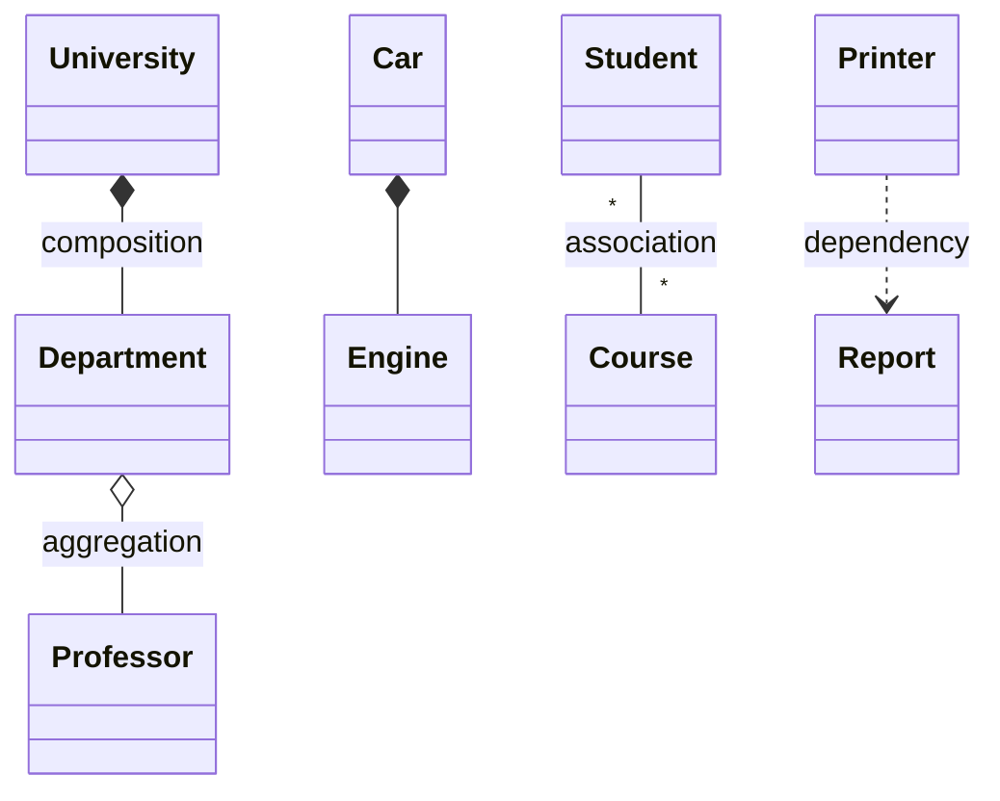

| Relationship | UML arrow | Typical C++ mapping |
|---|---|---|
| Composition | filled diamond `*--` | Value member, `std::vector<Part>`, or `std::unique_ptr<Part>` |
| Aggregation | hollow diamond `o--` | Non-owning pointer/reference, `std::vector<const Part*>`, `weak_ptr`; or `shared_ptr` when lifetime is truly shared |
| Association | plain line `--` | Non-owning pointer/reference members, or an association class |
| Dependency | dashed arrow `..>` | Function parameter, local variable, return type |
| Inheritance | `<\|--` | Public inheritance |

### 11.3 Runnable Example: University, Departments, Professors, Car/Engine

Domain rules: a department cannot exist without its university (composition). Professors exist independently and may belong to several departments (aggregation). An engine is part of a car (composition). A printer merely uses a report (dependency).

```cpp
// RUN
#include <iostream>
#include <memory>
#include <string>
#include <vector>

class Engine {                                            // part of Car
public:
    explicit Engine(int hp) : hp_(hp) {}
    int hp() const { return hp_; }
private: int hp_;
};
class Car {                                               // composition: Engine lives and dies with the Car
public:
    explicit Car(int hp) : engine_(hp) {}
    int power() const { return engine_.hp(); }
private: Engine engine_;
};

class Professor {                                         // independent entity
public:
    explicit Professor(std::string name) : name_(std::move(name)) {}
    const std::string& name() const { return name_; }
private: std::string name_;
};

class Department {                                        // aggregation of professors
public:
    explicit Department(std::string name) : name_(std::move(name)) {}
    void hire(const Professor& p) { staff_.push_back(&p); }       // non-owning link; caller keeps Professor alive
    void print() const {
        std::cout << name_ << ":";
        for (const Professor* p : staff_) std::cout << " " << p->name();
        std::cout << "\n";
    }
private:
    std::string name_;
    std::vector<const Professor*> staff_;
};

class University {                                        // composition of departments
public:
    Department& addDepartment(std::string name) {
        departments_.push_back(std::make_unique<Department>(std::move(name)));
        return *departments_.back();                      // stable address: the Department itself never moves
    }
private:
    std::vector<std::unique_ptr<Department>> departments_;   // owned exclusively (composition via unique_ptr)
};

class Report { public: std::string text() const { return "Quarterly Report"; } };
class ReportPrinter {                                     // dependency: Report used only during the call
public: void print(const Report& r) const { std::cout << "printing " << r.text() << "\n"; }
};

int main() {
    std::vector<std::unique_ptr<Professor>> faculty;     // the staff register owns professors
    faculty.push_back(std::make_unique<Professor>("Rao"));
    faculty.push_back(std::make_unique<Professor>("Mehta"));

    {
        University uni;
        Department& cse = uni.addDepartment("CSE");
        Department& math = uni.addDepartment("Math");
        cse.hire(*faculty[0]); cse.hire(*faculty[1]);
        math.hire(*faculty[1]);                           // same professor shared by two departments
        cse.print();
        math.print();
    }                                                     // university and its departments are destroyed here
    std::cout << "professors still alive: " << faculty[0]->name() << ", " << faculty[1]->name() << "\n";

    Car car(150);
    std::cout << "car power " << car.power() << "\n";
    ReportPrinter().print(Report());
}
```

```text
CSE: Rao Mehta
Math: Mehta
professors still alive: Rao, Mehta
car power 150
printing Quarterly Report
```

> **Warning:** If `University` stored `std::vector<Department>` by value and `addDepartment` returned a reference into it, the next `emplace_back` could reallocate and leave `cse` dangling (undefined behavior). Storing `unique_ptr<Department>` keeps each department's address stable. Note this is still **composition**: the university exclusively owns its departments, whether by value or by `unique_ptr`.

### 11.4 More Domain Mappings

| Domain pair | Typical relationship | Reasoning |
|---|---|---|
| Library and Books | Composition (the library's catalog owns book records) or association | If a book record cannot exist without a library catalog: composition; physical copies and loans are associations |
| Shopping cart and Products | Cart *references* products (association/aggregation); cart owns **cart items** (composition) | Products exist in the catalog independent of any cart; the line item (product ref + quantity) belongs to the cart |
| Team and Players | Aggregation | Players exist and may move between teams |
| Car and Engine | Composition | Engine belongs exclusively to the car in the model |

Composition vs inheritance: composition models **has-a/part-of** and is replaceable at run time via held interfaces. Inheritance models **is-a** and is fixed at compile time (Part 5).

**Part 11 revision**

- Dependency (uses) < association (knows) < aggregation (weak whole-part) < composition (owns).
- The *domain's* ownership and lifetime rules decide, not pointer vs value.
- Own with values/`unique_ptr`; refer with references/non-owning pointers/`weak_ptr`.

---

## Part 12: Advanced C++ OOP Concepts

Topics already covered in depth: `static`, `mutable`, `friend`, nested classes, abstract classes, pure virtual functions, virtual destructors, multiple and virtual inheritance, covariant returns, `override`, `final`, RTTI, `dynamic_cast`, slicing, Rules of Zero/Three/Five, RAII (Parts 2 to 6). The rest follows.

**Priority guide:** items marked **[Core]** are expected in interviews; **[Plus]** gives an advantage.

### 12.1 `const` Correctness [Core]

Mark everything that does not change as `const`: member functions, parameters passed by reference (`const T&`), and local variables. Provide both `const` and non-`const` overloads when returning references to internals. `const` objects can only call `const` member functions.

```cpp
class Library {
public:
    const Book& find(int id) const;     // used by const callers
    Book& find(int id);                 // used when mutation is intended (often implemented via the const one)
};
```

### 12.2 Exception Safety Guarantees [Core]

| Guarantee | Meaning | Example |
|---|---|---|
| No-throw (`noexcept`) | Never throws | Destructors, `swap`, move operations |
| Strong | If it throws, program state is unchanged (commit-or-rollback) | Copy-and-swap assignment, build a copy then swap |
| Basic | If it throws, invariants hold and nothing leaks, but state may have changed | Most standard-library operations |

```cpp
// RUN
#include <iostream>
#include <stdexcept>
#include <string>
#include <vector>

class Roster {
public:
    void replaceAll(const std::vector<std::string>& incoming) {
        std::vector<std::string> next;                   // 1. do all risky work on a temporary
        for (const auto& name : incoming) {
            if (name.empty()) throw std::invalid_argument("empty name");   // may throw midway
            next.push_back(name);
        }
        names_.swap(next);                               // 2. commit with a no-throw swap: strong guarantee
    }
    std::size_t size() const { return names_.size(); }
private:
    std::vector<std::string> names_{"keep1", "keep2"};
};

int main() {
    Roster r;
    try { r.replaceAll({"a", "b", "", "d"}); }
    catch (const std::exception& e) { std::cout << "error: " << e.what() << "\n"; }
    std::cout << "size after failure=" << r.size() << "\n";   // unchanged: strong guarantee
    r.replaceAll({"x"});
    std::cout << "size after success=" << r.size() << "\n";
}
```

```text
error: empty name
size after failure=2
size after success=1
```

**`noexcept` moves matter:** `std::vector` moves elements during reallocation only if the move constructor is `noexcept` (or the type is not copyable); otherwise it copies to preserve the strong guarantee.

```cpp
// RUN
#include <iostream>
#include <vector>

struct Loud {                                   // move can throw (not noexcept) but copy is available
    static inline int copies = 0, moves = 0;
    Loud() = default;
    Loud(const Loud&) { ++copies; }
    Loud(Loud&&) { ++moves; }                    // missing noexcept
};
struct Quiet {
    static inline int copies = 0, moves = 0;
    Quiet() = default;
    Quiet(const Quiet&) { ++copies; }
    Quiet(Quiet&&) noexcept { ++moves; }
};

template <class T>
void growOnce() {
    std::vector<T> v;
    while (v.size() == v.capacity()) v.emplace_back();   // fill until full (first iteration: capacity 0)
    while (v.size() < v.capacity()) v.emplace_back();
    T::copies = T::moves = 0;
    std::size_t n = v.size();
    v.emplace_back();                                    // forces reallocation of n existing elements
    std::cout << (T::copies == static_cast<int>(n) ? "copied all" : "did not copy all") << " / "
              << (T::moves == static_cast<int>(n) ? "moved all" : "did not move all") << "\n";
}

int main() {
    growOnce<Loud>();
    growOnce<Quiet>();
}
```

```text
copied all / did not move all
did not copy all / moved all
```

### 12.3 Templates vs OOP; Static vs Dynamic Polymorphism; CRTP [Core + Plus]

| | Dynamic (virtual) | Static (templates/CRTP) |
|---|---|---|
| Binding | Run time | Compile time |
| Heterogeneous collection (`vector<unique_ptr<Base>>`) | Yes | No (one concrete type per container) |
| Plug-in/ABI boundaries | Yes | No |
| Inlining and zero overhead | Limited | Yes |
| Code size / compile time | Smaller | Larger (per instantiation), longer errors |

**CRTP** (Curiously Recurring Template Pattern, conceptual): a base template takes the derived class as its parameter and calls derived functions with `static_cast`, giving static polymorphism without virtual calls.

```cpp
// RUN
#include <iostream>

template <class Derived>
class Shape {                                            // CRTP base: no virtual functions, no vptr
public:
    void describe() const {
        std::cout << "area=" << static_cast<const Derived&>(*this).area() << "\n";   // resolved at compile time
    }
};
class Square : public Shape<Square> {
public:
    explicit Square(double s) : s_(s) {}
    double area() const { return s_ * s_; }
private: double s_;
};
class Circle : public Shape<Circle> {
public:
    explicit Circle(double r) : r_(r) {}
    double area() const { return 3.0 * r_ * r_; }
private: double r_;
};

template <class T> void report(const Shape<T>& s) { s.describe(); }   // generic over any CRTP shape

int main() {
    report(Square(3));
    report(Circle(2));
}
```

```text
area=9
area=12
```

### 12.4 Type Erasure (Conceptual) [Plus]

**Idea:** give unrelated types a uniform value-semantic interface **without** a common base class, by hiding a template-based wrapper behind an internal abstract class. `std::function` and `std::any` work this way. The user writes `Drawable d = Circle{}` where `Circle` need not inherit anything.

```cpp
// RUN
#include <iostream>
#include <memory>
#include <vector>

class Drawable {                                       // type-erased wrapper
public:
    template <class T>
    Drawable(T obj) : self_(std::make_unique<Model<T>>(std::move(obj))) {}
    void draw() const { self_->draw(); }
private:
    struct Concept { virtual ~Concept() = default; virtual void draw() const = 0; };
    template <class T> struct Model : Concept {
        explicit Model(T o) : obj(std::move(o)) {}
        void draw() const override { obj.draw(); }      // requires only that T has draw()
        T obj;
    };
    std::unique_ptr<Concept> self_;                     // move-only here for simplicity
};

struct Circle { void draw() const { std::cout << "circle\n"; } };    // no base class
struct Label  { void draw() const { std::cout << "label\n"; } };

int main() {
    std::vector<Drawable> items;
    items.emplace_back(Circle{});
    items.emplace_back(Label{});
    for (const auto& d : items) d.draw();
}
```

```text
circle
label
```

### 12.5 Pimpl Idiom (Conceptual) [Plus]

**Pointer to implementation:** the public class holds a `std::unique_ptr` to a private implementation type that is only declared in the header and defined in the `.cpp`. Benefits: hides private details, shortens compile times, stabilizes binary interface. Cost: one allocation and indirection. The destructor (and move operations) must be defined in the `.cpp` where `Impl` is complete.

```cpp
// widget.h  (illustrative layout, not a single program)
class Widget {
public:
    Widget();
    ~Widget();                              // declared here, defined in widget.cpp
    void draw() const;
private:
    struct Impl;                            // incomplete type
    std::unique_ptr<Impl> impl_;
};
// widget.cpp:  struct Widget::Impl { /* heavy members */ };  Widget::~Widget() = default;
```

### 12.6 Interfaces, Destructors and Polymorphic Copying [Core]

- **Destructors in interfaces:** if callers may `delete` through the interface pointer (including via `unique_ptr<Interface>`), use `virtual ~I() = default;` (public). If objects are never deleted through the interface (for example, a callback interface owned elsewhere), a **protected non-virtual** destructor is a valid, cheaper alternative that makes misuse a compile error.
- **Copy/move of polymorphic classes:** copying through a base object slices. Either make the base non-copyable (`= delete` or `protected`) and provide `clone()` (see the covariant `clone()` in Part 6), or hold values in a variant/type-erased wrapper. Moving a polymorphic object through a base reference is also sliced; move the owning pointer instead.
- **Abstract factories and ownership:** factory functions return `std::unique_ptr<Interface>`: the caller receives sole ownership and can convert to `shared_ptr` if needed (Part 15).

### 12.7 Strategy for Learning This Part

**Must know:** const correctness, exception guarantees, `noexcept` moves, static vs dynamic polymorphism trade-offs, destructor rules for interfaces. **Useful advantage:** CRTP, type erasure, Pimpl (explain the idea and one use case; do not memorize boilerplate).

---


## Part 13: Memory Model and Object Layout

> Throughout this part, **[Standard]** marks behavior the C++ standard guarantees and **[Impl]** marks common compiler/ABI behavior that may differ. Interviewers like candidates who can tell the two apart.

### 13.1 Where Objects Live

| Storage duration | Typical location [Impl] | Lifetime [Standard] |
|---|---|---|
| Automatic | Stack | Until the enclosing block ends |
| Dynamic | Heap / free store | Until `delete` (or the owning smart pointer is destroyed) |
| Static | Static data segment | Whole program (initialized before `main` or at first use) |
| Thread | Thread-local storage | Thread lifetime |

"Stack" and "heap" are implementation terms. The standard speaks of **storage duration**. A member's storage is part of its enclosing object: a `std::string` member of a stack object is on the stack, but the characters it owns may be on the heap.

### 13.2 What Counts Toward an Object's Size

- **Non-static data members** are stored in each object. **[Standard]** layout order follows declaration order within the same access level; padding may be inserted. **[Impl]** exact size/offsets.
- **Member functions** are not stored per object (one copy of the code is shared).
- **Static data members** live once in static storage, outside any object.
- **Virtual functions** typically add one hidden pointer (vptr) to polymorphic objects **[Impl]**. The standard does not require a vptr; not every implementation or every object has one in the same way.
- An **empty class** has size >= 1 **[Standard]** so distinct objects have distinct addresses. A **base subobject** that is empty may take zero space: the **empty base optimization (EBO)**, which is required for standard-layout classes and widely applied.

```cpp
// RUN
#include <iostream>

struct Plain { int a; };
struct WithStaticAndFunction {
    int a;
    static int counter;                  // not part of the object
    void method() {}                     // code is not stored per object
};
int WithStaticAndFunction::counter = 0;

struct Polymorphic { int a; virtual void f() {} virtual ~Polymorphic() = default; };

struct EmptyTag {};
struct WithEmptyBase : EmptyTag { int a; };     // EBO: the empty base needs no extra space
struct WithEmptyMember { EmptyTag tag; int a; };// a member must have its own address => padding

struct B1 { int x = 1; };
struct B2 { int y = 2; };
struct Multi : B1, B2 {};

int main() {
    std::cout << std::boolalpha;
    std::cout << "static + member function add no per-object size (typical): "
              << (sizeof(WithStaticAndFunction) == sizeof(Plain)) << "\n";
    std::cout << "polymorphic object bigger (typical, vptr): " << (sizeof(Polymorphic) > sizeof(Plain)) << "\n";
    std::cout << "empty class size >= 1: " << (sizeof(EmptyTag) >= 1) << "\n";
    std::cout << "EBO applied (typical): " << (sizeof(WithEmptyBase) == sizeof(int)) << "\n";
    std::cout << "empty member costs space: " << (sizeof(WithEmptyMember) > sizeof(int)) << "\n";

    Multi m;
    B2* second = &m;                                           // derived-to-base conversion adjusts the pointer
    bool adjusted = static_cast<void*>(second) != static_cast<void*>(&m);
    std::cout << "B2 subobject is at a different address than Multi: " << adjusted << "\n";
}
```

```text
static + member function add no per-object size (typical): true
polymorphic object bigger (typical, vptr): true
empty class size >= 1: true
EBO applied (typical): true
empty member costs space: true
B2 subobject is at a different address than Multi: true
```

The last line is guaranteed: two distinct non-empty base subobjects cannot share an address, so converting `Multi*` to `B2*` must **adjust the pointer value**. That is the "pointer adjustment" in multiple inheritance; it is also why `reinterpret_cast` between base and derived pointers is wrong.

### 13.3 Base and Derived Subobjects, Slicing

A derived object contains its base class subobject(s) plus its own members. Upcasting a pointer/reference just views the same object as its base part. Copying into a base **object** copies only that subobject (**slicing**, Part 2).

### 13.4 Pointer vs Reference

| Aspect | Pointer | Reference |
|---|---|---|
| Can be null | Yes | No (valid code never has a null reference) |
| Can be reseated | Yes | No: bound once at initialization |
| Must be initialized | No (but should be) | Yes |
| Arithmetic | Yes | No |
| Typical role | Optional, nullable, rebindable, arrays | Required, non-null access (parameters, members that must exist) |
| Ownership | Raw pointers should be **non-owning** | Never owns |

### 13.5 Lifetime Errors (Undefined Behavior)

These are **never** safe to "demonstrate and print", because behavior is undefined. Study the bug and the fix.

| Error | Bug (illustrative) | Fix |
|---|---|---|
| Dangling reference/pointer to local | `const std::string& name() { std::string s = "x"; return s; }` | Return by value; or return a reference to data that outlives the call |
| Use-after-free | `int* p = new int(1); delete p; *p = 2;` | Use `unique_ptr`; set pointers to `nullptr` only as a stopgap |
| Memory leak | `Widget* w = new Widget; if (bad) return;` (no `delete`) | `auto w = std::make_unique<Widget>();` (RAII) |
| Double delete | Two owners `delete` the same pointer (shallow copy) | One owner; deep copy or `shared_ptr` |
| Iterator/reference invalidation | `auto& first = v[0]; v.push_back(1);  use(first);` | Re-acquire after modification; reserve capacity; use indices |
| Dangling member reference | `struct S { const std::string& r; S() : r("temp") {} };` | Store by value |

> **Interview tip:** When asked about "memory leak vs dangling pointer": a leak is memory that is still allocated but unreachable (nothing frees it); a dangling pointer points to memory that has been freed (it is reachable but invalid). The fix for both is clear ownership via RAII.

**Part 13 revision**

- [Standard] members are laid out in declaration order; empty class size >= 1; static members and member functions do not enlarge objects.
- [Impl] vptr/vtable, exact padding, EBO details, MI pointer layout.
- Pointer adjustment when converting between bases is real; never `reinterpret_cast` between them.
- References cannot be null/reseated; raw pointers are non-owning.

---

## Part 14: OOP Design Examples for LLD

Each example follows the same template: problem, requirements, responsibilities, diagram, relationships, design decisions, code, output, walkthrough, principles, improvements, follow-up questions.

### 14.1 Example 1: Payment Processing System

**Problem.** A store accepts several payment methods and wants to add more without touching checkout code.

**Requirements**

- Multiple methods (UPI, card, wallet), a common abstraction, extensible, no big `if/switch` on method type.
- Report success, decline or invalid input clearly. Clear ownership.

**Class responsibilities**

| Class | Responsibility |
|---|---|
| `PaymentMethod` | Interface: `pay(amount)` and `name()` |
| `UpiPayment`, `CardPayment`, `WalletPayment` | Method-specific rules |
| `PaymentProcessor` | Owns registered methods; validates input; finds a method by name and delegates |
| `PaymentResult` / `Status` | Value describing the outcome |

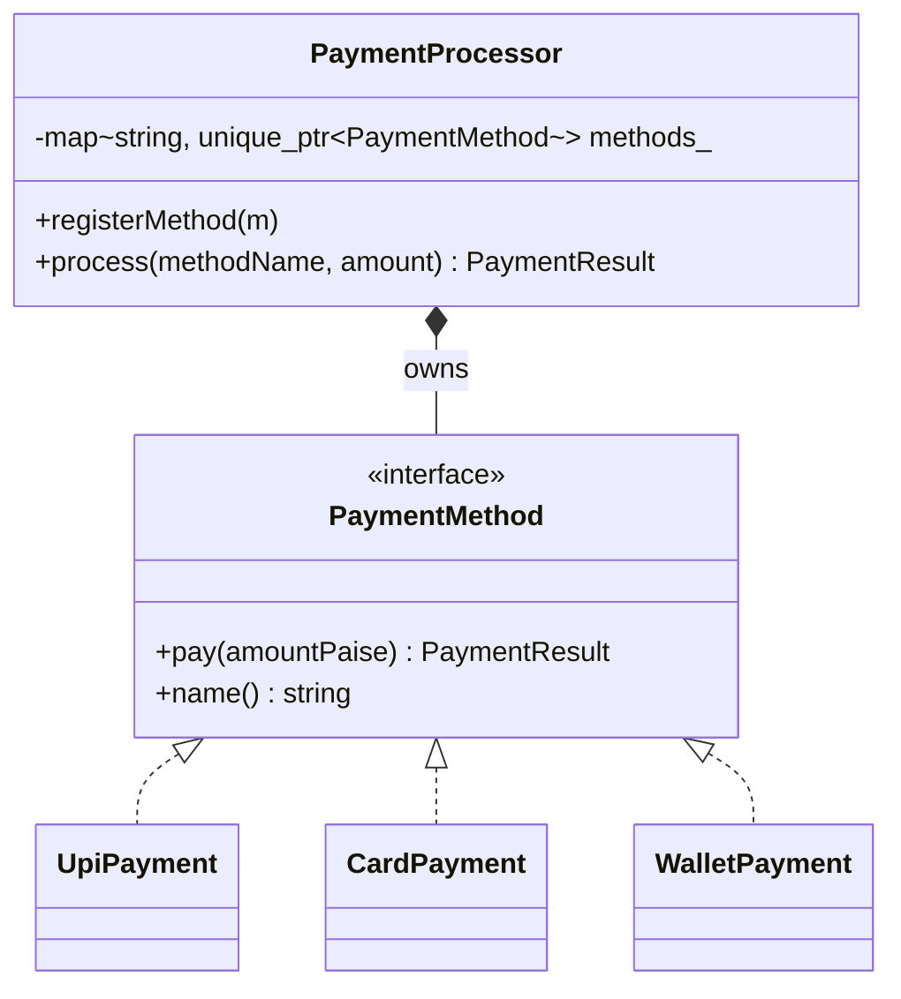

**Relationships.** `PaymentProcessor` *composes* (exclusively owns) its methods through `unique_ptr`. Concrete methods implement the interface (realization). Callers only depend on the processor.

**Design decisions**

- A **registry keyed by name** replaces the `if (type == "upi") ... else if ...` chain.
- **Error handling levels:** expected business outcomes (declined, invalid amount, unknown method) are returned as a `PaymentResult` status, not thrown; programming errors (registering a null method) throw.
- Money is an integer number of paise to avoid floating-point error.

```cpp
// RUN
#include <iostream>
#include <map>
#include <memory>
#include <stdexcept>
#include <string>

enum class Status { Success, Declined, Invalid };

struct PaymentResult {
    Status status;
    std::string message;
};

class PaymentMethod {
public:
    virtual ~PaymentMethod() = default;
    virtual PaymentResult pay(long long amountPaise) = 0;
    virtual std::string name() const = 0;
};

class UpiPayment : public PaymentMethod {
public:
    explicit UpiPayment(std::string vpa) : vpa_(std::move(vpa)) {}
    PaymentResult pay(long long amount) override {
        return {Status::Success, "UPI(" + vpa_ + ") paid " + std::to_string(amount)};
    }
    std::string name() const override { return "upi"; }
private:
    std::string vpa_;
};

class CardPayment : public PaymentMethod {
public:
    CardPayment(std::string last4, long long limit) : last4_(std::move(last4)), limit_(limit) {}
    PaymentResult pay(long long amount) override {
        if (amount > limit_) return {Status::Declined, "card ****" + last4_ + " limit exceeded"};
        return {Status::Success, "card ****" + last4_ + " paid " + std::to_string(amount)};
    }
    std::string name() const override { return "card"; }
private:
    std::string last4_;
    long long limit_;
};

class WalletPayment : public PaymentMethod {
public:
    explicit WalletPayment(long long balance) : balance_(balance) {}
    PaymentResult pay(long long amount) override {
        if (amount > balance_) return {Status::Declined, "wallet balance too low"};
        balance_ -= amount;                                          // state change owned by this class
        return {Status::Success, "wallet paid " + std::to_string(amount) + ", left " + std::to_string(balance_)};
    }
    std::string name() const override { return "wallet"; }
private:
    long long balance_;
};

class PaymentProcessor {
public:
    void registerMethod(std::unique_ptr<PaymentMethod> method) {
        if (!method) throw std::invalid_argument("null payment method");   // programming error
        std::string key = method->name();
        methods_[key] = std::move(method);                                 // processor takes ownership
    }
    PaymentResult process(const std::string& methodName, long long amountPaise) {
        if (amountPaise <= 0) return {Status::Invalid, "amount must be positive"};
        auto it = methods_.find(methodName);
        if (it == methods_.end()) return {Status::Invalid, "unknown method '" + methodName + "'"};
        return it->second->pay(amountPaise);                               // polymorphic call, no type switch
    }
private:
    std::map<std::string, std::unique_ptr<PaymentMethod>> methods_;
};

const char* label(Status s) {
    switch (s) {
        case Status::Success: return "SUCCESS";
        case Status::Declined: return "DECLINED";
        default: return "INVALID";
    }
}

int main() {
    PaymentProcessor processor;
    processor.registerMethod(std::make_unique<UpiPayment>("sonam@bank"));
    processor.registerMethod(std::make_unique<CardPayment>("4242", 50000));
    processor.registerMethod(std::make_unique<WalletPayment>(1000));

    struct Case { const char* method; long long amount; };
    for (Case c : {Case{"upi", 700}, Case{"card", 90000}, Case{"wallet", 600}, Case{"wallet", 600}, Case{"crypto", 100}, Case{"upi", 0}}) {
        PaymentResult r = processor.process(c.method, c.amount);
        std::cout << label(r.status) << ": " << r.message << "\n";
    }
}
```

```text
SUCCESS: UPI(sonam@bank) paid 700
DECLINED: card ****4242 limit exceeded
SUCCESS: wallet paid 600, left 400
DECLINED: wallet balance too low
INVALID: unknown method 'crypto'
INVALID: amount must be positive
```

**Execution walkthrough.** Registration stores each method under `name()`. `process` validates the amount, looks up the method and calls `pay` virtually. The wallet's second call fails because its own balance (state) dropped to 400.

**Principles:** polymorphism, OCP (add `NetBankingPayment` plus one `registerMethod` call), SRP (validation in the processor, rules in each method), encapsulation (wallet balance private), clear ownership (`unique_ptr` in a map).

**Potential improvements:** idempotency keys and transaction IDs, retries, a `PaymentMethodFactory`, async gateways, currency types, thread-safety.

**Follow-up questions:** How would you add refunds? (Add `refund` to the interface or a separate `Refundable` interface per ISP.) How would you handle a gateway timeout? (A `Pending` status plus reconciliation.)

### 14.2 Example 2: Notification System with Fan-out and Fallback

**Problem.** Send a notification through every channel a user has enabled; if a channel fails, report it and continue.

**Requirements:** Email, SMS and Push; common abstraction; constructor-based dependency injection; easy to extend; separate responsibilities (message content, channel delivery, orchestration).

| Class | Responsibility |
|---|---|
| `Notification` | Value object: recipient and text |
| `NotificationChannel` | Interface for a delivery channel |
| `EmailChannel`, `SmsChannel`, `PushChannel` | Delivery details |
| `NotificationService` | Orchestrates delivery over the injected channels |

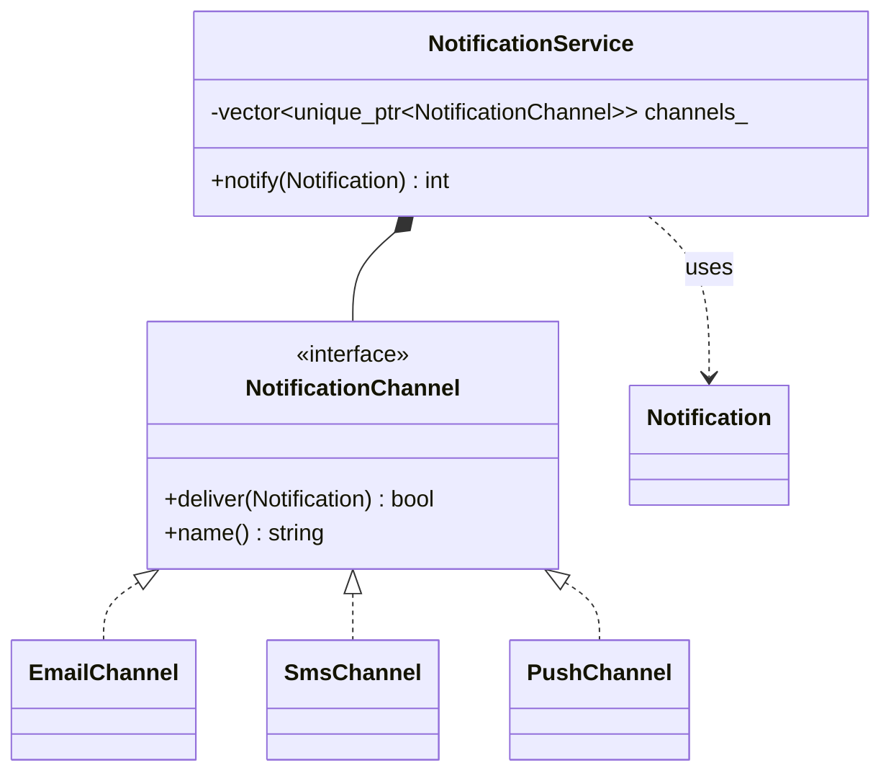

**Design decisions:** the service receives its channels by **constructor injection** as `vector<unique_ptr<NotificationChannel>>` (it owns them). `Notification` is a plain value passed by `const&` (a *dependency*). The service returns how many channels succeeded, leaving policy (alert on zero) to the caller.

```cpp
// RUN
#include <iostream>
#include <memory>
#include <string>
#include <vector>

struct Notification {
    std::string recipient;
    std::string text;
};

class NotificationChannel {
public:
    virtual ~NotificationChannel() = default;
    virtual bool deliver(const Notification& n) = 0;
    virtual std::string name() const = 0;
};

class EmailChannel : public NotificationChannel {
public:
    bool deliver(const Notification& n) override { std::cout << "  email -> " << n.recipient << ": " << n.text << "\n"; return true; }
    std::string name() const override { return "email"; }
};

class SmsChannel : public NotificationChannel {
public:
    bool deliver(const Notification& n) override {
        if (n.text.size() > 20) return false;                       // SMS length limit
        std::cout << "  sms -> " << n.recipient << ": " << n.text << "\n";
        return true;
    }
    std::string name() const override { return "sms"; }
};

class PushChannel : public NotificationChannel {
public:
    bool deliver(const Notification& n) override { std::cout << "  push -> " << n.recipient << ": " << n.text << "\n"; return true; }
    std::string name() const override { return "push"; }
};

class NotificationService {
public:
    explicit NotificationService(std::vector<std::unique_ptr<NotificationChannel>> channels)
        : channels_(std::move(channels)) {}                          // constructor injection, service owns channels

    int notify(const Notification& n) {
        int delivered = 0;
        for (auto& ch : channels_) {
            if (ch->deliver(n)) ++delivered;
            else std::cout << "  [" << ch->name() << " failed, continuing]\n";   // failure of one channel does not stop others
        }
        return delivered;
    }
private:
    std::vector<std::unique_ptr<NotificationChannel>> channels_;
};

int main() {
    std::vector<std::unique_ptr<NotificationChannel>> channels;
    channels.push_back(std::make_unique<EmailChannel>());
    channels.push_back(std::make_unique<SmsChannel>());
    channels.push_back(std::make_unique<PushChannel>());            // adding Push needed no change to the service

    NotificationService service(std::move(channels));
    std::cout << "short message:\n";
    int a = service.notify({"sonam", "Build passed"});
    std::cout << "long message:\n";
    int b = service.notify({"sonam", "Deployment to production completed"});
    std::cout << "delivered " << a << " and " << b << "\n";
}
```

```text
short message:
  email -> sonam: Build passed
  sms -> sonam: Build passed
  push -> sonam: Build passed
long message:
  email -> sonam: Deployment to production completed
  [sms failed, continuing]
  push -> sonam: Deployment to production completed
delivered 3 and 2
```

**Walkthrough.** `notify` iterates the injected channels polymorphically. The SMS channel enforces its own length rule, so channel-specific logic stays inside the channel.

**Principles:** DIP (service depends on the interface), OCP (new channel = new class), SRP, composition, constructor injection.

**Improvements:** per-user channel preferences, retry with backoff, async queue, templating.

**Follow-up questions:** How would you test the service? (Inject a recording fake channel.) Where would "retry" belong? (In a decorator around a channel, not inside every channel.)

---


### 14.3 Example 3: Parking Lot (OOP Foundations)

**Problem.** Model a small parking lot to practice OOP, not to cover every feature (no payments, floors or time-based billing).

**Requirements:** Vehicle hierarchy (motorbike, car, truck); spots of different sizes; a vehicle fits a spot of equal or larger size; the lot assigns the **smallest free spot that fits**; encapsulation of spot state.

| Class | Responsibility |
|---|---|
| `Vehicle` (abstract) | Knows its plate and the minimum spot size it needs |
| `Motorbike`, `Car`, `Truck` | Specify the required size |
| `ParkingSpot` | Knows its size and occupancy; decides compatibility |
| `ParkingLot` | Owns spots; chooses a spot; frees spots |

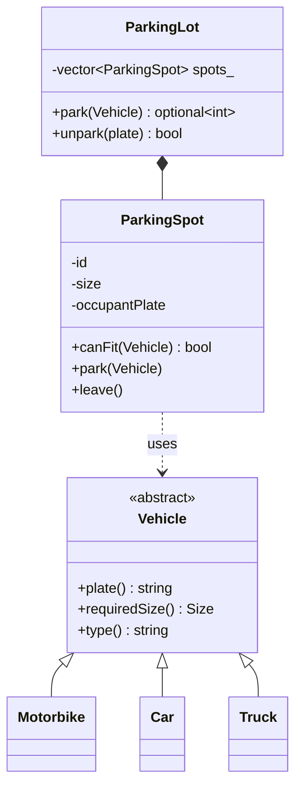

**Relationships and design decisions**

- `ParkingLot` **composes** its spots (they cannot exist without it): `std::vector<ParkingSpot>`.
- A spot *uses* a vehicle only during `park`; it stores the **plate string**, not a pointer to the vehicle, so the spot never dangles if the caller's vehicle object is destroyed. (A parked vehicle is not owned by the lot.)
- Compatibility lives in `ParkingSpot::canFit` (the spot knows its own rules), selection policy lives in `ParkingLot`.

```cpp
// RUN
#include <iostream>
#include <optional>
#include <string>
#include <vector>

enum class Size { Small = 1, Medium = 2, Large = 3 };

class Vehicle {
public:
    explicit Vehicle(std::string plate) : plate_(std::move(plate)) {}
    virtual ~Vehicle() = default;
    virtual Size requiredSize() const = 0;
    virtual std::string type() const = 0;
    const std::string& plate() const { return plate_; }
private:
    std::string plate_;
};
class Motorbike : public Vehicle {
public:
    using Vehicle::Vehicle;
    Size requiredSize() const override { return Size::Small; }
    std::string type() const override { return "Motorbike"; }
};
class Car : public Vehicle {
public:
    using Vehicle::Vehicle;
    Size requiredSize() const override { return Size::Medium; }
    std::string type() const override { return "Car"; }
};
class Truck : public Vehicle {
public:
    using Vehicle::Vehicle;
    Size requiredSize() const override { return Size::Large; }
    std::string type() const override { return "Truck"; }
};

class ParkingSpot {
public:
    ParkingSpot(int id, Size size) : id_(id), size_(size) {}
    int id() const { return id_; }
    Size size() const { return size_; }
    bool isFree() const { return occupantPlate_.empty(); }
    const std::string& occupantPlate() const { return occupantPlate_; }
    bool canFit(const Vehicle& v) const {                      // the spot owns the compatibility rule
        return isFree() && static_cast<int>(v.requiredSize()) <= static_cast<int>(size_);
    }
    void park(const Vehicle& v) { occupantPlate_ = v.plate(); }
    void leave() { occupantPlate_.clear(); }
private:
    int id_;
    Size size_;
    std::string occupantPlate_;                                // empty means free; encapsulated state
};

class ParkingLot {
public:
    explicit ParkingLot(const std::vector<Size>& layout) {
        for (std::size_t i = 0; i < layout.size(); ++i) spots_.emplace_back(static_cast<int>(i), layout[i]);
    }
    std::optional<int> park(const Vehicle& v) {
        ParkingSpot* best = nullptr;                           // best-fit: smallest suitable free spot
        for (auto& s : spots_)
            if (s.canFit(v) && (!best || s.size() < best->size())) best = &s;
        if (!best) return std::nullopt;
        best->park(v);
        return best->id();
    }
    bool unpark(const std::string& plate) {
        for (auto& s : spots_)
            if (s.occupantPlate() == plate) { s.leave(); return true; }
        return false;
    }
private:
    std::vector<ParkingSpot> spots_;                           // composition
};

void tryPark(ParkingLot& lot, const Vehicle& v) {
    auto spot = lot.park(v);
    if (spot) std::cout << v.type() << " " << v.plate() << " -> spot " << *spot << "\n";
    else      std::cout << v.type() << " " << v.plate() << " -> no spot available\n";
}

int main() {
    ParkingLot lot({Size::Small, Size::Medium, Size::Medium, Size::Large});
    Motorbike bike("BIKE-1");
    Car car1("CAR-1"), car2("CAR-2"), car3("CAR-3");
    Truck truck("TRUCK-1");

    tryPark(lot, bike);      // smallest fit: spot 0
    tryPark(lot, car1);      // spot 1
    tryPark(lot, car2);      // spot 2
    tryPark(lot, truck);     // spot 3
    tryPark(lot, car3);      // lot is full
    lot.unpark("CAR-1");
    tryPark(lot, car3);      // reuses spot 1
}
```

```text
Motorbike BIKE-1 -> spot 0
Car CAR-1 -> spot 1
Car CAR-2 -> spot 2
Truck TRUCK-1 -> spot 3
Car CAR-3 -> no spot available
Car CAR-3 -> spot 1
```

**Walkthrough.** Each `park` scans spots and keeps the smallest free compatible one. The truck only fits the large spot. After `unpark`, spot 1 is free again.

**Principles:** inheritance with a true is-a hierarchy, polymorphism (`requiredSize`), encapsulation (occupancy hidden behind `isFree`/`park`/`leave`), composition, SRP.

**Improvements:** floors, tickets with timestamps, pricing strategy, a spot-selection strategy (nearest vs best-fit), thread safety, an index from plate to spot for O(1) unpark.

**Follow-up questions:** Why not make `Truck` inherit `Car`? (Behavioral differences violate LSP and create needless coupling.) How would you add electric charging spots? (A capability interface or a spot attribute, not a subclass explosion.)

### 14.4 Example 4: Library Management System

**Problem.** Track books, physical copies, members and loans.

**Requirements:** a `Book` (title) can have many `BookCopy` objects; members borrow copies; a member may hold at most two loans; a copy can be on loan to one member at a time.

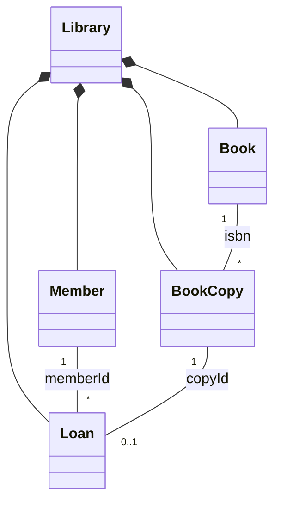

**Relationships, lifetime and design decisions**

- `Library` **owns** books, copies, members and loans by value in maps (composition): everything's lifetime is tied to the library.
- Cross-references between entities are **IDs**, not pointers (association by identity). This avoids dangling pointers when containers reallocate and makes persistence easy.
- Business rules are placed where the data lives: `Member::canBorrow()` encapsulates the loan limit; `BookCopy` guards its availability; `Library` coordinates (separation of responsibilities).
- Operations return a `Result` enum instead of throwing for expected business failures.

```cpp
// RUN
#include <iostream>
#include <map>
#include <string>
#include <vector>

class Book {
public:
    Book(std::string isbn, std::string title) : isbn_(std::move(isbn)), title_(std::move(title)) {}
    const std::string& title() const { return title_; }
private:
    std::string isbn_, title_;
};

class BookCopy {
public:
    BookCopy(int id, std::string isbn) : id_(id), isbn_(std::move(isbn)) {}
    const std::string& isbn() const { return isbn_; }
    bool available() const { return available_; }
    void markBorrowed() { available_ = false; }
    void markReturned() { available_ = true; }
private:
    int id_;
    std::string isbn_;
    bool available_ = true;
};

class Member {
public:
    Member(int id, std::string name) : id_(id), name_(std::move(name)) {}
    const std::string& name() const { return name_; }
    bool canBorrow(int maxLoans) const { return activeLoans_ < maxLoans; }   // rule lives with the data
    void loanAdded() { ++activeLoans_; }
    void loanClosed() { --activeLoans_; }
private:
    int id_;
    std::string name_;
    int activeLoans_ = 0;
};

struct Loan { int copyId; int memberId; };

enum class Result { Ok, NoSuchCopy, NoSuchMember, CopyUnavailable, LoanLimitReached, NotOnLoan };

const char* text(Result r) {
    switch (r) {
        case Result::Ok: return "ok";
        case Result::NoSuchCopy: return "no such copy";
        case Result::NoSuchMember: return "no such member";
        case Result::CopyUnavailable: return "copy unavailable";
        case Result::LoanLimitReached: return "loan limit reached";
        default: return "not on loan";
    }
}

class Library {
public:
    void addBook(const std::string& isbn, const std::string& title) { books_.emplace(isbn, Book(isbn, title)); }
    void addCopy(int copyId, const std::string& isbn) { copies_.emplace(copyId, BookCopy(copyId, isbn)); }
    void addMember(int id, const std::string& name) { members_.emplace(id, Member(id, name)); }

    Result checkout(int memberId, int copyId) {
        auto m = members_.find(memberId);
        if (m == members_.end()) return Result::NoSuchMember;
        auto c = copies_.find(copyId);
        if (c == copies_.end()) return Result::NoSuchCopy;
        if (!c->second.available()) return Result::CopyUnavailable;
        if (!m->second.canBorrow(kMaxLoans)) return Result::LoanLimitReached;
        c->second.markBorrowed();
        m->second.loanAdded();
        loans_.push_back({copyId, memberId});
        return Result::Ok;
    }
    Result giveBack(int copyId) {
        for (auto it = loans_.begin(); it != loans_.end(); ++it) {
            if (it->copyId == copyId) {
                members_.at(it->memberId).loanClosed();
                copies_.at(copyId).markReturned();
                loans_.erase(it);
                return Result::Ok;
            }
        }
        return Result::NotOnLoan;
    }
    std::string titleOf(int copyId) const { return books_.at(copies_.at(copyId).isbn()).title(); }
private:
    static constexpr int kMaxLoans = 2;
    std::map<std::string, Book> books_;      // owned by value: composition
    std::map<int, BookCopy> copies_;
    std::map<int, Member> members_;
    std::vector<Loan> loans_;
};

int main() {
    Library lib;
    lib.addBook("111", "Clean Code");
    lib.addBook("222", "Effective C++");
    lib.addCopy(1, "111"); lib.addCopy(2, "111"); lib.addCopy(3, "222");
    lib.addMember(10, "Asha"); lib.addMember(11, "Ravi");

    std::cout << "Asha takes copy 1: " << text(lib.checkout(10, 1)) << "\n";
    std::cout << "Ravi takes copy 1: " << text(lib.checkout(11, 1)) << "\n";
    std::cout << "Asha takes copy 2: " << text(lib.checkout(10, 2)) << "\n";
    std::cout << "Asha takes copy 3: " << text(lib.checkout(10, 3)) << "\n";
    std::cout << "Asha returns copy 1: " << text(lib.giveBack(1)) << "\n";
    std::cout << "Asha takes copy 3: " << text(lib.checkout(10, 3)) << " (" << lib.titleOf(3) << ")\n";
    std::cout << "return copy 9: " << text(lib.giveBack(9)) << "\n";
}
```

```text
Asha takes copy 1: ok
Ravi takes copy 1: copy unavailable
Asha takes copy 2: ok
Asha takes copy 3: loan limit reached
Asha returns copy 1: ok
Asha takes copy 3: ok (Effective C++)
return copy 9: not on loan
```

**Walkthrough.** `checkout` validates in a fixed order (member, copy, availability, limit), then updates the copy, the member and the loan list together. `giveBack` reverses all three.

**Principles:** encapsulation (state changes only through intention-revealing methods), association by id, composition for ownership, separation of responsibilities.

**Improvements:** due dates and fines, reservations, an atomic "checkout" transaction, repositories behind interfaces, a `Loan` class holding dates.

**Follow-up questions:** Why `BookCopy` separate from `Book`? (One title, many physical items with independent availability.) How would you prevent a half-updated state if one step failed? (Validate first, mutate last; or use the strong exception guarantee.)

### 14.5 Example 5: Logger with a Sink Abstraction

**Problem.** Application code logs messages; where they go (console, file, memory for tests) should be changeable without modifying the logger's users.

**Requirements:** an abstraction (`LogSink`), multiple implementations, **dependency inversion**, **constructor injection**, testability, a minimum severity filter.

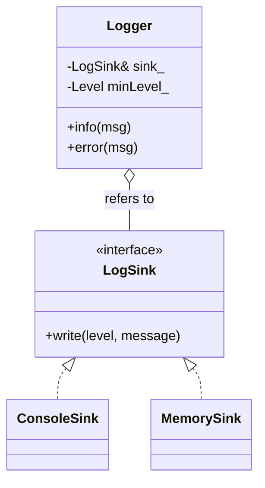

**Design decisions.** `Logger` holds a **reference** to a sink: it *refers to* (aggregation), it does not own. The caller (`main`) owns sinks and guarantees they outlive the logger. This makes a recording `MemorySink` trivially inspectable by tests. If you want the logger to own its sink, take a `std::unique_ptr<LogSink>` instead.

```cpp
// RUN
#include <iostream>
#include <string>
#include <vector>

enum class Level { Info = 1, Error = 2 };

class LogSink {
public:
    virtual ~LogSink() = default;
    virtual void write(Level level, const std::string& message) = 0;
};

class ConsoleSink : public LogSink {
public:
    void write(Level level, const std::string& message) override {
        std::cout << (level == Level::Error ? "[ERROR] " : "[INFO ] ") << message << "\n";
    }
};

class MemorySink : public LogSink {                       // test double: records everything
public:
    void write(Level level, const std::string& message) override {
        lines.push_back(std::to_string(static_cast<int>(level)) + ":" + message);
    }
    std::vector<std::string> lines;
};

class Logger {
public:
    Logger(LogSink& sink, Level minLevel) : sink_(sink), minLevel_(minLevel) {}   // injected dependency
    void info(const std::string& m)  { log(Level::Info, m); }
    void error(const std::string& m) { log(Level::Error, m); }
private:
    void log(Level level, const std::string& m) {
        if (static_cast<int>(level) >= static_cast<int>(minLevel_)) sink_.write(level, m);   // filtering policy
    }
    LogSink& sink_;
    Level minLevel_;
};

int main() {
    ConsoleSink console;
    Logger prodLogger(console, Level::Info);
    prodLogger.info("server started");
    prodLogger.error("disk almost full");

    MemorySink memory;                                    // a test needs no console or files
    Logger testLogger(memory, Level::Error);
    testLogger.info("ignored: below minimum level");
    testLogger.error("payment failed");
    std::cout << "test captured " << memory.lines.size() << " line(s): " << memory.lines[0] << "\n";
}
```

```text
[INFO ] server started
[ERROR] disk almost full
test captured 1 line(s): 2:payment failed
```

**Principles:** DIP, programming to an interface, SRP (logging policy vs output destination), testability.

**Improvements:** a `FileSink` (RAII file handle), a composite sink writing to several sinks, timestamps and formatters, thread-safe sinks.

**Follow-up questions:** Why not make `Logger` a Singleton? (Hidden global state, hard to test; inject it instead.) Reference vs `unique_ptr` for the sink? (Borrowed vs owned lifetime.)

### 14.6 Example 6: Strategy Pattern (Pricing)

**Problem.** Compute a cart total under interchangeable pricing rules; new rules must not require changing the calculation service.

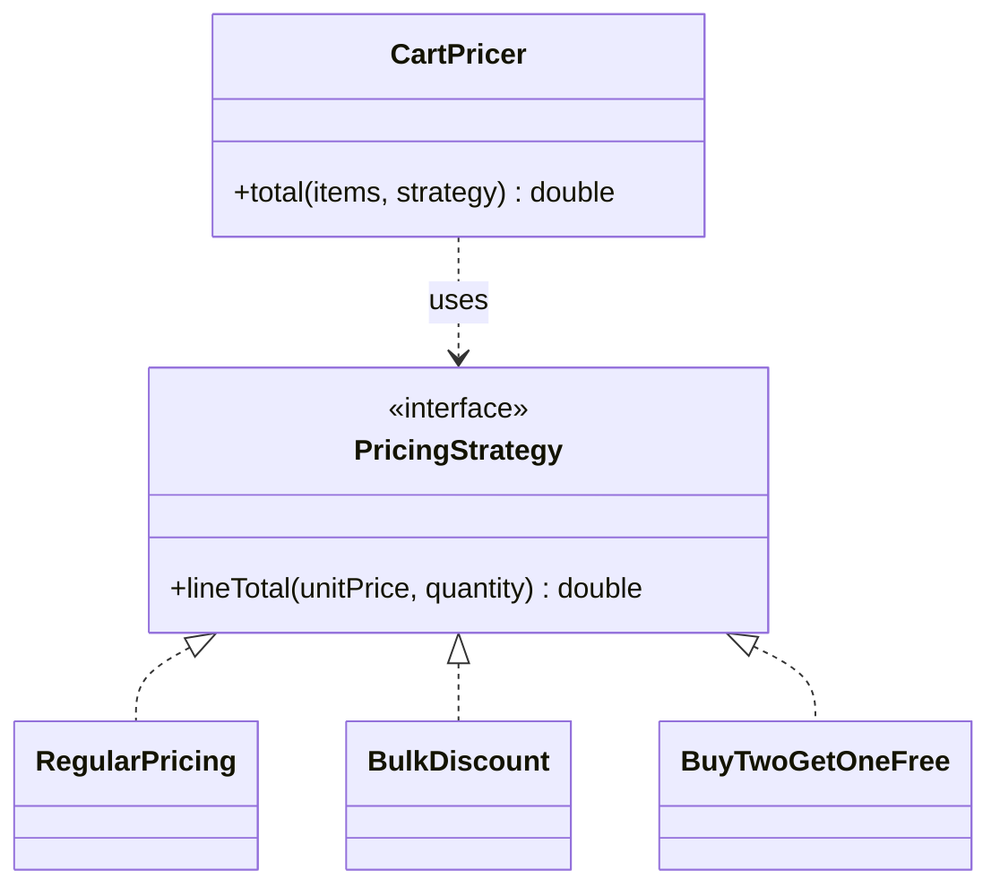

```cpp
// RUN
#include <iostream>
#include <memory>
#include <string>
#include <vector>

struct CartItem { std::string name; double unitPrice; int quantity; };

class PricingStrategy {
public:
    virtual ~PricingStrategy() = default;
    virtual double lineTotal(double unitPrice, int quantity) const = 0;
    virtual std::string name() const = 0;
};

class RegularPricing : public PricingStrategy {
public:
    double lineTotal(double p, int q) const override { return p * q; }
    std::string name() const override { return "Regular"; }
};

class BulkDiscount : public PricingStrategy {            // 10% off when buying at least minQty
public:
    explicit BulkDiscount(int minQty) : minQty_(minQty) {}
    double lineTotal(double p, int q) const override { return q >= minQty_ ? p * q * 0.9 : p * q; }
    std::string name() const override { return "Bulk"; }
private:
    int minQty_;
};

class CartPricer {                                       // closed for modification: knows only the interface
public:
    double total(const std::vector<CartItem>& items, const PricingStrategy& strategy) const {
        double sum = 0;
        for (const auto& i : items) sum += strategy.lineTotal(i.unitPrice, i.quantity);
        return sum;
    }
};

// New strategy added later: CartPricer is unchanged.
class BuyTwoGetOneFree : public PricingStrategy {
public:
    double lineTotal(double p, int q) const override { return p * (q - q / 3); }
    std::string name() const override { return "Buy2Get1"; }
};

int main() {
    std::vector<CartItem> cart{{"Notebook", 100.0, 3}, {"Pen", 10.0, 10}};
    CartPricer pricer;
    std::vector<std::unique_ptr<PricingStrategy>> strategies;
    strategies.push_back(std::make_unique<RegularPricing>());
    strategies.push_back(std::make_unique<BulkDiscount>(5));
    strategies.push_back(std::make_unique<BuyTwoGetOneFree>());
    for (const auto& s : strategies)
        std::cout << s->name() << ": " << pricer.total(cart, *s) << "\n";
}
```

```text
Regular: 400
Bulk: 390
Buy2Get1: 270
```

**Arithmetic.** Regular: 300 + 100 = 400. Bulk (10% off the pen line only, quantity 10 >= 5): 300 + 90 = 390. Buy2Get1: notebooks pay for 3 - 1 = 2 units (200), pens pay for 10 - 3 = 7 units (70), total 270.

**Walkthrough.** The strategy is passed per call (method injection). A strategy can also be held as a member (constructor/setter injection). In C++ a `std::function<double(double,int)>` can replace a one-method interface when you do not need a named type.

**Principles:** OCP, polymorphism, composition over inheritance, SRP.

**When not to use:** if there will only ever be one rule, a plain function is simpler.

**Follow-up questions:** Strategy vs State? (Strategy is chosen by the client and is usually stateless; State changes itself as the context changes.) Strategy vs Template Method? (Composition vs inheritance.)

---


### 14.7 Example 7: Factory Pattern

**Problem.** The caller knows a *format name* from configuration or user input but should not depend on the concrete exporter classes.

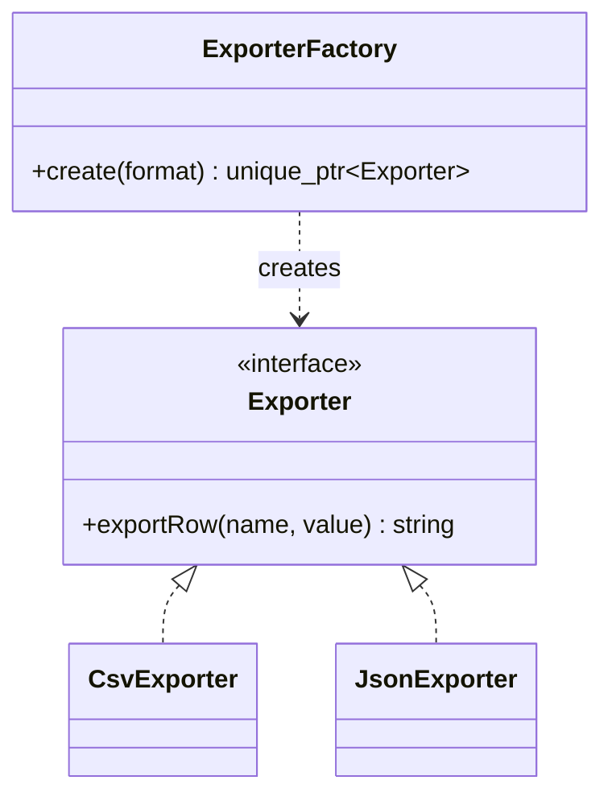

```cpp
// RUN
#include <iostream>
#include <memory>
#include <string>

class Exporter {
public:
    virtual ~Exporter() = default;
    virtual std::string exportRow(const std::string& name, int value) const = 0;
};
class CsvExporter : public Exporter {
public:
    std::string exportRow(const std::string& n, int v) const override { return n + "," + std::to_string(v); }
};
class JsonExporter : public Exporter {
public:
    std::string exportRow(const std::string& n, int v) const override {
        return "{\"name\":\"" + n + "\",\"value\":" + std::to_string(v) + "}";
    }
};

class ExporterFactory {                                     // "simple factory" idiom: one static creation function
public:
    static std::unique_ptr<Exporter> create(const std::string& format) {
        if (format == "csv")  return std::make_unique<CsvExporter>();
        if (format == "json") return std::make_unique<JsonExporter>();
        return nullptr;                                     // unknown format: caller must check
    }
};

int main() {
    for (const std::string fmt : {"csv", "json", "xml"}) {
        auto exporter = ExporterFactory::create(fmt);       // caller gets sole ownership
        if (!exporter) { std::cout << fmt << ": unsupported\n"; continue; }
        std::cout << fmt << ": " << exporter->exportRow("score", 42) << "\n";
    }
}
```

```text
csv: score,42
json: {"name":"score","value":42}
xml: unsupported
```

**When a factory is useful:** the concrete type depends on runtime data, construction is complex or has many steps, or you want one place to change when a new type appears. **When a plain constructor is enough:** the concrete type is known and fixed at the call site (`CsvExporter e;`). A factory there only adds indirection.

**Trade-off:** the factory's `if` chain still must be edited for each new type; it localizes the violation of OCP instead of removing it. A registry (`map<string, function<unique_ptr<Exporter>()>>`) removes even that.

**Principles:** DIP (callers depend on `Exporter`), SRP (creation separated from use). **Follow-ups:** Why return `unique_ptr`? (Ownership transfer is explicit and exception-safe.) Factory Method vs Simple Factory vs Abstract Factory? (Part 18.)

### 14.8 Example 8: Observer Pattern

**Problem.** A stock ticker publishes price changes; any number of observers react, and the ticker must not know their concrete types.

**Lifetime-safety decision.** If the subject stored raw pointers, an observer destroyed without unsubscribing would leave a **dangling pointer** (undefined behavior on the next notification). Here observers are owned by `shared_ptr` elsewhere and the subject stores **`weak_ptr`**: it never extends their lifetime and skips (and removes) expired ones automatically.

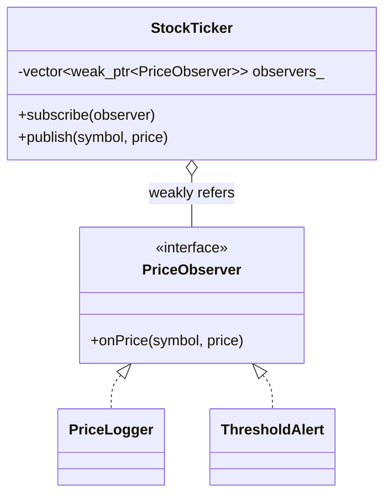

```cpp
// RUN
#include <iostream>
#include <memory>
#include <string>
#include <vector>

class PriceObserver {
public:
    virtual ~PriceObserver() = default;
    virtual void onPrice(const std::string& symbol, double price) = 0;
};

class PriceLogger : public PriceObserver {
public:
    void onPrice(const std::string& s, double p) override { std::cout << "  log: " << s << " = " << p << "\n"; }
};

class ThresholdAlert : public PriceObserver {
public:
    explicit ThresholdAlert(double limit) : limit_(limit) {}
    void onPrice(const std::string& s, double p) override {
        if (p >= limit_) std::cout << "  ALERT: " << s << " reached " << p << "\n";
    }
private:
    double limit_;
};

class StockTicker {
public:
    void subscribe(const std::shared_ptr<PriceObserver>& observer) { observers_.push_back(observer); }

    void publish(const std::string& symbol, double price) {
        std::vector<std::shared_ptr<PriceObserver>> live;     // snapshot of observers that still exist
        for (auto it = observers_.begin(); it != observers_.end();) {
            if (auto sp = it->lock()) { live.push_back(std::move(sp)); ++it; }
            else it = observers_.erase(it);                   // prune destroyed observers
        }
        for (auto& o : live) o->onPrice(symbol, price);       // notify the snapshot (safe if callbacks subscribe)
    }
    std::size_t observerCount() const { return observers_.size(); }
private:
    std::vector<std::weak_ptr<PriceObserver>> observers_;     // non-owning registration
};

int main() {
    StockTicker ticker;
    auto logger = std::make_shared<PriceLogger>();
    ticker.subscribe(logger);
    {
        auto alert = std::make_shared<ThresholdAlert>(150.0);
        ticker.subscribe(alert);
        std::cout << "publish 120\n";
        ticker.publish("ACME", 120.0);
        std::cout << "publish 160\n";
        ticker.publish("ACME", 160.0);
    }                                                         // 'alert' destroyed without explicit unsubscribe
    std::cout << "publish 170\n";
    ticker.publish("ACME", 170.0);
    std::cout << "observers registered: " << ticker.observerCount() << "\n";
}
```

```text
publish 120
  log: ACME = 120
publish 160
  log: ACME = 160
  ALERT: ACME reached 160
publish 170
  log: ACME = 170
observers registered: 1
```

**Walkthrough.** `publish` locks each `weak_ptr`; destroyed observers are erased. The alert disappears from notifications automatically after its scope ends.

**Principles:** DIP and loose coupling (subject knows only the interface), OCP (new observer types need no change to the subject), correct ownership (subject observes, does not own).

**Potential improvements:** explicit `unsubscribe`, event types, thread safety (locking around the list), observer ordering guarantees, avoiding re-entrancy surprises.

**Follow-ups:** What if an observer unsubscribes inside its callback? (Why we iterate a snapshot.) Push vs pull models? (Send data vs let observers query the subject.)

---

## Part 15: OOP Design Patterns Relevant to LLD

Patterns are named, reusable solutions to recurring design problems. Learn them as **applications of OOP principles**, not as templates to apply everywhere. Fuller code for Strategy, Simple Factory and Observer is in Part 14; here each pattern gets a compact illustration.

### 15.1 Strategy

| Aspect | Detail |
|---|---|
| Problem solved | Several interchangeable algorithms/policies; avoid `if/switch` on type |
| Use when / avoid when | Behavior varies independently of the client / only one algorithm will ever exist |
| Participants | `Strategy` interface, concrete strategies, `Context` that uses a strategy |
| Principles | OCP, composition over inheritance, DIP |
| Advantages / trade-offs | Swappable at run time, testable / more classes; clients must choose a strategy |
| Interview questions | Strategy vs State? Strategy vs `std::function`? See 14.6 |

### 15.2 Factory Method

| Aspect | Detail |
|---|---|
| Problem solved | A base class needs to create an object whose concrete type is decided by subclasses |
| Use when / avoid when | Framework code defers object creation to derived classes / a simple constructor or function suffices |
| Participants | `Product`, concrete products, `Creator` (declares the factory method), concrete creators |
| Principles | OCP, DIP, Template-Method style hook |
| Trade-offs | Parallel hierarchies of creators and products |

```cpp
// RUN
#include <iostream>
#include <memory>
#include <string>

class Document { public: virtual ~Document() = default; virtual std::string render() const = 0; };
class PdfDocument  : public Document { public: std::string render() const override { return "PDF document"; } };
class WordDocument : public Document { public: std::string render() const override { return "Word document"; } };

class Application {                                       // Creator
public:
    virtual ~Application() = default;
    std::string openNew() const {                          // uses the product through the interface
        std::unique_ptr<Document> doc = createDocument();  // factory method
        return doc->render();
    }
protected:
    virtual std::unique_ptr<Document> createDocument() const = 0;
};
class PdfApp  : public Application { protected: std::unique_ptr<Document> createDocument() const override { return std::make_unique<PdfDocument>(); } };
class WordApp : public Application { protected: std::unique_ptr<Document> createDocument() const override { return std::make_unique<WordDocument>(); } };

int main() {
    PdfApp pdf; WordApp word;
    std::cout << pdf.openNew() << "\n" << word.openNew() << "\n";
}
```

```text
PDF document
Word document
```

### 15.3 Simple Factory (an idiom, not a GoF pattern)

One function or static method that returns the right concrete type from a parameter (see Example 7). It is the most commonly useful form in interviews. It is *not* Factory Method (no subclass decides) and *not* Abstract Factory (no families).

### 15.4 Abstract Factory

| Aspect | Detail |
|---|---|
| Problem solved | Create **families** of related objects that must be used together (consistent theme) |
| Use when / avoid when | Products come in consistent sets (UI toolkits) / only one product type varies |
| Participants | Abstract factory, concrete factories, abstract products, concrete products |
| Principles | DIP, OCP (new family), consistency |
| Trade-offs | Adding a new *product type* changes every factory (hard); adding a new *family* is easy |

```cpp
// RUN
#include <iostream>
#include <memory>
#include <string>

struct Button   { virtual ~Button() = default;   virtual std::string draw() const = 0; };
struct Checkbox { virtual ~Checkbox() = default; virtual std::string draw() const = 0; };

struct LightButton   : Button   { std::string draw() const override { return "LightButton"; } };
struct LightCheckbox : Checkbox { std::string draw() const override { return "LightCheckbox"; } };
struct DarkButton    : Button   { std::string draw() const override { return "DarkButton"; } };
struct DarkCheckbox  : Checkbox { std::string draw() const override { return "DarkCheckbox"; } };

struct ThemeFactory {                                      // abstract factory
    virtual ~ThemeFactory() = default;
    virtual std::unique_ptr<Button> makeButton() const = 0;
    virtual std::unique_ptr<Checkbox> makeCheckbox() const = 0;
};
struct LightTheme : ThemeFactory {
    std::unique_ptr<Button> makeButton() const override { return std::make_unique<LightButton>(); }
    std::unique_ptr<Checkbox> makeCheckbox() const override { return std::make_unique<LightCheckbox>(); }
};
struct DarkTheme : ThemeFactory {
    std::unique_ptr<Button> makeButton() const override { return std::make_unique<DarkButton>(); }
    std::unique_ptr<Checkbox> makeCheckbox() const override { return std::make_unique<DarkCheckbox>(); }
};

void buildScreen(const ThemeFactory& f) {                  // client never names a concrete widget
    std::cout << f.makeButton()->draw() << " + " << f.makeCheckbox()->draw() << "\n";
}

int main() { buildScreen(LightTheme()); buildScreen(DarkTheme()); }
```

```text
LightButton + LightCheckbox
DarkButton + DarkCheckbox
```

**Ownership note:** factories return `unique_ptr`, so the caller owns what it creates and the factory keeps no ownership.

### 15.5 Observer

| Aspect | Detail |
|---|---|
| Problem solved | One-to-many notification without coupling subject to observers |
| Use when / avoid when | Event-style updates, UI models / notification chains become hard to trace |
| Participants | Subject, Observer interface, concrete observers |
| Principles | DIP, OCP, loose coupling |
| Trade-offs | Lifetime management (dangling observers), notification order, re-entrancy; see 14.8 |

### 15.6 Decorator

| Aspect | Detail |
|---|---|
| Problem solved | Add responsibilities to an object dynamically without subclass explosion |
| Use when / avoid when | Combinable optional features (logging, caching, compression) / the number of wrappers makes behavior opaque |
| Participants | Component interface, concrete component, decorator holding a component, concrete decorators |
| Principles | OCP, composition over inheritance, SRP |

```cpp
// RUN
#include <iostream>
#include <memory>
#include <string>

class Coffee {
public:
    virtual ~Coffee() = default;
    virtual int cost() const = 0;
    virtual std::string description() const = 0;
};
class Espresso : public Coffee {
public:
    int cost() const override { return 50; }
    std::string description() const override { return "Espresso"; }
};
class CoffeeDecorator : public Coffee {                    // same interface + holds a Coffee
public:
    explicit CoffeeDecorator(std::unique_ptr<Coffee> inner) : inner_(std::move(inner)) {}
protected:
    std::unique_ptr<Coffee> inner_;                        // owns the wrapped object
};
class Milk : public CoffeeDecorator {
public:
    using CoffeeDecorator::CoffeeDecorator;
    int cost() const override { return inner_->cost() + 10; }
    std::string description() const override { return inner_->description() + " + Milk"; }
};
class Sugar : public CoffeeDecorator {
public:
    using CoffeeDecorator::CoffeeDecorator;
    int cost() const override { return inner_->cost() + 5; }
    std::string description() const override { return inner_->description() + " + Sugar"; }
};

int main() {
    std::unique_ptr<Coffee> order = std::make_unique<Sugar>(std::make_unique<Milk>(std::make_unique<Espresso>()));
    std::cout << order->description() << " = " << order->cost() << "\n";
}
```

```text
Espresso + Milk + Sugar = 65
```

### 15.7 Adapter

| Aspect | Detail |
|---|---|
| Problem solved | Make an existing class fit the interface your code expects |
| Use when / avoid when | Integrating legacy or third-party code you cannot change / you control both sides (just change the interface) |
| Participants | Target interface, Adaptee (existing class), Adapter |
| Principles | DIP, SRP, composition |

```cpp
// RUN
#include <iostream>

class LegacyFahrenheitSensor {                              // cannot be modified
public:
    double readFahrenheit() const { return 212.0; }
};
class CelsiusSensor {                                       // what our code expects
public:
    virtual ~CelsiusSensor() = default;
    virtual double celsius() const = 0;
};
class SensorAdapter : public CelsiusSensor {
public:
    explicit SensorAdapter(const LegacyFahrenheitSensor& legacy) : legacy_(legacy) {}   // composition
    double celsius() const override { return (legacy_.readFahrenheit() - 32.0) * 5.0 / 9.0; }
private:
    const LegacyFahrenheitSensor& legacy_;
};

int main() {
    LegacyFahrenheitSensor legacy;
    SensorAdapter adapter(legacy);
    const CelsiusSensor& sensor = adapter;
    std::cout << sensor.celsius() << " C\n";
}
```

```text
100 C
```

### 15.8 Singleton

| Aspect | Detail |
|---|---|
| Problem solved | Exactly one instance with global access (configuration, hardware access) |
| Use when / avoid when | A single instance is a hard physical/domain fact **and** global access is acceptable / almost always otherwise: prefer passing one object by dependency injection |
| Participants | The class itself with private constructor and a static accessor |
| Risks | **Global mutable state**, hidden dependencies, order-of-initialization and destruction issues, hard to test (cannot substitute), thread-safety of its data |

**Thread-safe initialization in modern C++:** since C++11, initialization of a function-local `static` is guaranteed to occur **exactly once even if several threads call it concurrently** (the "Meyers singleton"). The initialization is thread-safe; *using* the object's data from many threads still needs synchronization.

```cpp
// RUN
#include <iostream>
#include <string>

class AppConfig {
public:
    static AppConfig& instance() {
        static AppConfig theInstance;                       // created on first call, thread-safe init (C++11+)
        return theInstance;
    }
    AppConfig(const AppConfig&) = delete;                   // no copies
    AppConfig& operator=(const AppConfig&) = delete;
    void setName(std::string n) { name_ = std::move(n); }
    const std::string& name() const { return name_; }
private:
    AppConfig() = default;                                  // no outside construction
    std::string name_ = "default";
};

int main() {
    AppConfig::instance().setName("prod");
    std::cout << AppConfig::instance().name() << "\n";
    std::cout << std::boolalpha << (&AppConfig::instance() == &AppConfig::instance()) << "\n";
}
```

```text
prod
true
```

> **Interview tip:** Mention the risks unprompted, then say "I would pass a `Config&` through constructors instead, which keeps one instance without global access."

### 15.9 Builder

| Aspect | Detail |
|---|---|
| Problem solved | Construct complex objects step by step; avoid constructors with many parameters; validate before producing the object |
| Use when / avoid when | Many optional fields, immutable result / few fields (use an aggregate or a constructor) |
| Participants | Product, Builder (often fluent), optional Director |

```cpp
// RUN
#include <iostream>
#include <map>
#include <stdexcept>
#include <string>

class HttpRequest {
public:
    std::string describe() const {
        std::string s = method_ + " " + url_;
        for (const auto& h : headers_) s += " [" + h.first + ": " + h.second + "]";
        return s;
    }
private:
    friend class HttpRequestBuilder;
    HttpRequest() = default;                                 // only the builder can create it
    std::string method_, url_;
    std::map<std::string, std::string> headers_;
};

class HttpRequestBuilder {
public:
    HttpRequestBuilder& url(std::string u)    { req_.url_ = std::move(u); return *this; }      // fluent: return *this
    HttpRequestBuilder& method(std::string m) { req_.method_ = std::move(m); return *this; }
    HttpRequestBuilder& header(std::string k, std::string v) { req_.headers_[std::move(k)] = std::move(v); return *this; }
    HttpRequest build() const {
        if (req_.url_.empty()) throw std::invalid_argument("url required");                    // validation in one place
        return req_;
    }
private:
    HttpRequest req_;
};

int main() {
    HttpRequest r = HttpRequestBuilder().method("GET").url("https://example.org").header("Accept", "json").build();
    std::cout << r.describe() << "\n";
    try { HttpRequestBuilder().method("POST").build(); }
    catch (const std::exception& e) { std::cout << "error: " << e.what() << "\n"; }
}
```

```text
GET https://example.org [Accept: json]
error: url required
```

### 15.10 State

| Aspect | Detail |
|---|---|
| Problem solved | Behavior changes with internal state; replace large `switch(state)` blocks with polymorphic state objects |
| Use when / avoid when | Many states with state-specific behavior and transitions / two or three simple states (an enum is clearer) |
| Participants | Context, State interface, concrete states |
| Principles | OCP, SRP (each state's rules in one class), polymorphism |

```cpp
// RUN
#include <iostream>
#include <memory>
#include <string>

class State {
public:
    virtual ~State() = default;
    virtual std::string name() const = 0;
    virtual std::unique_ptr<State> next() const = 0;         // returns the next state; does not delete itself
};
class Draft : public State {
public:
    std::string name() const override { return "Draft"; }
    std::unique_ptr<State> next() const override;
};
class Review : public State {
public:
    std::string name() const override { return "Review"; }
    std::unique_ptr<State> next() const override;
};
class Published : public State {
public:
    std::string name() const override { return "Published"; }
    std::unique_ptr<State> next() const override { return std::make_unique<Published>(); }   // terminal state
};
std::unique_ptr<State> Draft::next() const  { return std::make_unique<Review>(); }
std::unique_ptr<State> Review::next() const { return std::make_unique<Published>(); }

class Article {                                              // context
public:
    Article() : state_(std::make_unique<Draft>()) {}
    void advance() { state_ = state_->next(); }              // old state is destroyed only after next() returned
    std::string status() const { return state_->name(); }
private:
    std::unique_ptr<State> state_;
};

int main() {
    Article a;
    for (int i = 0; i < 4; ++i) { std::cout << a.status() << "\n"; a.advance(); }
}
```

```text
Draft
Review
Published
Published
```

### 15.11 Template Method

| Aspect | Detail |
|---|---|
| Problem solved | Fix the skeleton of an algorithm in a base class; let subclasses supply certain steps |
| Use when / avoid when | Several variants share the same sequence of steps / variation is better expressed with composition (Strategy) |
| Participants | Abstract class with a non-virtual template method and virtual hook steps |
| Principles | Reuse via inheritance ("Hollywood principle": the base calls the derived) |
| Trade-offs | Inheritance coupling; the sequence is fixed at compile time |

```cpp
// RUN
#include <iostream>

class DataJob {
public:
    virtual ~DataJob() = default;
    void run() const {                                        // template method: non-virtual, fixed order
        read();
        process();
        write();
    }
protected:
    virtual void read() const = 0;
    virtual void process() const = 0;
    virtual void write() const { std::cout << "  write: default sink\n"; }   // optional hook with default
};
class CsvJob : public DataJob {
protected:
    void read() const override    { std::cout << "  read CSV\n"; }
    void process() const override { std::cout << "  process rows\n"; }
};
class JsonJob : public DataJob {
protected:
    void read() const override    { std::cout << "  read JSON\n"; }
    void process() const override { std::cout << "  process objects\n"; }
    void write() const override   { std::cout << "  write: custom sink\n"; }
};

int main() {
    std::cout << "csv:\n";  CsvJob().run();
    std::cout << "json:\n"; JsonJob().run();
}
```

```text
csv:
  read CSV
  process rows
  write: default sink
json:
  read JSON
  process objects
  write: custom sink
```

### 15.12 Command

| Aspect | Detail |
|---|---|
| Problem solved | Encapsulate a request as an object so it can be queued, logged, undone |
| Use when / avoid when | Undo/redo, task queues, macros / a plain function call is enough |
| Participants | Command interface, concrete commands, receiver, invoker |
| Principles | SRP, OCP, decoupling invoker from receiver |

```cpp
// RUN
#include <iostream>
#include <memory>
#include <string>
#include <vector>

class TextEditor {                                          // receiver
public:
    void append(const std::string& s) { text_ += s; }
    void removeLast(std::size_t n) { text_.erase(text_.size() - n); }
    const std::string& text() const { return text_; }
private:
    std::string text_;
};

class Command {
public:
    virtual ~Command() = default;
    virtual void execute() = 0;
    virtual void undo() = 0;
};
class AppendCommand : public Command {
public:
    AppendCommand(TextEditor& ed, std::string s) : ed_(ed), s_(std::move(s)) {}
    void execute() override { ed_.append(s_); }
    void undo() override { ed_.removeLast(s_.size()); }
private:
    TextEditor& ed_;                                        // non-owning: editor outlives the command history
    std::string s_;
};

class History {                                             // invoker
public:
    void run(std::unique_ptr<Command> c) { c->execute(); done_.push_back(std::move(c)); }
    void undoLast() { if (!done_.empty()) { done_.back()->undo(); done_.pop_back(); } }
private:
    std::vector<std::unique_ptr<Command>> done_;
};

int main() {
    TextEditor editor;
    History history;
    history.run(std::make_unique<AppendCommand>(editor, "Hello"));
    history.run(std::make_unique<AppendCommand>(editor, " World"));
    std::cout << editor.text() << "\n";
    history.undoLast();
    std::cout << editor.text() << "\n";
}
```

```text
Hello World
Hello
```

### 15.13 Dependency Injection (a technique)

Not a GoF pattern: pass collaborators in rather than creating them. The three forms (constructor, setter, method injection), ownership choices and testing benefits are in Part 9, with concrete uses in Examples 2 and 5.

**Part 15 revision:** know the *problem* each pattern solves, a small implementation, and *when not to use it*. Singleton and Factory questions almost always ask about trade-offs.

---


## Part 16: Technical Interview Question Bank

**Format:** each item has the question, a technically correct answer, an optional snippet, likely **follow-ups**, and what a **strong answer** emphasizes.

### Level 1: Fundamentals

**Q1. What is OOP and why use it?**
**A:** A paradigm that organizes software as objects combining state and behavior, communicating through interfaces. It localizes invariants, models domains naturally and supports extension through polymorphism.
*Follow-up:* When is OOP a poor fit? *Strong answer:* acknowledges C++ is multi-paradigm and that simple algorithms need no class hierarchy.

**Q2. Name the four pillars.**
**A:** Encapsulation, abstraction, inheritance, polymorphism. *Follow-up:* Which is most important for LLD? *Strong answer:* abstraction plus polymorphism enable extensibility; encapsulation protects correctness.

**Q3. What is the difference between a class and an object?**
**A:** A class is a type (a blueprint with members); an object is an instance occupying storage with its own state and identity. *Follow-up:* Can a class exist without objects? Yes (e.g., only static members, or abstract).

**Q4. Explain `public`, `private`, `protected`.**
**A:** `public`: accessible everywhere. `private`: only inside the class (and friends). `protected`: class, friends and derived classes. *Strong answer:* adds that access is checked at compile time and per class, not per object.

**Q5. `struct` vs `class` in C++?**
**A:** Only the default access (public vs private) and default inheritance mode differ. By convention `struct` is for plain data aggregates.

**Q6. What is encapsulation?**
**A:** Bundling data with operations and restricting direct access so the class can enforce **invariants**. *Follow-up:* Is a getter that returns a non-const reference to a private member encapsulated? No, it leaks internals (see Part 1).

**Q7. What is abstraction?**
**A:** Exposing a minimal contract (what) while hiding implementation (how), so callers depend on the contract and implementations can change.

**Q8. Encapsulation vs abstraction?**
**A:** Encapsulation = protecting a class's invariants (inside one class). Abstraction = defining a replaceable contract between components. They are independent: a class can be encapsulated but concrete, or abstract but leaky.

**Q9. What is a constructor? Kinds?**
**A:** A special function that initializes an object and establishes invariants. Kinds: default, parameterized, copy, move, converting, delegating; may be `explicit`, `default`, or `delete`.

**Q10. When does the compiler generate a default constructor?**
**A:** Only when you declare **no** constructors at all. Declaring any constructor suppresses it; write `Foo() = default;` to get it back.

**Q11. Why use a member initializer list?**
**A:** It initializes members directly instead of default-constructing then assigning; mandatory for `const` members, reference members, and members/bases without a default constructor.

**Q12. In what order are members initialized?**
**A:** Virtual bases, direct bases (declaration order), then members in **declaration order**, then the constructor body. The initializer list's textual order is irrelevant.

**Q13. What is a destructor and when does it run?**
**A:** Cleans up the object. Runs at scope exit, `delete`, destruction of the owner, and stack unwinding. Order: body, members in reverse, bases in reverse.

**Q14. Can a constructor be private?**
**A:** Yes. Used for Singleton, static factory methods, Builder-only construction, and to prevent direct instantiation.

**Q15. What is the `this` pointer?**
**A:** Pointer to the object on which a non-static member function was called. Not available in static functions; in `const` members it is `const T*`.

**Q16. What is a `const` member function?**
**A:** One that promises not to modify observable state; callable on const objects. `mutable` members may still change.

**Q17. What is a static member?**
**A:** Shared by all objects, one copy per class; static functions have no `this` and can access only static members directly.

**Q18. Stack vs heap objects?**
**A:** Stack (automatic): destroyed at scope end, fast, limited size. Heap (dynamic): lives until freed, flexible lifetime but needs an owner (`unique_ptr`). These are implementation terms for automatic and dynamic storage duration.

**Q19. What is a copy constructor and when is it invoked?**
**A:** `T(const T&)`; creates a new object from an existing one: initialization from an lvalue, pass-by-value, and (when not elided) return by value.

**Q20. Why use `explicit`?**
**A:** To block accidental implicit conversions through single-argument constructors, e.g. `Seconds s = 5;` or passing `5` to a function taking `Seconds`.

### Level 2: Intermediate

**Q21. Types of inheritance?**
**A:** Single, multilevel, multiple, hierarchical, hybrid. *Strong answer:* mentions that multiple inheritance of pure interfaces is the safe common use.

**Q22. Public vs private inheritance?**
**A:** Public = is-a, base's public API stays public and conversion to base is allowed. Private = implemented-in-terms-of; base members become private and no outside conversion. Prefer a member (composition) over private inheritance.

**Q23. What is a virtual function?**
**A:** A member function whose call through a base pointer/reference is resolved at run time by the object's dynamic type.

**Q24. Pure virtual function and abstract class?**
**A:** `virtual void f() = 0;` makes the class abstract (cannot be instantiated); derived classes must override to become concrete.

**Q25. Can an abstract class have constructors and data members?**
**A:** Yes. Its constructor runs when concrete derived objects are constructed. Only instantiation of the abstract class itself is forbidden.

**Q26. Why a virtual destructor?**
**A:** Deleting a derived object through a base pointer without a virtual destructor is **undefined behavior** (derived destructor skipped, leaks). Make the destructor virtual in any base meant for polymorphic deletion.
```cpp
struct B { virtual ~B() = default; };   // required if you ever delete a D through B*
```

**Q27. Overloading vs overriding?**
**A:** Overloading: same name, different parameters, same scope, compile time. Overriding: derived class redefines a **virtual** base function with the same signature, run time.

**Q28. What is name hiding?**
**A:** A derived-class member named `f` hides **all** base members named `f` regardless of signature. Use `using Base::f;` to expose them.

**Q29. Function overloading vs operator overloading?**
**A:** Operator overloading is giving operators meaning for user types via functions named `operator@`; it follows the same overload resolution but has extra rules (arity/precedence fixed, some operators non-overloadable).

**Q30. Which operators cannot be overloaded?**
**A:** `::`, `.`, `.*`, `?:`, `sizeof`, `typeid`, and the cast keywords.

**Q31. Prefix vs postfix `++`?**
**A:** Prefix `T& operator++()` returns the updated object by reference. Postfix `T operator++(int)` returns a copy of the old value (dummy `int` distinguishes it); prefer prefix.

**Q32. What is object slicing and how to prevent it?**
**A:** Copying a derived object into a base object discards the derived part. Prevent via references/pointers, smart pointers, and protected/deleted base copy operations.

**Q33. Static vs dynamic binding?**
**A:** Static: chosen at compile time from the static type (non-virtual calls, overloads, default arguments). Dynamic: virtual call chosen at run time from the dynamic type.

**Q34. What does `override` do?**
**A:** Makes the compiler verify that the function really overrides a base virtual (catches wrong signature, missing `const`, typos).

**Q35. What does `final` do?**
**A:** On a virtual function: forbids further overriding. On a class: forbids inheriting. Can also enable devirtualization.

**Q36. Copy constructor vs copy assignment?**
**A:** Constructor initializes a **new** object; assignment replaces an **existing** object's state (must release old resources, handle self-assignment).

**Q37. Shallow vs deep copy?**
**A:** Shallow copies pointer values (shared target, double delete risk); deep copies the pointed-to data. Prefer types that make copying correct automatically (`vector`, `string`).

**Q38. Can a static member function access non-static members?**
**A:** Not directly (no `this`); only through an object passed to it.

**Q39. What is `friend` and its drawbacks?**
**A:** Grants a function/class access to private members. Not inherited, not transitive. Overuse weakens encapsulation; valid for `operator<<` and tightly coupled helpers.

**Q40. What is `mutable` for?**
**A:** Allows modification of a member inside a `const` member function; use for caches, counters and mutexes that are not logical state.

**Q41. What is the diamond problem?**
**A:** With multiple inheritance, a base reached through two paths appears twice (ambiguity and duplication). Solved with virtual inheritance (one shared subobject) or by avoiding data-bearing shared bases.

**Q42. Why avoid different default arguments in overriding functions?**
**A:** Default arguments are bound statically from the static type, so the call may use the base's default with the derived body.

**Q43. Can a virtual function be private?**
**A:** Yes. Access is checked on the static type, dispatch ignores it. Used in the Non-Virtual Interface idiom (public non-virtual function calls private virtual hooks).

**Q44. Why can't a constructor be virtual?**
**A:** Virtual dispatch needs an existing object with a dynamic type; the constructor creates that object, and the vptr is not yet set up for the final type. Use factories or `clone()`.

### Level 3: Advanced C++

**Q45. Explain Rule of Three, Five and Zero.**
**A:** Three: if you need a custom destructor, copy ctor or copy assignment, you probably need all three. Five: add move ctor/assignment. Zero: own resources via members that manage themselves so you write none. *Strong answer:* "I default to Zero."

**Q46. What does `std::move` do?**
**A:** It is a cast to an rvalue reference (`static_cast<T&&>`); it performs no move. The move constructor/assignment chosen as a result does the transfer. Moved-from objects are valid but unspecified.

**Q47. Why should move operations be `noexcept`?**
**A:** `std::vector` and others use `move_if_noexcept` during reallocation; a throwing move makes them copy to keep the strong guarantee, losing performance.

**Q48. `unique_ptr` vs `shared_ptr`?**
**A:** Unique = exclusive ownership, zero overhead, move-only. Shared = reference-counted shared ownership with control block and atomic counts. Default to unique; share only when lifetimes truly are shared.

**Q49. What is `weak_ptr` for?**
**A:** Non-owning observation of a `shared_ptr`-managed object; breaks cycles; `lock()` yields a temporary `shared_ptr` or null if expired.

**Q50. `make_shared` vs `shared_ptr(new T)`?**
**A:** `make_shared` makes one allocation (object and control block), is exception-safe in argument evaluation, and is usually preferred. Downside: memory is freed only after all weak references also go away; no custom deleter.

**Q51. How can `shared_ptr` leak?**
**A:** Cyclic strong references keep counts above zero. Use `weak_ptr` for the back-reference.

**Q52. How does virtual dispatch work (conceptually)?**
**A:** Typically each polymorphic object has a hidden vptr to a per-class vtable of function pointers; a virtual call indexes the vtable. This is an implementation technique, not required by the standard.

**Q53. What happens if you call a virtual function in a constructor?**
**A:** It dispatches to the version of the class **currently being constructed**, not the derived override (the derived part does not exist yet). Same in destructors.

**Q54. Why does casting between base pointers in multiple inheritance adjust the address?**
**A:** Distinct non-empty base subobjects live at different offsets in the derived object; converting to the second base must add its offset. Hence never `reinterpret_cast` between them.

**Q55. What is virtual inheritance and who constructs the virtual base?**
**A:** It ensures one shared base subobject across paths. The **most-derived** class initializes the virtual base; intermediate classes' initializers for it are ignored.

**Q56. When does `dynamic_cast` work?**
**A:** When the source type is polymorphic (has a virtual function) and the dynamic type is the target or derived from it; pointer form returns null on failure, reference form throws `bad_cast`.

**Q57. What does RTTI cost?**
**A:** Small per-class type info storage and run-time checks for `dynamic_cast`/`typeid`; can be disabled (`-fno-rtti`) in some projects. Frequent use signals a design problem.

**Q58. Explain the exception-safety guarantees.**
**A:** No-throw; strong (commit or rollback); basic (invariants hold, no leaks). Achieve strong with copy-and-swap or "do risky work on a temporary, then swap".

**Q59. What if a destructor throws?**
**A:** Destructors are implicitly `noexcept`; an escaping exception calls `std::terminate`. If one throws during stack unwinding from another exception, the program terminates too. Catch inside the destructor.

**Q60. Give examples of undefined behavior in OOP code.**
**A:** Deleting a derived object through a non-virtual base destructor; using an object after `delete`; dangling references to locals; double delete; `static_cast` downcast to a wrong type; modifying a truly `const` object via `const_cast`; accessing a moved-from `unique_ptr`'s target.

**Q61. How do you handle self-assignment?**
**A:** Either check `this != &other`, or use copy-and-swap which is naturally safe. Naive "delete then copy" breaks on `a = a`.

**Q62. What is copy elision?**
**A:** The compiler constructs an object directly in its destination instead of copying/moving. C++17 **guarantees** it for prvalues (`return T(x);`, `T t = T(x);`); NRVO for named locals is permitted but not guaranteed.

**Q63. What is RAII and why is it central in C++?**
**A:** Tie a resource's lifetime to an object's lifetime: acquire in the constructor, release in the destructor. It gives deterministic cleanup and exception safety.

**Q64. `Foo() = default;` vs `Foo() {}`?**
**A:** Defaulted keeps the type trivial/aggregate-friendly where possible and members get default/value-initialized normally; a user-provided `{}` makes the constructor user-provided, which can change triviality and aggregate status.

**Q65. What is an aggregate and how does it differ from constructor-based initialization?**
**A:** A class with no user-provided constructors, no private/protected non-static members, no virtual functions (C++17 allows public bases). Brace-init fills members directly in order; classes with constructors always call a constructor.

**Q66. What is perfect forwarding?**
**A:** Passing an argument through a template wrapper preserving its value category using a forwarding reference `T&&` plus `std::forward<T>`; avoids extra copies (`make_unique`, `emplace_back`).

**Q67. Does binding a temporary to a reference extend its life?**
**A:** A temporary bound to a `const&` (or `&&`) **local** variable lives as long as that reference. Not when returned from a function or bound to a member in a constructor initializer: those dangle.

### Level 4: LLD and Design

**Q68. Summarize SOLID.**
**A:** SRP one reason to change; OCP extend without modifying; LSP subtypes honor contracts; ISP small role interfaces; DIP depend on abstractions. *Strong answer:* gives a C++ example for each and says they are guidelines.

**Q69. How do you recognize an SRP violation?**
**A:** A class changes for unrelated reasons (rules, formatting, persistence), has a vague name, or tests need many unrelated mocks. Split by reason to change.

**Q70. Can you satisfy OCP without inheritance?**
**A:** Yes: templates, `std::function`/lambdas, composition of policy objects, data-driven registries.

**Q71. Give an LSP violation.**
**A:** `Square : Rectangle` with independent width/height setters; a function setting width then height expects area = w x h. Or a `Bird::fly()` that `Penguin` throws from. Fix with separate abstractions.

**Q72. What is ISP and a fix?**
**A:** Clients shouldn't depend on unused methods. Split a fat `Machine` into `Printer`, `Scanner` interfaces; implement only what applies.

**Q73. DIP vs dependency injection vs IoC container?**
**A:** DIP is the design principle (depend on abstractions). DI is the technique of supplying dependencies from outside. An IoC container automates wiring; plain constructor injection is usually enough.

**Q74. When composition over inheritance?**
**A:** When the relationship is not true behavioral is-a, when you only want code reuse, when behavior must change at run time, or to avoid exposing a base's full API. Use inheritance for substitutable abstractions.

**Q75. Forms of dependency injection and when to use each?**
**A:** Constructor (required deps, default), setter (optional/swappable), method (varies per call).

**Q76. How do you decide ownership in a design?**
**A:** Ask who creates and who must destroy. Exclusive owner: value member or `unique_ptr`. Shared lifetime: `shared_ptr`. Borrowing: reference or raw non-owning pointer with a documented lifetime guarantee. Observers: `weak_ptr`.

**Q77. Alternatives to Singleton?**
**A:** Create one instance in `main` and inject it; use a factory-managed or scoped instance. Keeps one instance without hidden global state.

**Q78. Cohesion vs coupling?**
**A:** Cohesion: how related a module's responsibilities are (want high). Coupling: dependence between modules (want low). Interfaces and DI reduce coupling.

**Q79. Which classes would you create for a parking lot?**
**A:** `Vehicle` (and subtypes), `ParkingSpot`, `ParkingLot`, `Ticket`, a spot-selection `Strategy`, a pricing `Strategy`. Justify each by responsibility, and keep inheritance only where behavior differs.

**Q80. How do you make code testable?**
**A:** Depend on interfaces, inject collaborators, avoid globals/singletons, keep side effects at the edges, and use fakes/mocks.

**Q81. Abstract base class with data vs pure interface?**
**A:** Pure interface (no data) is safest for multiple inheritance and ISP. A base with shared state and a template-method skeleton is fine for single inheritance where reuse is real.

**Q82. How do you avoid a God class?**
**A:** Identify distinct responsibilities, extract classes with intention-revealing names, push behavior to the data it uses, and introduce interfaces where variation exists.

**Q83. Strategy vs State?**
**A:** Strategy: client-chosen interchangeable algorithms, usually no transitions. State: behavior changes because the object's internal state changes, and states trigger transitions.

**Q84. When use a factory and when a constructor?**
**A:** Factory when the concrete type depends on runtime input, creation is complex, or you want to hide concrete types. Constructor when the type is known and construction is simple.

**Q85. How do you keep Observer safe from dangling observers?**
**A:** Store `weak_ptr`s (or provide RAII subscription tokens that unsubscribe in their destructor), prune expired entries, iterate a snapshot.

**Q86. How would you model "Student enrolls in Course"?**
**A:** Many-to-many association; introduce an `Enrollment` class (student id, course id, grade, date) rather than mutual lists, because the relationship has its own attributes and lifetime.

**Q87. What makes a good interface?**
**A:** Small, cohesive, expressed in domain terms, stable, easy to fake, no implementation leakage, documented preconditions/postconditions.

**Q88. When is introducing abstraction a mistake?**
**A:** When there is one implementation and no foreseeable variation (YAGNI), creating layers that only forward calls and hinder reading. Add abstractions at real variation points, ideally after the second use case appears.

---


## Part 17: Output-Based C++ Interview Questions

**How to practice:** read the code, write your predicted output, then expand the answer. All programs below were compiled with `g++ -std=c++17` and their outputs verified. Questions marked **(no run)** deliberately show code that does not compile or whose behavior is undefined/unspecified; for those, the answer explains *why* there is no predictable output.

### Q1. Multiple inheritance: constructor and destructor order

```cpp
// RUN
#include <cstdio>
struct A { A() { std::printf("A "); } ~A() { std::printf("~A "); } };
struct B { B() { std::printf("B "); } ~B() { std::printf("~B "); } };
struct C : B, A {                                   // note: B listed first
    C() { std::printf("C "); }
    ~C() { std::printf("~C "); }
};
int main() { C c; std::printf("| "); }
```

<details><summary>Answer</summary>

```text
B A C | ~C ~A ~B
```

**Rule:** direct bases are constructed in the order they appear in the base-specifier list (not alphabetical, not constructor-initializer order); destruction is the reverse. **Trap:** assuming `A` first because it is declared first in the file.
</details>

### Q2. Temporaries and local destruction order

```cpp
// RUN
#include <cstdio>
struct T {
    int id;
    explicit T(int i) : id(i) { std::printf("ctor%d ", id); }
    ~T() { std::printf("dtor%d ", id); }
};
int main() {
    T a(1);
    T b(2);
    T(3);                       // temporary
    std::printf("| ");
}
```

<details><summary>Answer</summary>

```text
ctor1 ctor2 ctor3 dtor3 | dtor2 dtor1
```

**Rule:** a temporary is destroyed at the end of the full-expression that created it; named locals are destroyed in reverse order of construction at scope exit. **Trap:** thinking `T(3);` lives until the end of `main`.
</details>

### Q3. Constructor overload selection

```cpp
// RUN
#include <cstdio>
struct Foo {
    Foo(int)         { std::puts("int"); }
    Foo(double)      { std::puts("double"); }
    Foo(bool)        { std::puts("bool"); }
    Foo(const char*) { std::puts("const char*"); }
};
int main() {
    Foo a('x');
    Foo b(2.5f);
    Foo c(true);
    Foo d("hi");
}
```

<details><summary>Answer</summary>

```text
int
double
bool
const char*
```

**Rule:** exact match beats promotion beats conversion. `char` to `int` and `float` to `double` are *promotions*; `true` is an exact `bool`; a string literal decays to `const char*` (exact after array-to-pointer) and beats the pointer-to-bool conversion. **Trap:** expecting `"hi"` to pick `bool`.
</details>

### Q4. How many copies?

```cpp
// RUN
#include <iostream>
struct T {
    static inline int copies = 0;
    T() = default;
    T(const T&) { ++copies; }
};
int main() {
    T a;
    T b = a;           // copy-initialization from an lvalue
    T c(a);            // direct-initialization from an lvalue
    T d = T(a);        // T(a) copies once; initializing d from that prvalue is elided in C++17
    std::cout << T::copies << "\n";
}
```

<details><summary>Answer</summary>

```text
3
```

**Rule:** each of the three lines copies `a` exactly once; C++17 guarantees that `d` is initialized directly from the prvalue (no second copy). **Trap:** counting four copies (pre-C++17 mental model).
</details>

### Q5. Copy constructor or copy assignment?

```cpp
// RUN
#include <cstdio>
struct T {
    T() = default;
    T(const T&)            { std::puts("copy ctor"); }
    T& operator=(const T&) { std::puts("copy assign"); return *this; }
};
int main() {
    T a;
    T b = a;
    T c;
    c = a;
    T d(a);
}
```

<details><summary>Answer</summary>

```text
copy ctor
copy assign
copy ctor
```

**Rule:** `=` in a declaration (`T b = a;`) is *initialization* and calls the copy constructor; assignment only happens to an already existing object. **Trap:** the "equals sign means assignment" reflex.
</details>

### Q6. `std::move` on a `const` object

```cpp
// RUN
#include <cstdio>
#include <utility>
struct T {
    T() = default;
    T(const T&)     { std::puts("copy"); }
    T(T&&) noexcept { std::puts("move"); }
};
int main() {
    T a;
    T b = std::move(a);
    const T c{};
    T d = std::move(c);
}
```

<details><summary>Answer</summary>

```text
move
copy
```

**Rule:** `std::move(c)` yields `const T&&`, which cannot bind to `T(T&&)`, so overload resolution falls back to `T(const T&)`. **Trap:** believing `std::move` always moves.
</details>

### Q7. A "missing const" that is not an override

```cpp
// RUN
#include <cstdio>
struct Base {
    virtual void f() const { std::puts("Base::f"); }
    virtual ~Base() = default;
};
struct Derived : Base {
    void f() { std::puts("Derived::f"); }      // no const: different signature, so no override
};
int main() {
    Derived d;
    Base* p = &d;
    p->f();
    d.f();
}
```

<details><summary>Answer</summary>

```text
Base::f
Derived::f
```

**Rule:** `f()` and `f() const` are different signatures. `Derived::f` hides `Base::f` for `Derived` objects but does not override it, so the virtual call through `Base*` runs `Base::f`. **Trap/lesson:** always write `override`; it turns this silent bug into a compile error.
</details>

### Q8. Function hiding

```cpp
// RUN
#include <cstdio>
#include <string>
struct Base {
    void f(int) { std::puts("Base::f(int)"); }
};
struct Derived : Base {
    void f(const std::string&) { std::puts("Derived::f(string)"); }
};
int main() {
    Derived d;
    Base* p = &d;
    p->f(5);                       // looked up in Base
    d.f(std::string("x"));         // looked up in Derived
    // d.f(5);                     // error: Derived::f hides Base::f
}
```

<details><summary>Answer</summary>

```text
Base::f(int)
Derived::f(string)
```

**Rule:** name lookup finds the nearest scope declaring the name and stops; overload resolution happens afterwards. Through `Base*` the lookup starts in `Base`. **Trap:** expecting `d.f(5)` to find the base overload.
</details>

### Q9. Object slicing in containers

```cpp
// RUN
#include <cstdio>
#include <memory>
#include <vector>
struct Base {
    virtual void who() const { std::puts("Base"); }
    virtual ~Base() = default;
};
struct Derived : Base {
    void who() const override { std::puts("Derived"); }
};
int main() {
    std::vector<Base> values;
    values.push_back(Derived());                    // sliced copy
    values[0].who();

    std::vector<std::unique_ptr<Base>> pointers;
    pointers.push_back(std::make_unique<Derived>());
    pointers[0]->who();
}
```

<details><summary>Answer</summary>

```text
Base
Derived
```

**Rule:** `vector<Base>` stores `Base` **objects**; the derived part is sliced off, so the stored element's dynamic type is `Base`. Pointers preserve the dynamic type. **Trap:** thinking virtual dispatch works on values.
</details>

### Q10. Static member shared state

```cpp
// RUN
#include <iostream>
struct Counter {
    static int count;
    int id;
    Counter() : id(++count) {}
};
int Counter::count = 0;
int main() {
    Counter a, b, c;
    std::cout << a.id << b.id << c.id << Counter::count << a.count << "\n";
}
```

<details><summary>Answer</summary>

```text
12333
```

**Rule:** there is one `count` for the whole class; each constructor increments it and copies the new value into its own `id`. `a.count` is the same variable as `Counter::count`. **Trap:** thinking each object has its own `count`.
</details>

### Q11. `const` overloads

```cpp
// RUN
#include <cstdio>
struct S {
    void show() const { std::puts("const"); }
    void show()       { std::puts("non-const"); }
};
int main() {
    S s;
    const S cs{};
    s.show();
    cs.show();
    const S& r = s;
    r.show();
}
```

<details><summary>Answer</summary>

```text
non-const
const
const
```

**Rule:** the overload is chosen by the constness of the *object expression*. A `const S&` view of a non-const object only sees the `const` overload. **Trap:** thinking the underlying object decides rather than the expression's type.
</details>

### Q12. Ambiguity across multiple bases

```cpp
// RUN
#include <cstdio>
struct Printer { void run() { std::puts("Printer::run"); } };
struct Scanner { void run() { std::puts("Scanner::run"); } };
struct Combo : Printer, Scanner {
    void run() {                      // without this, c.run() is ambiguous and does not compile
        Printer::run();
        Scanner::run();
    }
};
int main() {
    Combo c;
    c.run();
}
```

<details><summary>Answer</summary>

```text
Printer::run
Scanner::run
```

**Rule:** the same name from two unrelated bases is ambiguous unless the derived class declares its own (which hides both) or the call is qualified. **Trap:** assuming the first base wins.
</details>

### Q13. Virtual inheritance and construction

```cpp
// RUN
#include <cstdio>
struct A { A() { std::printf("A "); } };
struct B : virtual A { B() { std::printf("B "); } };
struct C : virtual A { C() { std::printf("C "); } };
struct D : B, C { D() { std::printf("D "); } };
int main() { D d; std::printf("\n"); }
```

<details><summary>Answer</summary>

```text
A B C D
```

**Rule:** the shared virtual base is constructed first, once, by the most-derived class. Without `virtual` the output would be `A B A C D` (two `A` subobjects). **Trap:** expecting `A` to be built inside each of `B` and `C`.
</details>

### Q14. Overload resolution with built-in types

```cpp
// RUN
#include <cstdio>
void f(int)         { std::puts("int"); }
void f(double)      { std::puts("double"); }
void f(const char*) { std::puts("const char*"); }
int main() {
    f('a');
    f(3.0f);
    f(nullptr);
    f(0);
}
```

<details><summary>Answer</summary>

```text
int
double
const char*
int
```

**Rule:** `char` promotes to `int`; `float` promotes to `double`; `nullptr` converts only to pointer types; the literal `0` is an exact `int` match (a null pointer constant too, but exact match wins). **Trap:** expecting `f(0)` to be ambiguous or choose the pointer.
</details>

### Q15. Ambiguous overloads (no run)

```cpp
void g(long);
void g(double);
// g(5);   // error: call of overloaded 'g(int)' is ambiguous
```

<details><summary>Answer</summary>

**Compile error.** `int` to `long` (integral conversion) and `int` to `double` (floating-integral conversion) are both *conversions* of the same rank, so neither is better. Fix: add `g(int)`, pass `5L`/`5.0`, or cast. **Trap:** assuming "closest type" wins; the rules rank categories, not numeric distance.
</details>

### Q16. Name lookup: member hides global

```cpp
// RUN
#include <iostream>
void log(int x) { std::cout << "global log " << x << "\n"; }
struct Svc {
    void log() { std::cout << "member log\n"; }
    void go() {
        log();            // finds Svc::log
        ::log(7);         // log(7) here would fail: the member name hides the global one
    }
};
int main() { Svc().go(); }
```

<details><summary>Answer</summary>

```text
member log
global log 7
```

**Rule:** unqualified lookup stops at the first scope that contains the name (class scope before namespace scope), before overload resolution. Use `::log` for the global. **Trap:** expecting overloads from different scopes to compete.
</details>

### Q17. Private virtual function

```cpp
// RUN
#include <cstdio>
class Base {
public:
    virtual ~Base() = default;
    void run() { step(); }
private:
    virtual void step() { std::puts("Base step"); }
};
class Derived : public Base {
    void step() override { std::puts("Derived step"); }
};
int main() {
    Derived d;
    d.run();
}
```

<details><summary>Answer</summary>

```text
Derived step
```

**Rule:** access control applies to the *name* at the call site, while virtual dispatch ignores it. A private virtual can be overridden and is called through the base's own member (the Non-Virtual Interface idiom). **Trap:** thinking private functions cannot be overridden.
</details>

### Q18. Implicit conversion vs `explicit`

```cpp
// RUN
#include <cstdio>
struct Id    { Id(int v)            { std::printf("Id(%d)\n", v); } };
struct Token { explicit Token(int v) { std::printf("Token(%d)\n", v); } };
void useId(Id)       { std::puts("useId"); }
void useToken(Token) { std::puts("useToken"); }
int main() {
    useId(5);              // implicit int -> Id
    useToken(Token(5));    // must be explicit
    // useToken(5);        // error: no implicit conversion
}
```

<details><summary>Answer</summary>

```text
Id(5)
useId
Token(5)
useToken
```

**Rule:** a non-`explicit` converting constructor allows implicit conversion in argument passing and copy-initialization. **Trap:** forgetting the hidden temporary `Id` created for `useId(5)`.
</details>

### Q19. Smart pointer ownership and counts

```cpp
// RUN
#include <iostream>
#include <memory>
int main() {
    auto p = std::make_shared<int>(1);
    auto q = p;
    std::weak_ptr<int> w = p;
    std::cout << p.use_count() << " ";
    q.reset();
    std::cout << p.use_count() << " ";
    p.reset();
    std::cout << std::boolalpha << w.expired() << " ";

    auto u = std::make_unique<int>(2);
    auto v = std::move(u);
    std::cout << (u == nullptr) << " " << *v << "\n";
}
```

<details><summary>Answer</summary>

```text
2 1 true true 2
```

**Rule:** `weak_ptr` does not contribute to `use_count`; the object dies with the last `shared_ptr`; a moved-from `unique_ptr` is guaranteed null. **Trap:** counting the `weak_ptr` as an owner.
</details>

### Q20. Virtual call inside a destructor

```cpp
// RUN
#include <cstdio>
struct Base {
    virtual void who() const { std::printf("Base::who "); }
    virtual ~Base() { who(); }
};
struct Derived : Base {
    void who() const override { std::printf("Derived::who "); }
    ~Derived() override { who(); }
};
int main() {
    { Derived d; }
    std::printf("\n");
}
```

<details><summary>Answer</summary>

```text
Derived::who Base::who
```

**Rule:** while `~Derived` runs the object is a `Derived`; after it finishes, the derived part is gone and during `~Base` the dynamic type is `Base`. **Trap:** expecting `Derived::who` twice.
</details>

### Q21. Delegating constructor order

```cpp
// RUN
#include <cstdio>
struct S {
    S() : S(5) { std::puts("S()"); }
    explicit S(int) { std::puts("S(int)"); }
};
int main() { S s; }
```

<details><summary>Answer</summary>

```text
S(int)
S()
```

**Rule:** the target constructor runs completely (including its body) before the delegating constructor's body. **Trap:** assuming the delegating body runs first.
</details>

### Q22. Guaranteed copy elision (C++17)

```cpp
// RUN
#include <cstdio>
struct T {
    T()          { std::puts("ctor"); }
    T(const T&)  { std::puts("copy"); }
    T(T&&)       { std::puts("move"); }
};
T make() { return T(); }
int main() {
    T a = make();
    T b = T(T());
}
```

<details><summary>Answer</summary>

```text
ctor
ctor
```

**Rule:** in C++17, initializing an object from a prvalue of the same type constructs it directly in place; no copy or move constructor is even required. Returning a **named local** (`T t; return t;`) is different: NRVO is permitted but **not guaranteed**, so a `move` may print depending on the compiler/flags (unspecified). **Trap:** expecting move constructor calls.
</details>

### Q23. Parentheses vs braces

```cpp
// RUN
#include <iostream>
#include <vector>
int main() {
    std::vector<int> a(3);
    std::vector<int> b{3};
    std::cout << a.size() << " " << b.size() << "\n";
}
```

<details><summary>Answer</summary>

```text
3 1
```

**Rule:** braces prefer an `initializer_list` constructor when viable: `b` holds one element with value 3; `a(3)` calls the size constructor. **Trap:** assuming both mean "three elements".
</details>

### Q24. Static local variable

```cpp
// RUN
#include <iostream>
int next() {
    static int n = 0;      // initialized once, lives for the whole program
    return ++n;
}
int main() {
    int a = next();
    int b = next();
    int c = next();
    std::cout << a << " " << b << " " << c << "\n";
}
```

<details><summary>Answer</summary>

```text
1 2 3
```

**Rule:** a function-local `static` is initialized on the first call only and keeps its value. **Trap:** expecting `1 1 1`. (Also never write `next() + next()` expecting a fixed evaluation order of operands.)
</details>

### Q25. Lifetime extension of a temporary

```cpp
// RUN
#include <iostream>
#include <string>
int main() {
    const std::string& r = std::string("ab") + "cd";   // temporary bound to a const reference
    std::cout << r << "\n";
}
```

<details><summary>Answer</summary>

```text
abcd
```

**Rule:** binding a temporary directly to a local reference extends its lifetime to the reference's scope. This does **not** apply to a reference *returned* from a function or bound to a member initialized in a constructor, which dangle. **Trap:** calling it "undefined" in this local case.
</details>

### Q26. Default member initializer vs constructor initializer list

```cpp
// RUN
#include <iostream>
struct S {
    int x = 1;
    S() {}
    explicit S(int v) : x(v) {}
};
int main() {
    S a;
    S b(5);
    std::cout << a.x << " " << b.x << "\n";
}
```

<details><summary>Answer</summary>

```text
1 5
```

**Rule:** a default member initializer is used by any constructor that does not mention the member; a mem-initializer overrides it. **Trap:** thinking both initializations run.
</details>

### Q27. Pure virtual function with a body

```cpp
// RUN
#include <cstdio>
struct Base {
    virtual void f() = 0;
    virtual ~Base() = default;
};
void Base::f() { std::puts("Base::f body"); }      // allowed: pure virtuals may have a definition
struct D : Base {
    void f() override {
        Base::f();                                 // call the base body explicitly
        std::puts("D::f");
    }
};
int main() { D d; d.f(); }
```

<details><summary>Answer</summary>

```text
Base::f body
D::f
```

**Rule:** `= 0` means "derived classes must override"; the base may still supply a body reachable only by qualified call. (A pure virtual **destructor** must have a body.) **Trap:** assuming pure virtual functions cannot have definitions.
</details>

### Q28. Member initialization order with dependent members (no run)

```cpp
struct P {
    int a;
    int b;
    P(int x) : b(x), a(b * 2) {}     // initializer list order is b, a; actual order is a, b
};
```

<details><summary>Answer</summary>

**Undefined behavior, no predictable output.** Members are initialized in declaration order (`a` first), so `a(b * 2)` reads `b` before it has been initialized (indeterminate value). Compilers warn with `-Wreorder`. Fix: write `P(int x) : a(x * 2), b(x) {}` or declare `b` first. **Lesson:** a class of interview questions has no "correct output"; saying so, and explaining why, is the correct answer.
</details>

### Q29. Layout questions are implementation-defined (no run)

```cpp
struct A { char c; int i; char d; };
// What is sizeof(A)?
```

<details><summary>Answer</summary>

**Implementation-defined.** It is 12 on typical 64-bit x86 ABIs (4-byte `int` alignment, padding after `c` and after `d`), but the standard only guarantees declaration-order layout and that padding may exist. State the typical value *and* that it depends on the ABI.
</details>

### Q30. Initialization trap: default-initialized built-ins (no run)

```cpp
struct Gauge { int reading; };
// Gauge g;           // reading is indeterminate (reading it is undefined behavior)
// Gauge h{};         // value-initialized: reading == 0
// Gauge* p = new Gauge;    // reading indeterminate
// Gauge* q = new Gauge();  // reading == 0
```

<details><summary>Answer</summary>

Default-initializing an object of class type with trivial default construction leaves built-in members **uninitialized**; `{}` or `()` value-initializes them to zero. Printing `g.reading` is undefined behavior, so "prints garbage" is not an acceptable answer. **Trap:** assuming members are zero by default (they are only for static storage duration).
</details>

---


## Part 18: Common OOP Interview Comparisons

### 18.1 Class vs Object

| Aspect | Class | Object |
|---|---|---|
| Nature | A type; compile-time description | A run-time entity occupying storage |
| Memory | No per-class instance storage (static members exist once) | Has its own non-static data |
| Count | One definition | Any number of instances |
| Identity | None | Distinct address |

### 18.2 Struct vs Class

| Aspect | `struct` | `class` |
|---|---|---|
| Default member access | public | private |
| Default inheritance | public | private |
| Everything else | Identical (can have constructors, virtuals, inheritance) | Identical |
| Convention | Passive data bundles, aggregates | Types with invariants |

### 18.3 Encapsulation vs Abstraction

| Aspect | Encapsulation | Abstraction |
|---|---|---|
| Goal | Protect invariants | Provide a minimal replaceable contract |
| Scope | Inside one class | Between components |
| Tools | `private`, validating methods, no escaping references | Interfaces, abstract classes, narrow APIs |
| Violation | Public data, leaked mutable references | Callers depend on concrete classes |

### 18.4 Abstraction vs Interface

| Aspect | Abstraction | Interface |
|---|---|---|
| Kind | A design concept | One way to express it in code |
| C++ form | Many: abstract class, template concept, plain API | Abstract class of only pure virtuals (no `interface` keyword) |
| Data/behavior | Any | Normally none (no state), virtual destructor |

### 18.5 Inheritance vs Composition

| Aspect | Inheritance | Composition |
|---|---|---|
| Relationship | is-a | has-a / uses |
| Binding | Compile time | Can change at run time (held interface) |
| Coupling | Tight (base internals leak) | Loose |
| Exposes API | All public base API | Only what you forward |
| Use for | Substitutable abstractions | Reuse, flexible behavior |

### 18.6 Association vs Aggregation vs Composition

| Aspect | Association | Aggregation | Composition |
|---|---|---|---|
| Strength | Weak "knows" | Whole-part, independent parts | Whole-part, owned parts |
| Lifetime | Independent | Part outlives whole | Part dies with whole |
| Sharing | Yes | Possible | No (exclusive) |
| Typical C++ | References/pointers | Non-owning pointers, `weak_ptr` | Value member, `vector<T>`, `unique_ptr<T>` |

### 18.7 Overloading vs Overriding

| Aspect | Overloading | Overriding |
|---|---|---|
| Scope | Same scope | Base vs derived |
| Signature | Must differ | Must match (return may be covariant) |
| `virtual` needed | No | Yes (on the base) |
| Bound | Compile time | Run time |

### 18.8 Overriding vs Name Hiding

| Aspect | Overriding | Name hiding |
|---|---|---|
| Requires `virtual` | Yes | No |
| Signature | Same | Any (same name is enough) |
| Effect | Base pointer calls derived version | Derived scope hides all base overloads of that name |
| Detection | `override` keyword catches mistakes | `-Woverloaded-virtual`; fix with `using Base::f` |

### 18.9 Compile-time vs Runtime Polymorphism

| Aspect | Compile-time | Runtime |
|---|---|---|
| Mechanism | Overloads, templates | Virtual functions |
| Dispatch cost | None | Indirect call |
| Flexibility | Types fixed at build time | Behavior selected by actual object |
| Heterogeneous container | No | Yes |

### 18.10 Static Binding vs Dynamic Binding

| Aspect | Static | Dynamic |
|---|---|---|
| Decides by | Static (declared) type | Dynamic (actual) type |
| Applies to | Non-virtual, overloads, default arguments | `virtual` via pointer/reference |
| When | Compile time | Run time |

### 18.11 Virtual vs Pure Virtual Functions

| Aspect | Virtual | Pure virtual (`= 0`) |
|---|---|---|
| Base implementation | Required (default behavior) | Optional (may have a body) |
| Derived must override | No | Yes (to be concrete) |
| Makes class abstract | No | Yes |

### 18.12 Abstract Class vs Concrete Class

| Aspect | Abstract | Concrete |
|---|---|---|
| Instantiable | No | Yes |
| Has pure virtual | At least one (unoverridden) | None remaining |
| Constructors/data | Allowed | Allowed |
| Use | Interface/base of a hierarchy | Actual objects |

### 18.13 Constructor vs Destructor

| Aspect | Constructor | Destructor |
|---|---|---|
| Purpose | Establish invariants, acquire resources | Release resources |
| Overloadable | Yes | No (exactly one) |
| Parameters / return | Parameters, no return | None |
| Virtual | Cannot be | Should be (polymorphic base) |
| Order across inheritance | Base to derived | Derived to base |

### 18.14 Default Constructor vs Defaulted Constructor

| Aspect | Default constructor | Defaulted constructor (`= default`) |
|---|---|---|
| Meaning | Callable with no arguments | Compiler generates the body |
| Relationship | A *role* (can be user-written) | A *way* of defining one |
| Effect on triviality/aggregates | User-provided `{}` makes it non-trivial/non-aggregate | `= default` on first declaration keeps them |

### 18.15 Copy Constructor vs Copy Assignment

| Aspect | Copy constructor | Copy assignment |
|---|---|---|
| Target | New object | Existing object |
| Old state to release | None | Yes |
| Self-assignment concern | No | Yes |
| Triggered by | `T b = a; f(a)` by value | `b = a;` |

### 18.16 Copy Semantics vs Move Semantics

| Aspect | Copy | Move |
|---|---|---|
| Source after | Unchanged | Valid but unspecified |
| Cost | Proportional to resource size | Usually pointer swaps |
| Parameter | `const T&` | `T&&` |
| Requirement | Always possible if defined | Should be `noexcept` |

### 18.17 Shallow Copy vs Deep Copy

| Aspect | Shallow | Deep |
|---|---|---|
| Copies | Pointer values | Pointed-to data |
| Result | Shared resource | Independent resources |
| Danger | Double delete, aliasing | Cost |
| Modern answer | Avoid owning raw pointers | Use `vector`/`string`/`unique_ptr` |

### 18.18 Pointer vs Reference

| Aspect | Pointer | Reference |
|---|---|---|
| Null | Possible | Not in valid code |
| Reseating | Yes | No |
| Syntax | `*p`, `->` | Transparent |
| Role | Optional/rebindable, arrays | Required non-null access |

### 18.19 `unique_ptr` vs `shared_ptr` vs `weak_ptr`

| Aspect | `unique_ptr` | `shared_ptr` | `weak_ptr` |
|---|---|---|---|
| Owns | Exclusively | Jointly | Never |
| Copy | No (move) | Yes | Yes |
| Overhead | None | Control block + counts | Control block access |
| Choose when | Default | Real shared lifetime | Observers, back-links, cycle breaking |

### 18.20 `static_cast` vs `dynamic_cast`

| Aspect | `static_cast` | `dynamic_cast` |
|---|---|---|
| Checked | Compile time | Run time |
| Needs polymorphic type | No | Yes (source) |
| Failure | UB if wrong downcast | `nullptr` / `bad_cast` |
| Cost | None | RTTI lookup |

### 18.21 Public vs Protected vs Private Inheritance

| Aspect | Public | Protected | Private |
|---|---|---|---|
| Models | is-a | Rare: implemented-in-terms-of for derived only | implemented-in-terms-of |
| Base public members become | public | protected | private |
| Upcast outside class | Allowed | Only in derived | Only in the class itself |

### 18.22 Dependency Injection vs Direct Construction

| Aspect | Dependency injection | Direct construction inside the class |
|---|---|---|
| Who creates dependency | Caller/composition root | The class |
| Coupling | To an interface | To a concrete type |
| Testing | Swap in fakes | Hard |
| Cost | Wiring code | None |

### 18.23 Tight vs Loose Coupling

| Aspect | Tight | Loose |
|---|---|---|
| Depends on | Concrete classes, internals | Abstractions |
| Change impact | Ripples | Localized |
| Testing | Needs real collaborators | Fakes possible |

### 18.24 Cohesion vs Coupling

| Aspect | Cohesion | Coupling |
|---|---|---|
| Measures | Relatedness *within* a module | Dependence *between* modules |
| Goal | High | Low |
| Fixed by | SRP, extraction | Interfaces, DI |

### 18.25 Rule of Three vs Five vs Zero

| Aspect | Three | Five | Zero |
|---|---|---|---|
| Functions you define | Destructor, copy ctor, copy assign | + move ctor, move assign | None |
| Era | C++98 | C++11 | Modern default |
| Needed when | Manually owning a resource | Same, plus efficient moves | Members manage themselves |

### 18.26 OOP vs Procedural Programming

| Aspect | OOP | Procedural |
|---|---|---|
| Organized around | Objects | Functions |
| Data hiding | Built in | Convention |
| Extension | New types | New functions or branches |
| Weakness | Over-engineering, indirection | Global state sprawl at scale |

### 18.27 Runtime Polymorphism vs Static Polymorphism (design view)

| Aspect | Virtual functions | Templates/CRTP |
|---|---|---|
| Interface contract | Explicit base class | Implicit (concepts/duck typing) |
| Binary compatibility | Good (stable vtable) | Header-only/instantiation |
| Performance | Indirect call | Inlinable |
| Error messages | Clear | Long template errors (pre-concepts) |

### 18.28 `override` vs `final`

| Aspect | `override` | `final` |
|---|---|---|
| Purpose | Assert you override a virtual | Forbid further override/derivation |
| Compiler check | Error if nothing overridden | Error if overridden/derived |
| Combine | Yes (`void f() override final;`) | Yes |

### 18.29 Virtual Inheritance vs Virtual Functions

| Aspect | Virtual inheritance | Virtual functions |
|---|---|---|
| Decides | How many base subobjects exist | Which function body runs |
| Solves | Diamond duplication | Run-time dispatch |
| Who initializes | Most-derived class constructs the virtual base | Not applicable |
| Cost | Extra indirection to reach the base | vtable call |

### 18.30 Simple Factory vs Factory Method vs Abstract Factory

| Aspect | Simple Factory | Factory Method | Abstract Factory |
|---|---|---|---|
| Form | One function/static method | Virtual creation hook in a base class | Interface creating a *family* |
| Decided by | Parameter | Subclass | Chosen factory object |
| GoF pattern | No (idiom) | Yes | Yes |
| Adding a type | Edit the function | Add a creator subclass | Add a family; adding a product type touches all |

---

## Part 19: Common Mistakes and Interview Traps

Each item: the mistake, why it is wrong, the fix, and the lesson.

#### 19.1 Missing virtual destructor

```cpp
struct Base { ~Base() {} };                  // non-virtual
struct Derived : Base { std::vector<int> big; };
Base* p = new Derived;
delete p;                                    // undefined behavior
```
**Why wrong:** deleting a derived object through `Base*` with a non-virtual destructor is UB (typically `~Derived` is skipped, leaking `big`). **Fix:** `virtual ~Base() = default;` (or hold `unique_ptr<Base>` and keep the virtual destructor). **Lesson:** a polymorphic base needs a virtual destructor.

#### 19.2 Virtual calls in constructors/destructors

```cpp
struct Base { Base() { init(); } virtual void init() = 0; };   // Derived::init is NOT reached
```
**Why wrong:** the derived part does not exist yet; a pure virtual call here is undefined behavior. **Fix:** two-phase init (`create()` factory that calls `init()` after construction) or pass what the base needs through its constructor. **Lesson:** during construction the dynamic type is the class being constructed.

#### 19.3 Hiding base overloads

```cpp
struct B { void f(int); void f(double); };
struct D : B { void f(const std::string&); };   // d.f(1) no longer compiles
```
**Fix:** `using B::f;` in `D`. **Lesson:** a derived name hides *all* base overloads.

#### 19.4 Confusing overriding with overloading

```cpp
struct B { virtual void run(int); };
struct D : B { void run(long); };     // overload, not override
```
**Fix:** add `override` so the compiler rejects it. **Lesson:** always write `override`.

#### 19.5 Passing polymorphic objects by value

```cpp
void draw(Shape s);        // slices
```
**Fix:** `void draw(const Shape& s);` or take a pointer/`unique_ptr`. **Lesson:** polymorphism needs reference or pointer semantics.

#### 19.6 Returning a reference to a local

```cpp
const std::string& name() { std::string s = "x"; return s; }   // dangling
```
**Fix:** return by value (move/elision makes it cheap). **Lesson:** never return references/pointers to automatic variables.

#### 19.7 Dangling pointers

```cpp
Widget* w = new Widget; Widget* alias = w; delete w; alias->use();   // use-after-free
```
**Fix:** single owner (`unique_ptr`), others borrow by reference with guaranteed lifetime; use `weak_ptr` for observers. **Lesson:** decide ownership first.

#### 19.8 `shared_ptr` where `unique_ptr` is correct

```cpp
std::shared_ptr<Strategy> s = std::make_shared<Strategy>();   // only one owner ever
```
**Why wrong:** hides ownership, adds atomic overhead, invites cycles. **Fix:** `unique_ptr` (convertible to `shared_ptr` later if sharing becomes real). **Lesson:** default to unique ownership.

#### 19.9 Circular `shared_ptr` ownership

```cpp
struct A { std::shared_ptr<B> b; };  struct B { std::shared_ptr<A> a; };   // leak
```
**Fix:** `std::weak_ptr<A> a;` in `B` (or a non-owning reference when lifetimes are nested). **Lesson:** only one direction of a graph owns.

#### 19.10 Believing `std::move` moves

```cpp
const std::string s = "x"; std::string t = std::move(s);   // silently copies
```
**Why wrong:** `std::move` is a cast; on `const` it selects the copy constructor. **Fix:** do not move from `const`; understand which overload runs. **Lesson:** moving is performed by the move constructor, not by `std::move`.

#### 19.11 Assuming a moved-from object is empty

```cpp
std::string a = "hello"; std::string b = std::move(a); if (a.empty()) { /* not guaranteed */ }
```
**Fix:** assign a new value or destroy; do not read its value. **Lesson:** valid but unspecified (only types like `unique_ptr` guarantee null).

#### 19.12 Initializer-list order assumption

```cpp
struct P { int a, b; P(int x) : b(x), a(b) {} };   // a initialized first: reads uninitialized b
```
**Fix:** match declaration order or avoid dependencies between members in initializers. **Lesson:** declaration order rules.

#### 19.13 Reference member not initialized

```cpp
struct S { int& r; S() {} };       // error: r must be bound in the initializer list
```
**Fix:** `S(int& x) : r(x) {}`. Also note: copy assignment becomes deleted. **Lesson:** references bind once, at initialization.

#### 19.14 `const` member not initialized

```cpp
struct S { const int id; S() { id = 1; } };   // error: assignment to const
```
**Fix:** `S() : id(1) {}`. **Lesson:** `const` members must be initialized, and make the class non-assignable.

#### 19.15 Public data bypassing invariants

```cpp
struct Account { long balance; };  acc.balance = -999;
```
**Fix:** private data with `deposit`/`withdraw` enforcing rules. **Lesson:** public data means every caller must uphold the invariant.

#### 19.16 Inheritance where composition is better

```cpp
class Stack : public std::vector<int> {};      // exposes insert, erase...; std::vector has no virtual destructor
```
**Fix:** `class Stack { std::vector<int> items_; ... };`. **Lesson:** is-a must be behavioral; otherwise has-a.

#### 19.17 Fat interfaces

```cpp
struct Worker { virtual void code() = 0; virtual void test() = 0; virtual void design() = 0; virtual void manage() = 0; };
```
**Fix:** split into role interfaces. **Lesson:** (ISP) clients should not depend on methods they do not use.

#### 19.18 Violating Liskov substitutability

```cpp
struct ReadOnlyFile : File { void write(const char*) override { throw std::logic_error("read-only"); } };
```
**Fix:** separate `Readable` and `Writable` abstractions. **Lesson:** a subtype must honor the base contract, not weaken it.

#### 19.19 Overusing Singleton

```cpp
Logger::instance().log("x");     // hidden global dependency in every class
```
**Fix:** inject a `Logger&`. **Lesson:** one instance is a lifetime decision; global access is a separate (usually bad) one.

#### 19.20 Unnecessary abstraction layers

```cpp
class IAdderFactory { ... };   // returns IAdder which wraps operator+
```
**Fix:** a function or lambda. **Lesson:** abstraction costs readability; add it at real variation points.

#### 19.21 God classes

```cpp
class SystemManager { /* users, billing, email, files, reports */ };
```
**Fix:** split by responsibility; push behavior to the data owner. **Lesson:** names containing "Manager/Util/Handler" often mark SRP violations.

#### 19.22 Confusing aggregation with composition (or deciding by pointer vs value)

**Mistake:** "a pointer member means aggregation; a value member means composition." **Why wrong:** a `unique_ptr<Engine>` member can be composition (exclusive ownership, same lifetime); a `Team` holding `Player` values might be wrong if players outlive teams. **Fix:** decide by domain ownership and lifetime, then pick the C++ representation. **Lesson:** relationships are semantics, not syntax.

#### 19.23 Assuming one memory layout everywhere

```cpp
static_assert(sizeof(Packet) == 8);     // fragile: padding, alignment, vptr are ABI-dependent
```
**Fix:** serialize fields explicitly (or use `static_assert` only for layouts you control and document). **Lesson:** `sizeof`, padding and vptr placement are implementation details.

#### 19.24 Unsafe casts

```cpp
Derived* d = (Derived*)basePtr;                    // C-style: could be static, const, or reinterpret
auto* x = reinterpret_cast<Circle*>(shapePtr);     // wrong with multiple inheritance (no pointer adjustment)
```
**Fix:** `dynamic_cast` (or better, add a virtual operation), `static_cast` when certain. **Lesson:** use the narrowest cast; avoid `reinterpret_cast` between class types.

#### 19.25 "An abstract class cannot have constructors or data"

**Mistake:** claiming abstract classes have no constructors/data. **Truth:** they can have both; the constructor runs for every derived object. Only instantiating the abstract type itself is disallowed. **Lesson:** abstract = has at least one unoverridden pure virtual function, nothing more.

---


## Part 20: Quick Revision Sheets

### 20.1 One-Page OOP Revision

**Pillars.** *Encapsulation:* private state + public operations protect invariants. *Abstraction:* depend on a minimal contract, not details. *Inheritance:* is-a reuse; public inheritance = substitutable. *Polymorphism:* one interface, many forms (compile time: overloads/templates; run time: virtual).

**Constructors.** Initialize in declaration order (virtual bases, bases, members, body). Use initializer lists; `explicit` for single-argument; `= default`/`= delete`; delegating constructors. Throwing constructor: no destructor for the object, but fully built subobjects are destroyed.

**Destructors.** Reverse order. Virtual in polymorphic bases. Never throw. RAII for cleanup.

**Copy/move.** Prefer Rule of Zero. If managing a resource: Rule of Five, copy-and-swap, `noexcept` moves. `std::move` only casts. Moved-from is valid but unspecified.

**Inheritance.** Prefer composition unless true is-a. Derived name hides base overloads (`using`). Diamond solved with virtual inheritance or interface-only bases. `dynamic_cast` for checked downcasts.

**Polymorphism.** Virtual dispatch via pointer/reference; `override` always; pure virtual = abstract; default arguments are static; no virtual dispatch to derived in ctor/dtor; vtable/vptr is an implementation detail.

**Ownership.** Value member or `unique_ptr` by default; `shared_ptr` for real sharing; `weak_ptr` to observe/break cycles; raw pointer/reference = non-owning.

### 20.2 C++ Syntax Cheat Sheet

```cpp
// RUN
#include <iostream>
#include <memory>
#include <string>
#include <utility>

class Base {                                          // abstract class (has a pure virtual function)
public:
    Base() = default;                                 // default constructor
    explicit Base(int id) : id_(id) {}                // parameterized constructor + initializer list; explicit
    Base(const Base&) = default;                      // copy constructor
    Base(Base&&) noexcept = default;                  // move constructor
    Base& operator=(const Base&) = default;           // copy assignment
    Base& operator=(Base&&) noexcept = default;       // move assignment
    virtual ~Base() = default;                        // virtual destructor
    virtual std::string name() const = 0;             // pure virtual (const member function)
    virtual void hook() {}                            // virtual with default body
    int id() const { return id_; }
    static int created() { return created_; }         // static member function
    inline static int created_ = 0;                   // static data member (C++17 inline)
protected:
    int id_ = 0;                                      // default member initializer
};

class Derived final : public Base {                   // final class; public inheritance
public:
    using Base::Base;                                 // inherit constructors
    std::string name() const override { return "Derived"; }       // override
    void hook() override final {}                     // override and forbid further overriding
    Derived operator+(const Derived& o) const { return Derived(id_ + o.id_); }   // binary operator (member)
    int operator[](int i) const { return id_ + i; }   // subscript operator
    friend std::ostream& operator<<(std::ostream& os, const Derived& d) { return os << "D" << d.id_; }  // stream insertion
};

int main() {
    std::unique_ptr<Base> p = std::make_unique<Derived>(3);          // owning polymorphic pointer
    Derived a(1), b(2);
    std::cout << p->name() << " " << (a + b) << " " << a[10] << " " << Base::created() << "\n";
    auto shared = std::make_shared<Derived>(7);                      // shared ownership
    std::weak_ptr<Derived> observer = shared;                        // non-owning observer
    std::cout << shared.use_count() << "\n";
}
```

```text
Derived D3 11 0
1
```

### 20.3 LLD-Oriented OOP Checklist

Before implementing a design ask:

- [ ] What are the core entities (nouns) and which operations belong to each (verbs)?
- [ ] What single responsibility does each class have?
- [ ] Which data must be encapsulated, and what are the invariants?
- [ ] Which relationships represent ownership (composition) and which are references?
- [ ] Where does behavior genuinely vary, so polymorphism is justified?
- [ ] Which classes should depend on abstractions instead of concrete types?
- [ ] Is inheritance a true behavioral is-a, or would composition be simpler?
- [ ] Are object lifetimes clear (who creates, who destroys)?
- [ ] Can each dependency be replaced for testing?
- [ ] Are interfaces minimal and cohesive?
- [ ] Does anything violate SOLID in a way that will hurt when requirements change?
- [ ] Have I avoided speculative abstraction and unnecessary patterns?

### 20.4 Interview Answer Framework

1. **Definition:** one crisp sentence.
2. **Intuition:** why it exists / the problem it solves.
3. **Example:** a tiny real-world or domain example.
4. **C++ implementation:** 5 to 15 lines of idiomatic C++17 (`override`, `const`, smart pointers).
5. **Trade-offs:** costs, pitfalls, when not to use it.
6. **Real-world application:** one LLD use (payment, notification, parking lot).

Example, *"What is a virtual destructor?"*: (1) A destructor declared `virtual` so deleting via a base pointer runs the derived destructor. (2) Without it, deletion through a base pointer is undefined behavior and leaks derived resources. (3) `Shape* s = new Circle;`. (4) `virtual ~Shape() = default;`. (5) Small cost (vptr); not needed for non-polymorphic classes. (6) Every interface in a plugin/strategy hierarchy.

### 20.5 Last-Minute Revision Checklist

**Fundamentals (Parts 1, 2)**
- [ ] Class, object, state/behavior/identity; access specifiers; struct vs class
- [ ] Encapsulation vs abstraction (with an example of each without the other)
- [ ] `this`, const member functions, `mutable`, static members, friend, nested classes
- [ ] Stack/heap vs automatic/dynamic storage; padding is implementation-defined
- [ ] Slicing: cause and prevention

**Lifecycle (Parts 3, 4)**
- [ ] Initialization order and why list order is ignored
- [ ] `explicit`, delegating, defaulted, deleted constructors; aggregates vs constructors
- [ ] Constructor exceptions, RAII, virtual destructors, no virtual dispatch in ctor/dtor
- [ ] Rule of Zero/Three/Five; copy-and-swap; self-assignment
- [ ] `std::move` is a cast; moved-from state; `noexcept` moves
- [ ] `unique_ptr` / `shared_ptr` / `weak_ptr`; cycles; when to use which
- [ ] Guaranteed copy elision (C++17)

**Inheritance and polymorphism (Parts 5 to 8)**
- [ ] Access transformations; public vs private inheritance
- [ ] Hiding vs overriding vs overloading; `using Base::f`
- [ ] Diamond problem and virtual inheritance (most-derived constructs the base)
- [ ] `dynamic_cast`/`static_cast`/`const_cast`/`reinterpret_cast` rules
- [ ] Virtual, pure virtual, abstract, interface, `override`, `final`, covariant returns
- [ ] Static vs dynamic binding; default arguments are static
- [ ] vtable/vptr concept (implementation detail)
- [ ] Operator overloading rules, prefix vs postfix, non-overloadable operators

**Design (Parts 9 to 12, 14, 15)**
- [ ] DIP vs DI, constructor/setter/method injection, ownership decisions
- [ ] SRP, OCP, LSP, ISP, DIP, each with a bad/good example
- [ ] Association, aggregation, composition, dependency (decided by ownership/lifetime)
- [ ] Exception safety guarantees, CRTP/type erasure/Pimpl at idea level
- [ ] Payment, notification, parking lot, library, logger, strategy, factory, observer implementations
- [ ] Singleton risks and thread-safe initialization; Builder, Decorator, Adapter, State, Template Method, Command

**Internals (Part 13)**
- [ ] Standard guarantees vs ABI details; empty class size; EBO; pointer adjustment in multiple inheritance
- [ ] Dangling reference, use-after-free, leak, double delete

### 20.6 Must Know vs Advanced

| Category | Topics |
|---|---|
| **Must know for technical interviews** | Pillars; constructors/destructors and order; initializer lists; copy vs assignment; shallow/deep copy; Rule of Three/Five/Zero; virtual functions/destructors; overloading vs overriding vs hiding; abstract classes; slicing; static/const/mutable; smart pointers; casts; operator overloading basics; diamond problem |
| **Must know for LLD** | SOLID with examples; composition vs inheritance; interfaces and DI; ownership/lifetime; association/aggregation/composition; Strategy, Factory, Observer; payment/notification/parking-lot style designs; testability with fakes |
| **Advanced (gives an advantage)** | vtable/vptr details; virtual inheritance layout; EBO; CRTP; type erasure; Pimpl; exception-safety guarantees in depth; `noexcept` and container reallocation; perfect forwarding; Decorator/State/Command/Builder; memory-model subtleties |

### 20.7 Seven-Session Practice Plan

| Session | Focus | What to do |
|---|---|---|
| 1 | **Fundamentals** (Parts 1, 2) | Read, type and run the examples; explain encapsulation vs abstraction aloud; do the Level 1 questions |
| 2 | **Constructors and lifecycle** (Part 3) | Re-derive the init/destruction order from memory; do output Questions Q1 to Q6, Q20 to Q22, Q26, Q28 |
| 3 | **Inheritance and polymorphism** (Parts 5 to 8) | Draw the diamond and vtable diagrams; do Level 2 questions and output Questions Q7 to Q18 |
| 4 | **Copy and move semantics** (Part 4, Part 12.2) | Write a `Buffer` with Rule of Five from scratch; practice smart-pointer questions; Level 3 questions |
| 5 | **SOLID and relationships** (Parts 9 to 11) | For each SOLID principle write a fresh bad/good example in a new domain; classify 6 relationships by ownership |
| 6 | **LLD implementations** (Parts 14, 15) | Re-implement parking lot and payment from a blank file in under 40 minutes each; sketch class diagrams first |
| 7 | **Mock interviews and revision** (Parts 16 to 20) | Answer 20 random questions aloud using the answer framework; redo Part 19 traps; skim the checklist and cheat sheet |

---

*End of notes.*
