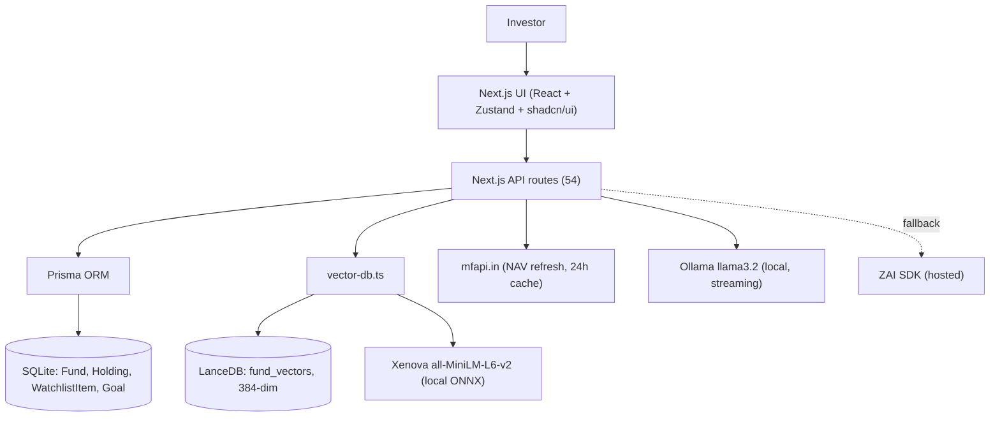
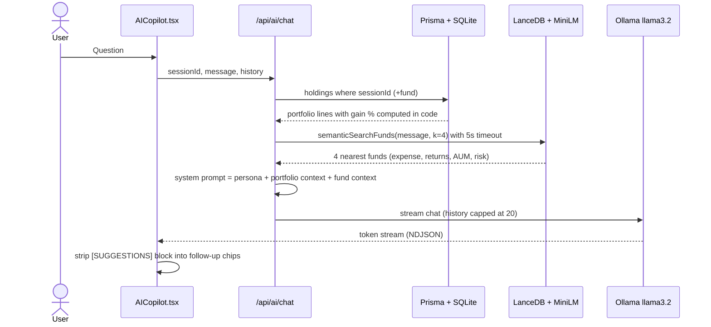
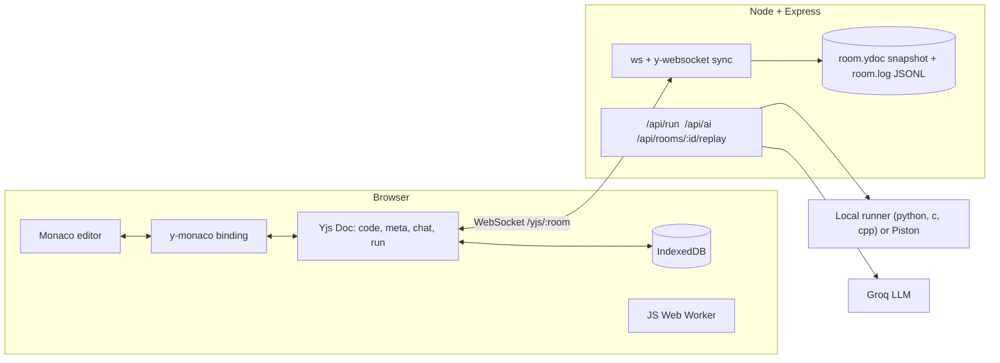
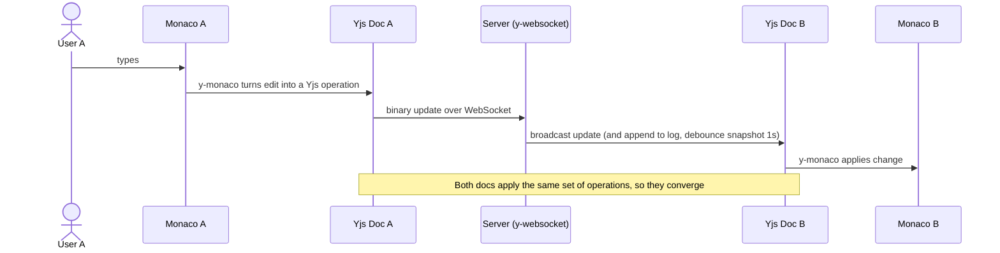
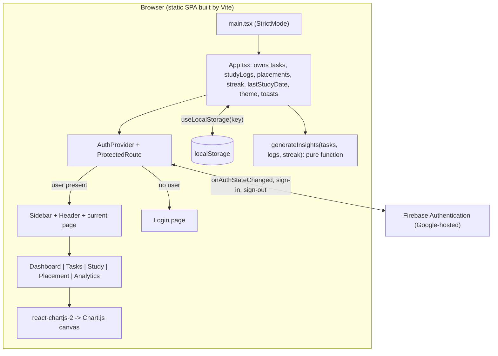
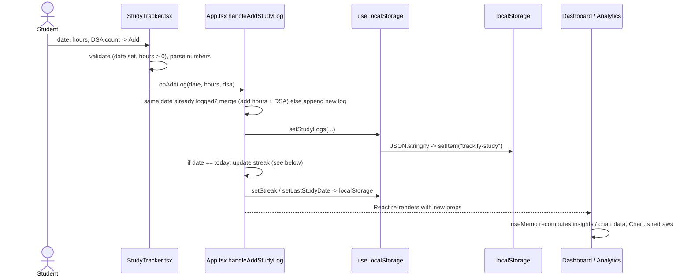
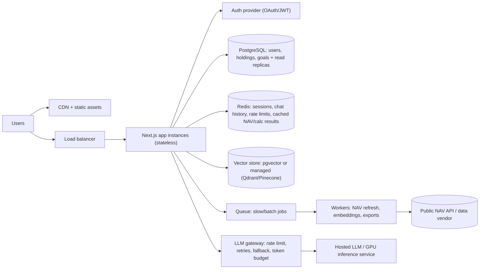
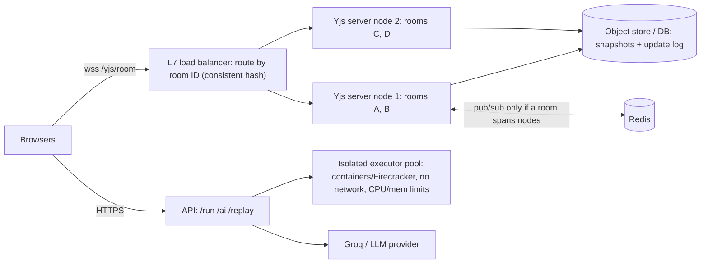
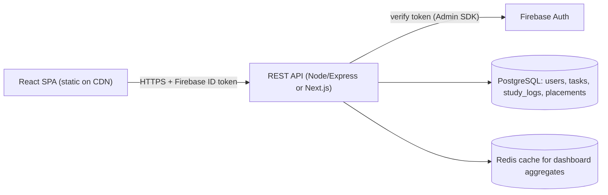

# PROJECT_INTERVIEW_GUIDE.md

**Candidate:** Sonam Narula | **Target:** Capgemini (highest-package profile) | **Version:** code-verified edition

> This version replaces the earlier draft. Instead of guessing from the resume, I **cloned all three repos and read the code**, ran the CodeFusion test-suite and benchmark, and ran the Trackify build. Everything below is tagged by how well it is supported.

---

## 0. How to read this guide

| Tag | Meaning |
|---|---|
| ✅ **Verified** | I saw it in your code, config, tests, or ran it myself. Safe to say confidently. |
| ⚠️ **Gap / risk** | Found while reading the code: a bug, an inconsistency, or a resume claim the code doesn't fully support. Know it before an interviewer finds it. |
| 🎯 **Only you know** | Cannot be learned from the repo (team size, who wrote what, personal stories). Kept to a short list in Section 8. |
| 🚀 **Improvement** | Not built yet. Say "I would…", never "I built…". |
| 💡 **Illustration** | An example for understanding, not a claim about real usage. |

**Golden rule:** speak from the ✅ items. When you hit a ⚠️ item, mention it *yourself* before they do, with the fix. That reads as senior-level honesty.

---

## 1. Verification report

### 1.1 What I inspected

| Repo | Commits | What I did |
|---|---|---|
| **AcornFolio** | 32 (Jul 28 – Aug 7, 2026) | Read Prisma schema, RAG pipeline (`vector-db.ts`, `ai/chat`, `ai/insights`), XIRR, tax, SWP, stress-test, switch-guide, commission, NAV routes, store, config, docs |
| **CodeFusion** | 16 (v1: May 27; v2: Oct 9, 2026) | Read v1 (from git history) **and** v2 (server, client, tests, CI, Docker); **ran 8/8 tests ✅ and the benchmark ✅** |
| **Trackify** | 29 (Apr 1 – Oct 10, 2026) | Read `App.tsx`, hooks, auth, coach, charts, docs; **ran the build** |

### 1.2 Resume claim vs. code (the important table)

| Resume says | What the code shows | Status |
|---|---|---|
| AcornFolio: "50+ API routes" | **54** `route.ts` files under `src/app/api` | ✅ |
| "SIP/SWP, XIRR, tax, exit-load, stress-test calculators" | All exist (`sip/*`, `swp/calculator`, `portfolio/xirr`, `tax/calculate`, exit-load in `ExitLoadCalc.tsx` + `funds/switch-guide`, `portfolio/stress-test`). Also STP, Monte Carlo, overlap, rebalancing, correlation, etc. | ✅ |
| "384-dim embeddings of 71 funds" | `Xenova/all-MiniLM-L6-v2` (384-dim), **71** funds in `prisma/fundSeed.ts` | ✅ |
| "user query + portfolio context → vector search → retrieved context → prompt → LLM" | Vector search uses **only the user message**; portfolio is read separately from SQLite by `sessionId` and injected into the prompt. Close, but the arrow is looser than the code. | ⚠️ minor |
| "figures are never LLM-generated" | True for calculators and dashboards. In the **chat route**, the LLM gets code-computed numbers but nothing technically stops it from doing arithmetic itself (its own prompt even suggests "calculate my exact loss"). | ⚠️ |
| AcornFolio: "Prisma + SQLite" | ✅ 4 models: `Fund`, `Holding`, `WatchlistItem`, `Goal` | ✅ |
| **CodeFusion: "Socket.io", "Monaco → Socket.io → Node/Express → all clients"** | **The current repo contains no Socket.io.** It uses **Yjs (CRDT) + `y-websocket` + `ws`**. Socket.io existed only in v1 (May 2026) and was deleted on Oct 9, 2026. | ⚠️ **major** |
| CodeFusion: "real-time collaborative editor" | ✅ and far more (see Project 2) | ✅ |
| **Trackify: "no backend or API cost", "zero external API dependency"** | Data is in `localStorage` (✅), coach is a pure function (✅), **but the app uses Firebase Authentication** (email/password + Google). No custom backend, no database, but not "no external service". | ⚠️ |
| Trackify: "Deployed live" | URL `trackify.wasmer.app` appears in README/notes. I can't test the live site from here. | ✅ (link in repo) |
| Trackify: "React (TypeScript), Vite, Chart.js" | ✅ via `react-chartjs-2` | ✅ |
| Skills: **Tailwind CSS** | Used in **AcornFolio** (Tailwind v4 + shadcn/ui) ✅. **Not** in Trackify (repo `notes.md` claims Tailwind; `package.json` has none). | ✅ / ⚠️ |
| Skills: **Vercel** | AcornFolio has Vercel-specific build config; CodeFusion v1 had `vercel.json`. No confirmed live Vercel URL in any README. | ⚠️ |
| Skills: **MongoDB** | **Not used in any of the three repos.** | ⚠️ |
| Skills: **GCP** | **Not used in any repo** (you hold the Cloud Computing Foundations certificate). | ⚠️ |
| Skills: **SQL** | Prisma over SQLite; no raw SQL found in AcornFolio. | ⚠️ |

### 1.3 Critical findings (read these first)

1. **CodeFusion resume/GitHub mismatch.** An interviewer who opens your GitHub link will see *Yjs and CRDTs*, not Socket.io. Your resume describes v1. Fix the resume (Section 2) or be ready to explain the v1 → v2 migration (Project 2 has the story). This is the single biggest credibility risk, and also a big opportunity: the v2 is much stronger than what the resume says.
2. **Trackify `npm run build` currently fails.** `src/pages/PlacementTracker.tsx` line 6 has a typo: `widath="16"` instead of `width="16"`. `tsc` rejects it; `vite build` alone succeeds (I verified), and with that one-character fix `tsc` passes. Fix it and push before anyone clones the repo.
3. **Trackify has Firebase Auth**, contradicting "no backend / zero external dependency". Re-word to "no custom backend or database, zero AI/API cost".
4. **Trackify data is not separated per account** (README admits it). Two logins on one browser share the same localStorage keys.
5. **Trackify streak bug (timezone).** `App.tsx` computes "today" with `new Date().toISOString()`, which is **UTC**. In India (UTC+5:30), between 12:00 am and 5:30 am IST "today" is still the previous UTC date, so late-night study logs can break or mis-count a streak. The streak is also a stored counter, not recomputed, so deleting a log doesn't fix it (your own `docs` Part 11 notes this).
6. **AcornFolio Ollama → ZAI fallback is reachable only in one case.** In `ai/chat/route.ts`, if Ollama isn't running, `fetch` **throws** (connection refused) and the code jumps to the generic error message; the ZAI fallback runs only if Ollama *responds with a non-OK status*. So on a server without Ollama (e.g., Vercel), chat shows the error message instead of falling back.
7. **AcornFolio RAG on Vercel degrades silently.** `next.config.ts` excludes LanceDB/transformers from the Vercel bundle; `semanticSearchFunds` catches errors and returns `[]`, so the **keyword fallback in the chat route never fires** (it only triggers on a thrown error/timeout). On Vercel the assistant would answer with no fund context.
8. **AcornFolio `commission` route likely has an arithmetic slip:** `opportunityCost10y` multiplies an *annual* commission by `12` before applying the SIP future-value factor, which treats it as monthly. Verify and fix.
9. **AcornFolio quality flags an interviewer may spot:** `typescript.ignoreBuildErrors: true` in `next.config.ts`; no automated tests; leftover `.zip`, `.DS_Store`, `builder_pack/`, `learning-log-archive/` in the repo; schema comment says expense ratio is in basis points but the data and code treat it as a percent (0.72 = 0.72%).
10. **AI-assisted development is visible.** AcornFolio contains `agent-ctx/` and `worklog*.md` (AI-agent work logs), plus a repo-authored `Interview QA.md` written from the README only. See Section 3 for how to talk about this honestly.
11. **AcornFolio's own `Interview QA.md` disagrees with the code in places.** It says the chat route "attaches calculator outputs like the switch-cost estimate" (it attaches holdings + fund data, not calculator outputs) and implies streaming for both providers (only the Ollama path streams). **Do not memorize that file; use this guide.**
12. **Trackify `notes.md` contains numbers I could not verify or that contradict the repo:** "Lighthouse 94/100", "TTI under 1.2 s", "bundle ≈ 280 KB", "Tailwind CSS". I measured the production JS at **~541 KB raw / ~156 KB gzipped** (Firebase included) and there is no Tailwind. **Never quote those numbers** unless you re-measure.

---

## 2. Suggested resume re-wording (so resume = repo = what you say)

These use only things I verified. Keep or adapt.

**AcornFolio** — *Next.js, TypeScript, Prisma, SQLite, RAG, LanceDB*
- Built a Next.js/TypeScript dashboard that exposes hidden Direct vs Regular mutual-fund plan costs for Indian retail investors, backed by 50+ API routes (SIP/SWP/STP, XIRR, tax, exit-load, overlap, Monte Carlo, stress-test).
- Designed a RAG assistant: `all-MiniLM-L6-v2` embeddings (384-dim) of 71 funds in LanceDB; the chat route retrieves the top matches, adds the user's holdings from Prisma/SQLite, and streams an explanation from a local Ollama (Llama 3.2) model.
- Kept financial math in deterministic server code and used the LLM only to explain results.

**CodeFusion** — *React, Node.js, Express, Yjs (CRDT), Monaco, WebSockets*
- Built a real-time collaborative code editor where concurrent edits merge without overwrites using Yjs CRDTs over WebSockets; added offline editing (IndexedDB), live cursors/presence, and persistent rooms with snapshot + replay log.
- Added shared code execution (browser Web Worker for JS; server/Piston for other languages), a Groq-powered AI assistant, interview mode, and session replay.
- Wrote 8 integration tests (real server + real Yjs clients), CI with GitHub Actions, and Docker deployment; benchmarked ≈21 ms propagation across 10 loopback clients.

**Trackify** — *React (TypeScript), Vite, Chart.js, Firebase Auth*
- Built a student productivity and placement analytics dashboard (tasks, study hours, DSA questions, placement applications) with interactive Chart.js charts and streak tracking.
- Implemented an in-browser pipeline (aggregation, streaks, completion rates) on localStorage and a rule-based coaching engine (pure function, no AI API), plus Firebase email/Google authentication; deployed live.

**Skills section:** only keep MongoDB, GCP, SQL, Vercel if you can answer the questions in Section 6.4. Otherwise move them to "Familiar with / coursework".

---

## 3. How to talk about "AI-assisted development" (they may ask)

The repo's `agent-ctx/` and worklogs make it obvious AcornFolio used AI coding agents. Interviewers increasingly ask. A strong, honest answer:

> "Yes, I used AI coding agents to speed up scaffolding, like repetitive API routes and UI components. What I owned was the product idea, the architecture, and the key decision to keep calculations deterministic and use the LLM only for explanation. I reviewed the generated code, and I can walk through any module, for example the XIRR solver or the RAG route, line by line."

**Only say this if it is true for you** (🎯 see Section 8, question 2). Then **actually prepare to walk through** the modules in this guide: XIRR (Newton-Raphson with bisection fallback), `vector-db.ts`, the chat route, and the tax route. If you can explain those without notes, the "AI wrote it" concern disappears.

---

## 4. Pre-interview fix list (small, high-impact)

| # | Fix | Effort |
|---|---|---|
| 1 | Trackify: `widath` → `width` in `PlacementTracker.tsx` line 6; confirm `npm run build` passes | 1 min |
| 2 | Trackify: compute "today" with local date (not `toISOString()`) for streaks | 10 min |
| 3 | Resume: update CodeFusion bullets (Yjs), Trackify bullets (Firebase Auth) | 15 min |
| 4 | AcornFolio: move the `catch` so a failed Ollama `fetch` falls back to ZAI | 10 min |
| 5 | AcornFolio: fix `opportunityCost10y` (×12) or explain the intent | 10 min |
| 6 | AcornFolio: remove `.DS_Store`, the `.zip`, and `builder_pack/` from the repo; add a `.gitignore` entry | 10 min |
| 7 | CodeFusion: README says port 5050; Dockerfile uses 5000. Align them | 2 min |
| 8 | CodeFusion: `vercel.json` is a v1 leftover (client-only); remove or document that the backend needs a Docker host | 5 min |
| 9 | Add a "Live demo" or screen recording link for AcornFolio and CodeFusion (only Trackify has a URL) | 30 min |
| 10 | Add 3–5 unit tests for XIRR/SIP (compare with Excel's `XIRR`) and Trackify streak logic | 1–2 h |

---


# PROJECT 1: AcornFolio

## 1.1 At a glance

| Item | Details (all ✅ verified in repo unless tagged) |
|---|---|
| **What** | Next.js 16 / React 19 / TypeScript mutual-fund dashboard + AI Co-Pilot for Indian retail investors |
| **Purpose** | Show hidden **Direct vs Regular** plan costs (expense ratio, tax, exit load) in one place and explain them |
| **Origin** | README: built "for a hackathon/demo setting". The repo contains the **"Hack to the Future" Builder Pack** (fintech hackathon data/eval sets, May 2026). 🎯 Section 8, Q1 (solo or team?) |
| **Size** | 54 API route files, ~50 feature components, 4 Prisma models, 71 seeded funds |
| **Stack** | Next.js (App Router), TypeScript, Tailwind v4 + shadcn/ui (Radix), Zustand, Recharts, Framer Motion, Prisma + SQLite, LanceDB, `@xenova/transformers`, Ollama (Llama 3.2) with ZAI SDK fallback |
| **Live link** | None in the README (⚠️ add a demo video/link) |

### 30-second introduction

> "AcornFolio is a Next.js and TypeScript dashboard for Indian retail investors who often don't realise a Regular mutual fund plan costs more than the Direct plan of the same fund. It has over fifty API routes for calculators like SIP, SWP, XIRR, tax, exit load and stress tests, and an AI co-pilot built as a RAG pipeline: it retrieves relevant funds from a LanceDB vector index of 71 funds, adds the user's holdings, and a local LLM explains the result. My key design decision was to keep the financial math in deterministic code and use the LLM only for explanation."

### 2-minute explanation

> "In India every mutual fund has a Direct plan and a Regular plan. Same portfolio, same fund manager, but the Regular plan pays a distributor commission through a higher expense ratio. Over many years of compounding, that gap becomes lakhs of rupees, and on top of that switching has tax and exit-load consequences. Most investors never see those numbers together.
>
> AcornFolio puts them in one dashboard. It's a Next.js app with more than fifty API routes. They power calculators like SIP, SWP, STP, XIRR, capital-gains tax, exit load, stress tests and Monte Carlo, plus analysis like portfolio overlap, sector exposure and rebalancing. Fund and holdings data live in SQLite through Prisma. Holdings are tied to a session ID, so there's no login in the demo.
>
> On top, there's an AI Co-Pilot. I embed 71 funds with the all-MiniLM-L6-v2 model, which gives 384-dimension vectors, and store them in LanceDB. When the user asks something, the chat route embeds the question, retrieves the top four matching funds, reads the user's holdings from SQLite, builds a system prompt with both, and streams the answer from a local Ollama Llama 3.2 model.
>
> The principle I'm proudest of is separation of responsibility: calculators are plain code and are testable; the LLM explains, it doesn't compute. In finance a wrong number is worse than an awkward sentence."

### Analogy

**An accountant and a translator.** The accountant (deterministic code) does every calculation on a calculator and prints the result. The translator (LLM) sits beside them with the fund factsheet open and explains the printout in simple words. The translator isn't supposed to do sums in their head.

---

## 1.2 Problem and solution

**Problem.** A Regular plan has a higher yearly fee than the Direct plan of the same fund because it includes commission for the distributor. The difference looks small (often a fraction of a percent to around a percent a year) but compounds. Switching isn't free: capital-gains tax and exit load may apply. First-time investors usually see none of this.

**Who:** Indian retail investors who bought via an agent or app and don't know their plan type.

**How AcornFolio helps (💡 illustration, not real usage):** The user adds a holding (fund, plan type, invested/current amount, purchase date). The dashboard shows the cost gap, the **switch guide** estimates tax and exit load, **XIRR** shows true returns for SIP-style cash flows, **stress test** shows downside, and the co-pilot answers questions like "Why am I losing money in this fund?".

**Can do (✅):** Direct vs Regular comparison and commission disclosure; calculators (SIP, step-up SIP, lumpsum, SWP, STP, XIRR, tax, ELSS, inflation, emergency fund, FD vs MF); portfolio analytics (overlap, correlation, diversification, sector exposure, rebalancing, Monte Carlo, stress test, alerts, export); watchlist, goals, risk profiler; AI chat and per-fund AI insights.

**Cannot / limits (say these proactively):**
- **Data:** funds are **seeded sample data** (71). NAV can be refreshed from the public `mfapi.in` API (24-hour in-memory cache), and NAV history **falls back to a simulated series** if that fails. So don't call it "live market data".
- **Not financial advice** (README disclaimer); no SEBI registration claim.
- **No authentication:** holdings are tied to a client-generated session ID (`sessionStorage`), so they're lost when the tab session ends and aren't portable across devices. (`next-auth` is in `package.json` but unused.)
- **Stress-test scenarios are hard-coded percentage shocks per asset class**, not derived from historical data.
- Tax logic encodes **Budget 2024** rates; re-verify against current rules before demoing, since they change.

---

## 1.3 Architecture and end-to-end flow



### Chat (RAG) sequence — exactly as the code runs



### Step-by-step with an example (💡)

1. User types *"Why is my HDFC fund a problem?"*.
2. `AICopilot.tsx` posts `{sessionId, message, history}` to `/api/ai/chat`.
3. `getAugmentedContext` reads that session's holdings from SQLite and formats lines like "fund (plan): Invested ₹…, Current ₹…, Gain: x%". **The gain % is computed in code.**
4. `semanticSearchFunds` embeds the **message only** (mean-pooled, normalised, 384-dim), runs `vectorSearch(...).limit(4)`, and returns each hit's expense ratios, returns, AUM and risk from a JSON `details` column.
5. The route races the search against a **5-second timeout**; on a thrown error it tries a keyword `LIKE` fallback.
6. The system prompt = persona + `[USER PORTFOLIO CONTEXT]` + `[FUND CONTEXT]`. Conversation is stored in an in-memory `Map` keyed by session (24 h TTL, 20 messages max).
7. The request goes to local **Ollama (`llama3.2:latest`)** and streams back; the UI parses the stream and splits the `[SUGGESTIONS]…[/SUGGESTIONS]` block into follow-up buttons.

**Embeddings in plain words:** a model turns text into 384 numbers so that similar meaning ⇒ nearby vectors. Vector search returns the nearest vectors. Here the embedded text per fund is `schemeName + fundHouse + category + subCategory + riskometer`, so retrieval finds *which funds the question is about*; the numbers (expense, returns) are then read from the stored JSON.

---

## 1.4 Complete tech stack (verified usage)

### Next.js 16 (App Router) + React 19 + TypeScript
- **Role:** UI and all 54 API route handlers in one codebase.
- **Why:** One deployable, shared types between UI and API, file-based routing makes 50+ endpoints easy to organise.
- **Alternatives:** React + Express (clean split, two deployments), NestJS (structure for large backends), Python FastAPI (if ML-heavy).
- **Trade-offs:** Can't scale API independently; serverless limits hurt native ML packages (you hit this: Vercel's 250 MB function limit forced you to exclude LanceDB/transformers ✅ `next.config.ts`).
- **Follow-ups:** Server vs Client Components? Why `output: "standalone"`? (self-hosting/Docker-like deploys). What does `ignoreBuildErrors: true` risk?

### Prisma + SQLite
- **Role:** ORM + file database for funds, holdings, watchlist, goals.
- **Why:** Zero setup, typed queries, `db:push`/seed scripts (`prisma/seed.ts` loads 71 funds from `fundSeed.ts`).
- **Alternatives:** PostgreSQL (concurrency, hosted), MongoDB (not needed: data is relational), Drizzle/raw SQL.
- **Trade-offs:** Single-writer; file on disk doesn't persist on serverless; `Fund` row is wide (≈40 columns) and `topHoldings` is JSON-in-a-string.
- **Relations:** `Holding → Fund`, `WatchlistItem → Fund` (cascade delete), `Goal` standalone; `@@index([sessionId])`, `@@unique([sessionId, fundId])` on watchlist.
- **Follow-ups:** Why store holdings by `sessionId`? Migration path to Postgres (`provider` switch + hosted URL)? Why `@@unique` on watchlist?

### RAG
- **Role:** Ground the LLM in your fund data and the user's holdings.
- **Why:** Reduces hallucinated fund facts; update data without retraining.
- **Alternatives:** Fine-tuning (stale, costly), plain prompting (hallucination), SQL-only lookup (exact but not semantic), tool-calling to the calculators (best next step).
- **Trade-offs:** Retrieval quality limits answer quality; only **top-4** funds; embeddings are built from names/categories, not cost data.

### LanceDB (vector DB) + `@xenova/transformers` (all-MiniLM-L6-v2)
- **Role:** Embedded vector store (`data/lancedb/fund_vectors.lance`) + local embedding model running in Node via ONNX.
- **Why:** No external service/API cost; privacy; simple local dev.
- **Alternatives:** pgvector (keep everything in Postgres), Pinecone/Qdrant (managed scale), FAISS, or even brute-force cosine for 71 vectors.
- **Trade-offs:** Large native deps (bundle limit on Vercel), model download/cold start, needs writable disk.
- **Distance metric:** LanceDB's default is L2; with normalised vectors (you pass `normalize: true`) L2 ranking equals cosine ranking. *(Confirm in LanceDB docs if asked for specifics.)*
- **Code facts:** lazy dynamic imports so routes still load without the packages; `syncFundsToVectorDB` creates the table if missing (it calls `table.add` if the table already exists, so re-running would **duplicate rows**: ⚠️ guard or overwrite).
- **Follow-ups:** Why not cosine explicitly? How to evaluate retrieval? What if a fund isn't in the 71?

### LLM layer: Ollama `llama3.2` (primary) and ZAI SDK (fallback)
- **Role:** Streaming chat (Ollama) and non-streaming per-fund insights (`ai/insights` uses ZAI with a template fallback, so insights work even if the LLM fails).
- **Why Ollama:** free, private (portfolio data stays local), works offline for demos.
- **Trade-offs:** requires a local machine running Ollama; not deployable on Vercel; the fallback has the ⚠️ reachability bug (Section 1.3 finding 6).

### Zustand, Recharts, shadcn/ui + Radix, Tailwind v4, Framer Motion
- **Zustand** holds funds/holdings/session in `src/lib/store.ts` (less boilerplate than Redux). **Recharts** draws charts. **shadcn/ui** gives owned, customisable components on Radix primitives. **Tailwind** for styling. **Framer Motion** for animation (be ready to name where you used it: 🎯).

### mfapi.in (public AMFI-based NAV API)
- **Role:** NAV refresh/history routes; 24 h in-memory cache; **simulated fallback** for NAV history. ⚠️ README roadmap says "Live AMFI NAV sync" is *future*, but the code already calls it. Describe it as "NAV refresh from a public API, seed data otherwise".

### Not used (don't claim): MongoDB, GCP, next-auth (installed, unused), Redis.

---

## 1.5 Implementation deep dive

### Modules (with file anchors)

| Module | Where | What it does |
|---|---|---|
| RAG core | `src/lib/vector-db.ts` | Lazy-loads embedder + LanceDB; `syncFundsToVectorDB`, `semanticSearchFunds` (returns `[]` on error) |
| Chat route | `src/app/api/ai/chat/route.ts` | Context assembly, 5 s retrieval timeout, keyword fallback, in-memory conversation store, Ollama streaming |
| Insights route | `ai/insights/route.ts` | **Best "code computes, LLM explains" example**: it computes `expenseDiff` and `returnDiff` in code, puts them in the prompt, and has a deterministic fallback paragraph if the LLM fails |
| XIRR | `portfolio/xirr/route.ts` | Builds cash flows (lumpsum, or initial + monthly SIPs from purchase date to today, then the current value as final inflow), solves with **Newton-Raphson (≤50 iterations, tol 1e-8) then bisection fallback (≤100 iterations, range −0.9999…100)**, adds a warning when the holding period is under 30 days and the XIRR comes out above 100% |
| Tax | `tax/calculate/route.ts` | Equity: >365 days LTCG at 12.5% (₹1.25 L exemption), else STCG 20%; debt at slab (default 30%); hybrids split 65/35; category parsed from strings |
| SWP | `swp/calculator/route.ts` | Monthly loop: add return, subtract withdrawal, record yearly breakdown, detect depletion year |
| Stress test | `portfolio/stress-test/route.ts` | 5 scenarios (2008, COVID, mild correction, rate hike, bull run) × (equity/debt/hybrid) fixed % impacts applied to each holding |
| Switch guide | `funds/switch-guide/route.ts` | Expense saving, 10-year reinvested saving (assumes 12%), tax on switch, regex-parsed exit-load string |
| Commission | `funds/commission/route.ts` | Per-fund commission bps, annual commission on ₹1 L–₹1 Cr, 10/20/30-year compounding cost (⚠️ ×12 slip, Section 1.3) |
| NAV | `funds/nav`, `nav-history`, `sip/*-returns` | mfapi.in fetch + 24 h cache (+ simulated fallback for history) |
| State | `src/lib/store.ts` | Zustand; `sessionId = session-<Date.now()>-<Math.random()>` in `sessionStorage` |

### XIRR in plain words (be able to whiteboard it)
XIRR finds the rate *r* where the **net present value** of all dated cash flows is zero: `Σ amountᵢ / (1+r)^(daysᵢ/365.25) = 0`. No closed form exists, so solve numerically. **Newton-Raphson** iterates `r ← r − f(r)/f′(r)` (fast, but can diverge or hit a flat derivative). **Bisection** halves a bracket where the sign changes (slow but safe). Your code tries Newton first and falls back to bisection. Edge: if all cash flows have the same sign there's no root and the result is meaningless; ⚠️ the route doesn't explicitly validate that.

### Data model summary
`Fund` (Direct and Regular ISIN/NAV/expense/returns, AUM, exit-load string, benchmark, Sharpe, tracking error, `topHoldings` JSON) · `Holding` (sessionId, fundId, planType, units, invested, current, purchaseDate, sipAmount) · `WatchlistItem` · `Goal`.

### Edge cases, failure modes, security, performance

| Area | Finding | How to say it |
|---|---|---|
| Streaming parse | Chat splits each network chunk by `\n` and `JSON.parse`s each line; a JSON line split across chunks would throw | "Needs a buffer for partial lines." |
| Session ID | `Date.now()+Math.random()` (not cryptographically random) held in `sessionStorage`; anyone who guesses it can read that session's holdings via API | "Fine for a demo; production needs auth and `crypto.randomUUID`." |
| Prompt injection | User text goes straight into the conversation; persona rules live in the same system message | "Worst case is bad wording, since numbers come from code, but I'd add input filtering and keep calculators out of the LLM's reach." |
| Conversation store | In-memory `Map`: lost on restart, not shared across instances | "Move to Redis/DB." |
| Rate limiting / auth | None on 54 routes; LLM calls cost compute | "Add rate limits + auth." |
| Data freshness | Seeded data; NAV refresh optional | "Be explicit that it's sample data." |
| Validation | Calculators validate positives (e.g., SWP); `zod` is installed but I didn't see systematic use | "Add schema validation per route." |
| Tests | None | "Calculators are the first thing I'd test." |
| Persona | System prompt forces "Sir" and an aggressive tone ("financial emergency"); fallback message says "bhai". Inconsistent and not ideal for a regulated domain | "I'd neutralise tone and add disclaimers in the response." |

### Implemented vs. improvements

| ✅ Built | 🚀 Next |
|---|---|
| 54 routes, calculators, analytics | Unit tests vs Excel `XIRR` and known tax cases |
| RAG with local embeddings + LanceDB | Evaluate retrieval (hit-rate on a question set); embed richer text; hybrid search |
| Streaming local LLM + hosted fallback | Fix fallback reachability; tool-calling so the LLM *calls* calculators instead of doing arithmetic |
| Session-based holdings | Auth, Postgres, hosted vector DB for deployment |
| Seed + mfapi NAV refresh | Scheduled data-refresh job; CAS (statement) import |

---

## 1.6 My contribution (verified facts you can build on)

- Git author on all commits is **Sonam Narula** (also under the handle `sonamnarula`). Nothing in the repo names teammates. 🎯 Confirm solo vs team (Section 8, Q1) and which parts AI agents scaffolded (Q2).
- The commit history shows the app was **imported in one commit** (`feat: Import AcornFolio project…`, Aug 7) into a repo that also holds Python learning logs. So history won't show incremental development; if asked, say it was developed locally/in a hackathon workspace and consolidated.

**"What exactly did you build?" (template; fill the 🎯 bits)**
> "I designed AcornFolio's architecture and the key rule that all financial maths is deterministic code. The app has [54] API routes for calculators and analytics. I built the RAG pipeline: embedding 71 funds with MiniLM into LanceDB, the retrieval function with a timeout and keyword fallback, and the chat route that assembles portfolio and fund context before calling the LLM. I also [built / worked on]: [the XIRR solver / tax logic / dashboard UI]. [I used AI coding agents for repetitive route and component scaffolding and reviewed the output.]"

**"What was challenging?"** (pick one that's true for you; real candidates found in the code)
> "Deploying to Vercel. LanceDB and the transformers runtime are heavy native packages that exceeded the 250 MB function limit, so I made them lazy imports, excluded them from the Vercel trace, and made the RAG path degrade gracefully." *(✅ this is literally in `next.config.ts` and `vector-db.ts` comments.)*
> Or: "Making XIRR robust. Newton-Raphson alone diverges on some cash flows, so I added a bisection fallback and a warning for very short holding periods." *(✅ in code.)*

---

## 1.7 Interview Q&A: AcornFolio

### Basic

**Q1. Explain AcornFolio.** → 30-second intro. *Cross: "Who is it NOT for?"* → "Someone already in Direct plans, or with a tiny portfolio where the rupee gap doesn't justify switching effort."

**Q2. Direct vs Regular?**
> "Same portfolio and manager. Regular includes distributor commission inside the expense ratio, so it's costlier every year, and that compounds."
*Cross: "Why not always switch?"* → "Switching is a redemption: it can trigger capital-gains tax and exit load, and you lose advisory support. That's what the switch guide estimates."

**Q3. What is RAG and why use it?**
> "Retrieve relevant data first, then give it to the LLM with the question so the answer is grounded in real data instead of the model's memory."
*Cross: "RAG vs fine-tuning?"* → "RAG updates by changing data, not weights; fine-tuning bakes in knowledge that goes stale."

**Q4. What is an embedding?** → "A vector of numbers representing meaning; similar texts are close. Mine are 384-dimensional from all-MiniLM-L6-v2."

**Q5. SIP vs SWP vs STP vs XIRR?** → SIP invest regularly; SWP withdraw regularly; STP transfer regularly between funds; XIRR annualised return for irregular dated cash flows. *Cross: "Why not CAGR for a SIP?"* → "CAGR assumes one investment and one withdrawal; SIP has many dated cash flows."

### Core (design and code)

**Q6. Walk me through a chat request.** → Use the sequence diagram. *Cross 1: "Where do portfolio numbers come from?"* → "SQLite via Prisma, and the gain % is computed in code before it enters the prompt." *Cross 2: "What if LanceDB is slow?"* → "A 5-second `Promise.race` timeout, then a keyword search fallback." *Cross 3 (trap): "What if the vector search returns nothing?"* → "`semanticSearchFunds` returns an empty array on error, so the keyword fallback wouldn't trigger there. That's a gap; I'd treat an empty result as a fallback trigger too."

**Q7. "Figures are never LLM-generated". Prove it.**
> "For the dashboard and calculators, every number comes from route handlers. The per-fund insights route is the clearest example: it computes the expense and return differences in code, passes them into the prompt, and has a deterministic fallback paragraph if the LLM fails. In the free-form chat, the LLM receives code-computed numbers, but I haven't technically prevented it from doing its own arithmetic. The robust fix is tool-calling, so the model asks my calculators for results."
*(This is the honest, strong answer; it shows you understand the real boundary.)*

**Q8. Why LanceDB for 71 funds?**
> "Honestly 71 vectors could be brute-forced. I chose an embedded vector DB for zero infrastructure and to prove the architecture that scales to many more funds. At thousands of funds I'd use approximate indexing, or pgvector to keep data next to Postgres."
*Cross: "Which distance metric?"* → "Default L2; with normalised vectors it ranks the same as cosine."

**Q9. Why a local LLM (Ollama)?** → "Free, private (portfolio stays on the machine), works offline. Trade-off: it needs a machine running Ollama, so it can't run on a serverless host; that's why there's a hosted fallback." *Cross (trap): "Does the fallback work when Ollama is off?"* → "Not currently: a refused connection throws into the catch block. I'd restructure the try/catch so that failure triggers the fallback."

**Q10. Explain your XIRR implementation.** → Section 1.5 whiteboard. *Cross: "When does it fail?"* → "No sign change in cash flows, or very short durations that give absurd rates; I add a warning when the period is under 30 days and XIRR exceeds 100%. I'd add validation and tests against Excel."

**Q11. Walk me through the tax logic.**
> "Equity-oriented funds: held over a year is LTCG at 12.5% above a ₹1.25 lakh exemption, otherwise STCG at 20%. Debt funds are taxed at the user's slab rate. Hybrids are split 65/35 by category string. These are Budget-2024 rules encoded as constants, so I'd re-verify them against current law."
*Cross: "Is the category string matching robust?"* → "No, it's substring matching on category names; a mapped enum from the fund record would be safer."

**Q12. What does the stress test do?** → "Five fixed scenarios with percentage shocks per asset class applied to each holding's current value. It's a simple what-if, not a historical simulation." *Cross: "Where do the percentages come from?"* → "They're my assumptions; to defend them I'd calibrate against historical index drawdowns."

**Q13. Why Prisma + SQLite? What breaks in production?** → "Zero setup for a demo. In production: single-writer lock, and on serverless the file isn't persisted. I'd move to Postgres (change provider + URL) and use a managed vector store." *Cross: "Is switching mostly a config change?"* → "Mostly, but JSON-in-string columns and any SQLite-specific behaviour need review."

**Q14. How is a user identified without login?** → "A client-generated session ID in `sessionStorage`, sent with each API call; holdings are keyed by it." *Cross: "Security?"* → "Guessable-ish ID and no auth means anyone with the ID can read that session; fine for a demo, not for real data."

### Advanced / system design

**Q15. Scale to 100k users?** → "Auth + Postgres; Redis for conversation state and caching; hosted vector DB or pgvector; rate limiting; queue/stream LLM calls; split heavy analytics into background jobs; CDN for the frontend."

**Q16. How would you evaluate the assistant?** → "Build a golden set of questions with expected funds and facts; measure retrieval hit-rate and check answers use only provided numbers; track hallucination rate; add regression tests on prompts."

**Q17. How do you secure the AI endpoint?** → "Auth, rate limits, input length limits, never include secrets in prompts, output filtering, and keep calculators outside LLM control."

**Q18. How would you make retrieval better?** → "Embed richer text (cost and holdings), hybrid keyword + vector search, re-ranking, and use the user's holdings to bias results."

**Q19. Trade-off of the "Sir" persona?** → "It's a product decision that hurts trust in a financial tool. I'd use a neutral, calm tone and add an explicit disclaimer."

### Behavioural / ownership

**Q20. "Did you write this yourself or did AI?"** → Section 3 answer. *Cross: "Show me the XIRR solver."* → be ready to explain it line by line.

**Q21. "No tests, TypeScript errors ignored in the build — why?"** → "This was a hackathon-pace build. `ignoreBuildErrors` unblocked deployment, and I know it hides real problems. Next I'd remove it, fix the errors, and add unit tests for XIRR, tax and SIP first because they're highest-stakes."

**Q22. "Hardest bug?"** → Vercel bundle size / graceful degradation, or XIRR convergence (both ✅ real).

**Q23. "What would you do differently?"** → "Auth from day one, tests for the calculators, and wiring the LLM to the calculators via tool-calling."

---

## 1.8 Credibility check: AcornFolio

| Resume claim | Likely challenge | Evidence you now have |
|---|---|---|
| "50+ API routes" | "Are they real?" | 54 route files; by group: funds 22, portfolio 12, sip 5, ai 2, tax 2, goals 2, holdings 2, watchlist 2, risk/savings/stp/swp 1 each, plus the root route |
| "71 funds, 384-dim" | "Data source? Model?" | `fundSeed.ts` (71), all-MiniLM-L6-v2. Source of the numbers: seeded sample data (🎯 say where you got them) |
| "Hidden costs visible in one place" | "Measured impact?" | None. Say "design goal; demoable" |
| "LLM only explains" | "Show me" | `ai/insights` route; be honest about chat |
| RAG diagram | "Does portfolio go through vector search?" | No: only the query is embedded; portfolio is read from SQLite |

---


# PROJECT 2: CodeFusion

## 2.1 At a glance

| Item | Details |
|---|---|
| **What** | Real-time collaborative code editor: multiple people edit one file live, run code, chat, ask an AI, and replay the session |
| **Versions** | **v1 (May 27, 2026):** Socket.io + full-text relay (what your resume describes). **v2 (Oct 9, 2026, current repo):** rewritten on **Yjs CRDT + y-websocket**. ✅ both verified via git history |
| **Stack (v2)** | React 18, Vite, React Router, Monaco (`@monaco-editor/react`, `y-monaco`), Yjs, `y-websocket`, `y-indexeddb`, Node.js, Express, `ws`, `express-rate-limit`, Groq API, Piston (optional), Docker, GitHub Actions, Node test runner |
| **Size** | ≈1,500 lines of JS across client + server + tests |
| **Verified by me** | `npm test` → **8/8 pass**; `npm run bench` → **p50 20.6 ms, p95 21.1 ms** (10 clients, loopback, polling granularity ≈20 ms) |
| **Live link** | None in README (⚠️ add one, or a demo GIF) |

### The v1 → v2 story (your best talking point)

> "My first version used Socket.io and sent the whole document on every keystroke. It worked with one person typing, but when two people edited at once, the last message won and someone's work vanished, and a reconnect could lose edits. So I rewrote the sync layer with Yjs, a CRDT library. Now every edit is a small mergeable operation, so concurrent edits converge, offline edits merge on reconnect, and I could build presence, replay and persistence on top of the same document."

*(v1 evidence: `server/index.js` had `socket.on("code-change")` → `updateCode(roomId, code)` → `socket.to(roomId).emit("code-update", {code})`, i.e. full-text relay, in-memory `Map` rooms, and a simulated "Run" that only printed a placeholder. ✅)*

### 30-second introduction

> "CodeFusion is a real-time collaborative code editor built with React, Monaco, Node and Express. Instead of sending whole documents, it uses Yjs CRDTs over WebSockets, so concurrent edits from any number of people merge without overwriting each other, even across disconnects. On top of that I built live cursors, shared code execution, an AI assistant, interview mode, persistent rooms and session replay, with integration tests, CI and Docker."

### 2-minute explanation

> "The problem is that the usual tutorial recipe for a collaborative editor is Socket.io plus a text-change event. That works for one typist, but when two people edit the same line the last message wins and the other edit is lost.
>
> CodeFusion treats the document as a CRDT. Each room has one Yjs document containing the code as a shared text, a metadata map for language, host and lock state, a shared array for chat, and a map for the latest run result. The browser's Monaco editor is bound to the shared text through y-monaco. Updates travel over a WebSocket to a small Node server that uses y-websocket's sync logic, so every client converges to the same text. Edits made offline are kept in IndexedDB and merge when you reconnect.
>
> The server also persists each room as a snapshot file plus an append-only log of timestamped updates, which powers a replay slider that rebuilds the document step by step. JavaScript runs in a Web Worker in the browser with a five-second limit; other languages go through a backend runner or an optional Piston server. An AI assistant on Groq can explain, review, fix or write tests, and replies appear in the shared chat.
>
> I tested it with eight integration tests using a real server and real Yjs clients, set up CI on GitHub Actions, and containerised it with Docker."

### Analogy

**A Google Doc, but for code.** Everyone writes on the same page at once; the system keeps a smart "merge notebook" of every small change so that no one's writing is lost, even if their internet drops for a minute.

---

## 2.2 Problem and solution

**Problem.** Remote pair programming, mock interviews and debugging sessions end up as pasted snippets and mismatched versions. Naive real-time editors overwrite concurrent edits.

**Solution (✅ per code):**
- **Conflict-free sync** (Yjs CRDT), no locks, no overwrites
- **Offline-first** (`y-indexeddb`): edits made offline merge on reconnect
- **Presence:** named, coloured cursors/selections, typing indicator, participant list; **Follow mode**
- **Shared execution:** JS in a Web Worker (5 s, killed); Python/C/C++ via local runner; Java/Go/Rust/TypeScript via Piston; the result is stored in the shared doc so everyone sees the same output
- **AI pair programmer** (Groq): Explain / Review / Fix / Write tests / `/ai <question>`
- **Interview mode:** host can lock editing (view-only for others) and start a shared countdown
- **Persistent rooms** (snapshot) and **session replay** (timestamped update log)
- **Quality:** 8 integration tests, GitHub Actions CI, multi-stage Dockerfile, rate limits, room-ID validation

**Limits (README's own list + my findings):**
- One file per room; no accounts, so room access = knowing the link.
- AI replies aren't streamed.
- Replay log capped at **20,000 events/room**.
- ⚠️ **The "lock" is enforced in the client only** (`readOnly = locked && !isHost`). Host and lock live in the shared `meta` map, which any client with a raw WebSocket could modify. It's a UX guard, not a security boundary.
- ⚠️ **Local code execution is not a sandbox** (README says so). Default: enabled in dev, disabled in production.
- ⚠️ **Single Node process:** y-websocket keeps live documents in that process's memory. Running multiple server instances behind a load balancer would need a different provider/sync layer, since a room must live on one instance.

---

## 2.3 Architecture and end-to-end flow



### Typing sequence



### Shared Run flow (nice detail)

1. A presses **Run** (or Ctrl/Cmd+Enter).
2. If JavaScript → `runJS` in a Web Worker (5 s timeout, `worker.terminate()`); else `POST /api/run` (rate-limited 20/min/IP).
3. The running client writes `{stdout, stderr, code, by, lang, ms, ts}` into the shared `run` Y.Map.
4. Everyone's UI observes `run` and shows the same output. Late joiners get it for free.

### AI flow

Client calls `POST /api/ai` with `{mode, code, language, prompt, output}`; the server builds a task-specific prompt (code truncated to 12,000 chars, last output to 2,000), calls Groq (`llama-3.3-70b-versatile`, temperature 0.2, max 1,200 tokens), returns `{text}`; the **asking client** pushes the reply into the shared chat array. An `aiBusy` flag in `meta` (60 s staleness) stops two people triggering the AI simultaneously.

### Persistence and replay

Per room: `<room>.ydoc` = compacted snapshot (debounced to 1 write/second; loaded when the first user joins) and `<room>.log` = append-only JSONL `{t: timestamp, u: base64 update}`. Replay: the client downloads events, applies them to a fresh `Y.Doc` up to the slider position (incrementally forward; rebuild when scrubbing backward).

---

## 2.4 Complete tech stack

### Yjs (CRDT)
- **Role:** shared data types (`Y.Text`, `Y.Map`, `Y.Array`) that merge concurrent edits automatically.
- **CRDT in plain words:** every character/operation gets a unique identity and position relative to its neighbours, so operations can be applied in *any order* and every replica ends up with the same text. No central "referee" needed.
- **Why:** correct concurrent editing, offline merge, small binary updates, mature ecosystem (`y-monaco`, `y-websocket`, `y-indexeddb`).
- **Alternatives:** **OT (Operational Transformation)**: used by Google Docs, needs a central server to order/transform ops, notoriously hard to implement; **Automerge** (CRDT, heavier); Socket.io last-write-wins (what v1 did); managed services (Liveblocks, Firebase).
- **Trade-offs:** metadata growth (tombstones) in long-lived docs; learning curve; debugging binary updates.
- **Follow-ups:** CRDT vs OT? What is a state vector? How does Yjs handle two users typing at the same index? What is awareness?

### y-websocket (+ `ws`)
- **Role:** sync protocol and server utilities. Your server calls `setupWSConnection(ws, req, {docName: room})` on upgrade requests to `/yjs/:room`; `ws` is the WebSocket server (`noServer: true`, `maxPayload` 1 MB).
- **Why:** battle-tested sync + awareness protocol.
- **Trade-offs:** in-process doc map (single instance); persistence hooks are yours to implement (you did: `setPersistence`).
- ⚠️ **Known quirk:** the bench prints "Yjs was already imported" (two copies of Yjs). You handled it in `persistence.js` by using the same CommonJS instance via `createRequire`, but the warning still appears in the benchmark.

### y-monaco / Monaco Editor
- **Role:** `MonacoBinding(ytext, model, editors, awareness)` keeps the editor model and Yjs text in sync and renders remote cursors; you added custom CSS per remote client ID (names/colours sanitised via `safeName`/`safeColor` regexes to avoid CSS injection ✅).
- **Why Monaco:** VS Code's editor: syntax highlighting, themes, keybindings (`Ctrl/Cmd+Enter` → run). Bundled locally (no CDN).
- **Alternatives:** CodeMirror 6 (lighter, mobile-friendly, also Yjs-bindable).
- **Trade-off:** big bundle, weak on mobile.

### y-indexeddb
- **Role:** stores a local copy of the Yjs doc in the browser (`cf-<room>`), so refreshes and offline edits survive and merge later.

### React 18, Vite, React Router
- **Role:** UI (Home, Room pages), hooks (`useCollab`, `usePeers`, `useYObserve`), dev server/build.
- **Pattern worth explaining:** `useYObserve(ytype)` re-renders when a shared type changes; refs (`runRef`, `followRef`) avoid stale closures in Monaco callbacks; cleanup functions handle React StrictMode double-mount.

### Node.js + Express
- **Role:** HTTP API (`/api/health`, `/api/config`, `/api/run`, `/api/ai`, `/api/rooms/:room/replay`), serves the built client (single-service deploy) and upgrades WebSocket connections.
- **Security middleware:** `express-rate-limit` (run 20/min, AI 12/min, replay 30/min per IP), JSON body limit 200 KB, code ≤ 50,000 chars, stdin ≤ 10,000 chars, room ID regex `[A-Za-z0-9_-]{4,64}`, WebSocket origin check, `trust proxy`.

### Code execution (runner.js)
- **Local:** writes to a temp dir, compiles (C/C++ with `gcc`/`g++ -O2`, C++17) then runs with a stripped environment (`PATH`, `HOME=cwd` only), 5 s run timeout (15 s compile), 64 KB output cap, temp dir removed. **Not a sandbox.**
- **Piston:** optional external executor (`PISTON_URL`) for Python, C, C++, Java, Go, Rust, TypeScript.
- **Browser JS:** Web Worker killed after 5 s; keeps untrusted JS off the server.

### Groq API
- **Role:** hosted LLM (OpenAI-compatible endpoint), default `llama-3.3-70b-versatile`; key stays on the server (`GROQ_API_KEY`).
- **Why:** very fast inference, generous free tier. **Trade-off:** third-party dependency/privacy (code is sent to Groq), non-streaming responses.

### Testing / CI / Docker
- **Node test runner** (`node --test`), 8 integration tests with **real server + real Yjs clients, no mocks:** health/config, concurrent-edit convergence, late joiner, replay log, invalid room IDs, runner (Python output/stdin/time limit; skipped without `python3`), run/AI rejection paths, restart persistence.
- **GitHub Actions:** Node 20, `npm ci`, `npm test`, `npm run build` on push/PR.
- **Docker:** multi-stage build; runtime serves API + WebSocket + built client from one container with a `/data` volume and a health check. ⚠️ Dockerfile uses port **5000** while README/dev default is **5050**.

### Socket.io (v1 only)
Removed in v2. Know why: full-document relay, last-write-wins, in-memory rooms lost on restart, simulated run output. Also know what it's good at (rooms, reconnection, fallbacks) so you don't sound like you dismiss it.

### Not used (don't claim): MongoDB, TypeScript, Tailwind (v2 uses plain CSS; v1 used Tailwind), Redis.

---

## 2.5 Implementation deep dive

### Document model (one `Y.Doc` per room)

| Shared type | Holds |
|---|---|
| `code` — `Y.Text` | the file |
| `meta` — `Y.Map` | `language`, `host`, `locked`, `timer`, `initialized`, `aiBusy` |
| `chat` — `Y.Array` | chat + AI messages |
| `run` — `Y.Map` | last execution result |
| *awareness* (not in the doc) | name, colour, cursor, typing; ephemeral, never persisted |

### Notable design decisions (in your own words)
1. **Run result lives in the shared doc** so output is "just another synced value" and late joiners get it.
2. **JS runs in the browser Worker**, so untrusted JS never touches the server.
3. **Two files per room**: a compacted snapshot for restart recovery and an append-only log for replay.
4. **Per-tab identity** (`sessionStorage` ID) so two tabs of one browser count as two people; the display name persists in `localStorage`.
5. **Host takeover:** if the host disconnects, another person present can claim host (`canClaimHost`).
6. **Starter code swap:** switching language replaces the starter template only if nobody edited it yet.

### Edge cases / failure modes / security

| Area | Finding | How to say it |
|---|---|---|
| Authorization | Anyone with the room link can join, edit, replay history; lock/host are client-side | "Link-as-secret model. For real use I'd add accounts and server-enforced permissions (reject updates from non-hosts when locked)." |
| Execution | Local runner = server permissions; temp dir + stripped env + timeout aren't isolation | "Use Piston/containers with CPU/memory limits and no network; keep local exec off in production, which is the default." |
| Output cap | Cap is checked per chunk (`out.length < OUTPUT_CAP`), so a final chunk can slightly exceed it | minor |
| Run trust | Any client can write a fake `run` result into the doc | "Output is informational; the server isn't the source of truth for it." |
| Replay | Endpoint returns full history for a room ID (rate limited, no auth); 20k event cap | "Fine for link-based rooms; add auth for private rooms." |
| Scaling | Single process holds live docs | "Move to a provider with shared state (e.g., Redis-backed pub/sub, or a Hocuspocus-style server) before scaling out." |
| Memory/log growth | Append-only log is capped, snapshots are full state each second while active | "Compaction and retention policy." |
| Persistence | Snapshot writes are fire-and-forget (`fs.writeFile` callback ignored) | "Add error handling/retry." |
| Latency claim | Benchmark polls every ~20 ms, so ≈21 ms is an upper bound on loopback | "Real networks add RTT; I report it as a local upper bound." |

### Implemented vs. improvements

| ✅ Built | 🚀 Next (README roadmap + mine) |
|---|---|
| CRDT sync, offline, presence, replay, persistence | Multi-file projects + file tree |
| JS/Python/C/C++ (+ Piston languages) execution | Container sandbox with resource limits |
| AI assistant (non-streaming) | Streaming responses |
| Host lock + timer | Server-enforced permissions, accounts, saved rooms |
| 8 integration tests + CI + Docker | Load tests beyond 10 loopback clients; E2E browser tests |
| Single instance | Horizontal scale strategy; voice via WebRTC |

---

## 2.6 My contribution

- ✅ Git authors: **Sonam Narula / SonamNarula** only; README credit "Built by Sonam Narula". 🎯 Confirm no teammates (Section 8, Q1).
- ✅ v2 was committed on **Oct 9, 2026**, after v1 in May. The rewrite is a visible, defensible engineering decision.

**"What exactly did you build?" (template)**
> "I built both the client and server. On the client, a React app with Monaco bound to a Yjs document, a hook that wires up the WebSocket provider and IndexedDB, presence and follow mode, the shared run output, and the replay viewer. On the server, an Express app that hosts the y-websocket sync endpoint, persistence with snapshots and a replay log, a code-runner service, a Groq-backed AI endpoint, and rate limiting and validation. I also wrote the integration tests and the CI and Docker setup."

**"What was challenging?"** (real candidates)
> "Moving from last-write-wins to a CRDT and then making everything else fit it: showing run output to everyone, keeping a stable identity per tab, handling host takeover, and getting Yjs to bundle with a single instance on client and server (the 'Yjs imported twice' problem). My commit 'stabilize Yjs bundling' is where I fixed that." ✅ *(commit `bbdcce4`)*

---

## 2.7 Interview Q&A: CodeFusion

### Basic

**Q1. Describe CodeFusion.** → 30-second intro. *Cross: "How is it different from VS Code Live Share?"* → "Same idea, much smaller. I built the core sync myself to understand how it works, and added interview-specific features like lock mode, timer and replay."

**Q2. What is a WebSocket? Why not HTTP polling?**
> "A persistent two-way connection, so the server can push updates instantly without the client asking repeatedly, which wastes requests and adds latency."

**Q3. Why Monaco?** → "VS Code's editor: syntax highlighting, keybindings, themes. Trade-off is bundle size and mobile support; CodeMirror is lighter."

### Core

**Q4. Walk me through what happens when I type a character.** → typing sequence diagram. *Cross 1: "Is it the whole document?"* → "No. y-monaco turns the edit into a small Yjs operation; only that binary update is sent." *Cross 2: "What stops your own edit being applied twice?"* → "The binding distinguishes local from remote transactions; and Yjs updates are idempotent, so applying one twice has no effect."

**Q5. Why did you move away from Socket.io?** → v1 → v2 story. *Cross: "Could Socket.io have solved conflicts?"* → "Yes, with OT/CRDT logic on top, but Yjs already provides that plus offline merge, so I used its WebSocket provider instead of reinventing it. Socket.io remains great for chat-style events."

**Q6. CRDT vs OT?**
> "OT transforms concurrent operations against each other and needs a central server to impose order; correct implementations are very hard. CRDTs design the data structure so operations commute: each element has a unique ID and position, so replicas converge regardless of delivery order. Trade-off: CRDTs carry extra metadata."
*Cross: "What are tombstones?"* → "Deleted items kept as markers so concurrent operations can still reference them; Yjs garbage-collects when possible."

**Q7. What happens when two people type at the same position?** → "Both operations are applied; Yjs orders them deterministically using client IDs and positions, so both characters survive and all clients show the same order."

**Q8. What if someone loses connection?** → "They keep typing; `y-indexeddb` keeps the local doc; on reconnect the provider exchanges state vectors and only missing updates, and the CRDT merges them." *Cross: "What's a state vector?"* → "A compact summary of which updates each client has seen, so peers send only the difference."

**Q9. What is Awareness?** → "An ephemeral channel for presence (name, colour, cursor, typing). It isn't part of the document and never persisted."

**Q10. How does persistence work?** → two-file design. *Cross: "What if the server crashes between snapshots?"* → "Up to a second of changes might be missing from the snapshot, though the append-only log has them and clients re-send state on reconnect, since Yjs merges missing updates. A durable store with write-ahead semantics would be the next step."

**Q11. How does session replay work?** → "Every update is logged with a timestamp; the viewer applies updates up to the slider position onto a fresh Y.Doc; scrubbing backward rebuilds from scratch." *Cross: "Cost?"* → "O(n) rebuild when going backward; fine under the 20,000 event cap; snapshots at intervals would speed it up."

**Q12. How do you run untrusted code safely?**
> "JavaScript runs in a Web Worker with a 5-second kill, so it never touches my server. For other languages, the local runner uses a temp directory, stripped environment, timeouts and output caps, but that isn't a true sandbox, so it's off by default in production. For public use I'd route to Piston or containers with CPU, memory and network limits."

**Q13. Security overall?** → "Room-ID validation on HTTP and WebSocket, origin check, 1 MB frame limit, body-size and code-length caps, per-IP rate limits, sanitised usernames in injected CSS, API keys server-side. Gaps: link-only access control, client-enforced lock, no auth."

**Q14. The host lock: is it secure?** (trap) → "No, it's a UX guard. The lock flag lives in shared state and the read-only check is in the client. To enforce it I'd verify updates on the server and reject changes from non-hosts while locked."

**Q15. How did you test it?** → "Eight integration tests with a real server and real Yjs clients: convergence after concurrent edits, late joiners, restart persistence, replay, room-ID validation, runner time limits. CI runs them on every push." *Cross: "Benchmark?"* → "Ten clients on loopback, about 21 ms p95, but the poll interval is 20 ms, so it's an upper bound; real networks add round-trip time."

### Advanced / system design

**Q16. Scale to 100k concurrent users?** → "Shard rooms across instances with consistent hashing or sticky routing so a room lives on one node; use a shared pub/sub (Redis) if rooms span nodes; store snapshots in a DB/object store; autoscale; limit room size; separate the execution service; CDN for the client."

**Q17. How would you add multi-file projects?** → "Model the project as a `Y.Map` of path → `Y.Text`, plus tree metadata in a `Y.Map`; one Monaco model per file; presence includes the active file."

**Q18. How would you enforce permissions server-side?** → "Intercept updates in the server's doc handler, check the sender's role against room metadata stored server-side (not in the client-writable doc), and drop disallowed updates."

**Q19. Why store run results in the doc instead of broadcasting an event?** → "So they're durable, late joiners get them, and I don't need another channel. Trade-off: clients can forge them."

**Q20. Why is AI non-streaming, and how would you stream it?** → "Simplicity. To stream, use the provider's SSE streaming, forward tokens to the asking client, then push the final text into the shared chat; or stream into a shared `Y.Text` for everyone to see live."

### Behavioural

**Q21. "Biggest mistake / what would you redo?"** → "Starting with the Socket.io full-text approach. I should have researched CRDT/OT first; but building v1 taught me exactly why they exist."

**Q22. "Why is the Dockerfile on 5000 and README on 5050?"** → minor; mention you'd align them.

---

## 2.8 Credibility check: CodeFusion

| Claim (resume or README) | Challenge | Evidence |
|---|---|---|
| Resume: "Socket.io" | "Where's it in the repo?" | ⚠️ Only in v1 history. Update the resume to Yjs/y-websocket, or explain v1 → v2 |
| "~21 ms p95, 10 clients" | "Real network?" | Loopback upper bound; measured by me: p50 20.6 / p95 21.1 ms |
| "0 overwritten keystrokes" (README banner) | "How do you know?" | Convergence test with concurrent edits; don't claim universality |
| "8 integration tests" | "Coverage?" | 8/8 pass (✅ run); no coverage tool, no client/E2E tests |
| "Interview mode" | "Is lock secure?" | Client-side only (⚠️) |
| README screenshots | "Real or mock?" | README labels the room image "illustrative mock-up"; show a real screen recording instead |

---


# PROJECT 3: Trackify

## 3.1 At a glance

| Item | Details (✅ = verified in repo) |
|---|---|
| **What** | ✅ Student productivity and placement tracker: tasks, study hours + DSA questions, placement applications, analytics, rule-based "AI coach" |
| **Purpose** | ✅ One honest dashboard instead of four scattered tools; surfaces weak areas (README: "the dashboard doesn't flatter you") |
| **Stack** | ✅ React 18, TypeScript, Vite 5, Chart.js 4 via `react-chartjs-2`, Firebase Authentication (email/password + Google), plain CSS with custom properties (light/dark theme) |
| **Size** | ✅ ≈3,100 lines under `src/` (≈2,000 TS/TSX + ≈1,050 CSS); 5 pages, 6 components, 1 context, 1 hook, 1 util |
| **Live** | ✅ README links `trackify.wasmer.app` (I can't open it from here: 🎯 open it once yourself before the interview) |
| **History** | ✅ 29 commits, Apr 1 to Oct 10, 2026, single author (Sonam Narula). Repo name says "college minor project"; `docs/` holds a synopsis, full report and 7-part code walkthrough |
| **Data** | ✅ `localStorage` keys: `trackify-tasks`, `trackify-study`, `trackify-placements`, `trackify-streak`, `trackify-last-study`, `trackify-dark` |

### 30-second introduction

> "Trackify is a placement-prep dashboard I built in React and TypeScript with Vite. A student logs tasks, study hours and DSA questions, and placement applications, and the app shows charts, a study streak, and feedback from a rule-based coach. Everything is stored in the browser's localStorage, so there is no custom backend and no API cost, and sign-in runs on Firebase Authentication. It's deployed live."

### 2-minute explanation

> "I built Trackify because my own placement prep was scattered: DSA counts in one place, tasks in another, applications in a spreadsheet, and none of them told me the truth about my consistency.
>
> It's a single-page React app in TypeScript, bundled with Vite. `App.tsx` owns all the state: tasks, study logs, placement applications and the streak. I wrote a small generic `useLocalStorage` hook that reads once on load and writes through on every change, so everything survives a refresh. Pages like the dashboard, tasks, study tracker, placement tracker and analytics are mostly presentational and receive data and handlers as props.
>
> Analytics uses Chart.js through react-chartjs-2: a bar chart of the last seven days of study hours, a line chart of DSA questions, and doughnut charts for task priority and placement outcomes. The coach is a pure function in `aiInsights.ts`. It takes tasks, study logs and the streak, and applies threshold rules, like more than two high-priority tasks pending or fewer than five DSA questions this week, to return three short messages. No model, no API.
>
> The streak is incremental: logging today either increments, restarts at one, or does nothing, depending on the last study date. Access is gated by Firebase Auth through a context provider and a protected-route component.
>
> The trade-off I made on purpose is client-only storage: zero cost and works offline, but data lives in one browser and isn't separated per account. If I extended it, I'd add a backend and database with per-user data, and compute the streak from the logs instead of storing a counter."

### Analogy
**A fitness band for studying.** You log your effort, it keeps your streak, draws weekly charts, and a blunt coach reads the numbers and tells you where you're slacking. The coach isn't an AI; it's a checklist of "if this number is below that, say this".

---

## 3.2 Problem and solution

**Problem.** Placement preparation has many parallel tracks (DSA, coursework, aptitude, applications). Students rarely have one view of consistency or neglected areas, so they plan by feeling rather than data.

**Solution (✅):** task manager with priorities and filters; study log (hours + DSA questions per date) with streak; placement pipeline (applied → interview → selected/rejected, status editable in place, filter by status); analytics (4 charts); dashboard with stats and three coach insights; light/dark theme; toast notifications; auth gate.

**Limits (state them proactively):**
- **No custom backend/database:** data is per-browser. Clearing site data or switching device loses everything.
- **Auth ≠ data isolation:** Firebase authenticates you, but all `localStorage` keys are global (not keyed by user ID), so two accounts on the same browser share data. (README "Known limits" admits this.)
- **Coach is rules, not AI.** The component label says "AI Productivity Coach"; be ready to explain it's a deterministic rule engine.
- **One user, one device**; no sharing, no sync, no export.

---

## 3.3 Architecture and end-to-end flow



**Key architecture facts (✅):**
- **No router library.** Navigation is a `useState<Page>('dashboard')` and a `switch` in `renderPage()`. URLs don't change per page, so no deep links and the browser Back button doesn't navigate between pages.
- **Single source of truth in `App.tsx`**, with props passed down ("lifting state up"). Handlers (`handleAddTask`, `handleToggleTask`, `handleAddStudyLog` …) live in `App.tsx`.
- **`AuthProvider` + `ProtectedRoute`** wrap everything: while Firebase is resolving the session, a spinner shows; if there's no user, `Login` renders instead of the app.

### Flow 1: Logging a study session (sequence)



### Flow 2: Streak algorithm (exact, from `App.tsx`)

```
today     = new Date().toISOString().split('T')[0]            // UTC date string
yesterday = new Date(Date.now() - 86400000).toISOString()...  // UTC date string
if (date === today):
    if lastStudyDate === today      -> nothing (already counted)
    else if lastStudyDate === yesterday -> streak += 1; lastStudyDate = today
    else                            -> streak = 1; lastStudyDate = today
```
Notes: it only runs when the **log's date equals today**, so back-dated entries never change the streak; the streak is **stored**, not derived from the logs.

### Flow 3: Auth

`Login.tsx` calls `createUserWithEmailAndPassword` / `signInWithEmailAndPassword` or `signInWithPopup(auth, googleProvider)`. Firebase persists the session (IndexedDB/local), `onAuthStateChanged` in `AuthContext` pushes the `User` into React state, `ProtectedRoute` swaps `Login` for the app. `logout` = `signOut(auth)`.

### Data model (`src/types/index.ts`)

```ts
Task         { id, title, priority: 'low'|'medium'|'high', completed, createdAt }
StudyLog     { date: 'YYYY-MM-DD', hours, dsaQuestions }
PlacementApp { id, company, role, status: 'applied'|'interview'|'rejected'|'selected', appliedDate, notes }
```
IDs come from `Math.random().toString(36).slice(2, 10)`.

---

## 3.4 Complete tech stack (verified usage)

### React 18 + TypeScript
- **Role:** component UI with hooks (`useState`, `useEffect`, `useMemo`, `useCallback`, `useContext`); TypeScript types for the three entities and for page props.
- **Why React over vanilla JS:** the UI is *derived from state* (lists, filters, charts, streak). React re-renders the affected parts when state changes, whereas vanilla JS needs hand-written DOM updates for every list, counter and chart, which is where bugs creep in. Component reuse (StatCard, EmptyState, Toast).
- **When vanilla would be better:** tiny/static pages, no build step, strict bundle-size budgets, or embedding in other pages.
- **Trade-offs:** bundle size (React + ReactDOM + Firebase + Chart.js → my build measured ≈541 KB raw / ≈156 KB gzipped JS in one chunk; Vite warns), build tooling, re-render pitfalls.
- **Follow-ups:** Controlled vs uncontrolled inputs? (`useState` + `value`/`onChange` → controlled.) What does `React.StrictMode` do? (double-invokes effects/renders in dev to expose side-effect bugs.) Why `key` in lists?

### Vite 5
- **Role:** dev server (native ES modules, instant start, HMR) and production build (Rollup).
- **Why:** much faster than Create React App/Webpack for a small app; minimal config (`plugins: [react()]`).
- **Trade-off/Gap:** one 541 KB chunk; no code splitting (`React.lazy`, `manualChunks`).
- **Note:** `npm run build` = `tsc && vite build`. ⚠️ **`tsc` currently fails** on `widath="16"` (typo) in `PlacementTracker.tsx` line 6; `vite build` alone succeeds. Fix before the interview.

### Chart.js 4 + react-chartjs-2
- **Role:** 4 charts: **Bar** (study hours, last 7 days), **Line** (DSA per day, filled, `tension: 0.4`), **Doughnut** ×2 (task priority split, placement status split).
- **How it's wired:** `ChartJS.register(CategoryScale, LinearScale, BarElement, PointElement, LineElement, ArcElement, Title, Tooltip, Legend, Filler)`: Chart.js 4 is tree-shakable, so you register only what you use. `last7` is computed in `useMemo([studyLogs])`; chart `data`/`options` objects feed `<Bar/>`, `<Line/>`, `<Doughnut/>`. `maintainAspectRatio:false` lets the CSS container control height.
- **Why Chart.js:** simple declarative config, canvas performance for small data, responsive + tooltips out of the box. **Alternatives:** Recharts (React-native SVG), D3 (max control, more code), ECharts/Highcharts.
- **Trade-offs:** canvas is less accessible than SVG; theme colours are read from the DOM at render (`data-theme`), so a theme toggle needs a re-render to refresh chart colours.
- **Follow-ups:** Why register components? How do charts update when data changes? (new props → react-chartjs-2 updates the chart instance.) Canvas vs SVG?

### localStorage + `useLocalStorage<T>`
- **How the hook works:** `useState(() => JSON.parse(localStorage.getItem(key)) ?? initial)` (lazy initialiser, runs once; `try/catch` → falls back to initial on corrupt JSON). The setter accepts a value or an updater function, calls `setStoredValue`, then `localStorage.setItem(key, JSON.stringify(value))`.
- **Why localStorage:** no backend, instant, offline, free; fine for small personal data.
- **Limits:** ≈5 MB per origin, synchronous (blocks the main thread on big writes), strings only, per-browser, readable by any script on the origin (XSS risk), not encrypted.
- **Alternatives:** IndexedDB (bigger, async, structured), a backend + DB (sync, multi-device, per-user), Firebase Firestore/Supabase (hosted DB with auth rules).
- ⚠️ **Subtle bug in the hook:** the updater form calls `value(storedValue)` using the *closure's* value, so two updates in one tick (before re-render) can overwrite each other. React's own `setState(prev => …)` avoids this. Also no `storage` event listener, so two tabs don't sync.

### Firebase Authentication
- **Role:** email/password and Google sign-in (`firebase/auth`), session persistence, `onAuthStateChanged` listener.
- **Why:** building secure auth yourself (hashing, sessions, reset flows, OAuth) is risky; Firebase gives it free for small apps.
- **Security point:** Firebase *web* config (`apiKey`, `projectId`…) is **not a secret**; it identifies the project. Protection comes from **Authorized domains** and server-side rules. README says the same.
- **Honest gap:** auth only gates the UI; it doesn't protect data (data is local, not per-user). So Firebase here is a *login screen*, not data security.
- **Resume impact:** contradicts "no backend / zero external API dependency" if worded literally; use "no custom backend/database, zero AI-API cost".

### Context API (`AuthContext`)
- Provides `{user, loading, logout}` to the tree, avoiding prop drilling for auth. **Why not Redux/Zustand:** only auth is cross-cutting; everything else is lifted state in `App.tsx` which is enough at this size. **Trade-off:** Context re-renders all consumers on change; fine here.

### Rule-based coach (`src/utils/aiInsights.ts`)
Pure function `generateInsights(tasks, studyLogs, streak) → string[3]`. Exact rules (✅):

| Block | Order of checks (first match wins) |
|---|---|
| **Tasks** | none → "add 3 tasks"; **>2 high-priority pending**; **>6 pending**; **completion <40% and >3 tasks**; **≥85%** (praise); else "mediocre" |
| **Study** (last 7 *entries*) | no logs/avg 0; **≤2 active days**; **avg <1.5 h**; **<5 DSA** in last 7; else "solid" |
| **Streak** | **0**; **<5**; **<21**; **<60**; else 60+ |

- **Why rules, not an LLM:** free, offline, instant, explainable, deterministic, testable (pure function). **Trade-offs:** rigid, hand-written, blunt tone (it's intentionally strict, but a real product would be gentler), can't generalise.
- ⚠️ **Findings:** `studyLogs.slice(-7)` takes the last 7 *log entries*, not the last 7 *calendar days*, and the average divides by 7 regardless; entries are in insertion order (back-dated logs break "recent"). The Analytics page, by contrast, builds a proper 7-day window by date. Know this inconsistency.

### Hosting (`trackify.wasmer.app`)
Static SPA hosted on Wasmer's platform ✅ (URL). 🎯 You should be able to say how you deployed (Wasmer Edge/static upload) and that Firebase Authorized Domains includes it. Note the README badge uses a Vercel logo but the URL is Wasmer; don't claim Vercel for this project.

### Not used (don't claim): Tailwind (CSS is hand-written; `notes.md` wrongly says Tailwind), Node/Express, MongoDB/SQL, Redux, React Router, any AI API.

---

## 3.5 Implementation deep dive

### Module map

| File | Responsibility |
|---|---|
| `main.tsx` | Mounts `<App/>` inside `React.StrictMode` |
| `App.tsx` | All state + handlers + page switch + theme (`data-theme` attribute via `useEffect`) + auth wrapper |
| `hooks/useLocalStorage.ts` | Generic persisted state |
| `context/AuthContext.tsx`, `components/ProtectedRoute.tsx`, `firebase.ts` | Auth |
| `pages/Dashboard.tsx` | Stat cards, last-7-entries hours, 3 insights (`useMemo`), recent tasks |
| `pages/TaskManager.tsx` | Add task (title + priority), filter (all/pending/completed), toggle, delete, counts |
| `pages/StudyTracker.tsx` | Add log (date/hours/DSA), streak banner, totals, sorted list (newest first), delete |
| `pages/PlacementTracker.tsx` | Add application, status select, filter by clicking status cards, delete |
| `pages/Analytics.tsx` | 7-day window by date; 4 charts |
| `components/Toast.tsx`, `Sidebar`, `Header`, `StatCard`, `EmptyState` | UI |
| `utils/aiInsights.ts` | Coach |

### Details worth knowing
- **Merge-on-same-date:** adding a second log for the same date **adds** hours and DSA to the existing one (`findIndex(l => l.date === date)`), with an "updated" toast.
- **Validation:** hours must be a number > 0; DSA defaults to 0 if blank. ⚠️ No upper bound (hours > 24 allowed) and no check that dates aren't in the future.
- **Derived stats on the Study page:** "Avg Hours/Day" = total hours ÷ number of logs (i.e., per *active* day, not per calendar day) and "Active Days" = `studyLogs.length`.
- **Theme:** `isDark` in localStorage; an effect sets `document.documentElement.dataset.theme`; CSS variables switch palettes.
- **Performance:** all arrays are tiny, so `useMemo` is for correctness of derived data and avoiding chart reconfiguration, not for speed.

### Edge cases / failure modes / security

| Area | Finding | How to say it |
|---|---|---|
| **Timezone (real bug)** | "today/yesterday" via `toISOString()` = **UTC** date. IST is UTC+5:30, so between 00:00 and 05:30 IST the app thinks it's still *yesterday* → a late-night session can be dated wrong and break/miscount the streak. Analytics mixes local `setDate` with UTC `toISOString`, so the same drift can hit the chart's day labels | "I'd format local dates (`toLocaleDateString('en-CA')` or build `YYYY-MM-DD` from `getFullYear/Month/Date`)." |
| **Streak stored, not derived** | Delete a log or back-date one → streak and `lastStudyDate` go stale (own docs Part 11 lists it) | "Derive streak from sorted unique dates each render; it's cheap for hundreds of logs." |
| **Per-account isolation** | Keys aren't namespaced by `user.uid` | "Prefix keys with uid, or move data to Firestore/DB." |
| **Corrupt data** | `JSON.parse` wrapped in try/catch → silently resets to initial | "Good for resilience; I'd add schema validation and versioning." |
| **ID collisions** | `Math.random` 8-char IDs | "Use `crypto.randomUUID()`." |
| **XSS** | React escapes text by default; no `dangerouslySetInnerHTML` (✅ none found in these pages) | "localStorage is XSS-readable, so never store secrets." |
| **Storage quota** | 5 MB | "A few thousand logs is still tiny; IndexedDB beyond that." |
| **Bundle size** | 541 KB single chunk | "Lazy-load the Analytics page (Chart.js) with `React.lazy`." |
| **Build** | `tsc` fails (typo) | "Fixed/will fix: caught by the type checker, which is the point of TypeScript." |
| **External deps** | Google Fonts (`index.html`) + Firebase | "No *AI/API cost*, but not zero external services." |

### Implemented vs. improvements

| ✅ Built | 🚀 Next |
|---|---|
| 5-module dashboard, 4 charts, streak, coach | Derive streak from logs; local-time dates; unit tests for `generateInsights` and streak |
| `useLocalStorage`, theme persistence | `uid`-namespaced storage or Firestore/Postgres sync; export/import JSON |
| Firebase email + Google auth | Route-level code splitting; React Router for deep links |
| Live deployment | Accessibility pass (chart alt text/ARIA), PWA/offline |

---

## 3.6 My contribution

- ✅ Single git author (Sonam Narula), README written in first person ("Why I built it"). It's described as a college minor project: 🎯 Q1 (solo or team?).

**"What exactly did you build?"**
> "I built it end to end: the React and TypeScript front end with five pages, the state design in `App.tsx`, the `useLocalStorage` hook, the streak logic, the rule-based coach, the Chart.js analytics, Firebase sign-in with a protected-route wrapper, theming, and the deployment."

**"What was challenging?"** (pick what's true)
> "Getting the streak logic right. It's incremental, so it depends on `lastStudyDate`, and I learned it breaks when logs are deleted or back-dated and also around midnight because I used UTC dates. If I redo it, I'd compute the streak from the stored logs using local dates."
> Or: "Keeping charts in sync with state and theme: Chart.js reads colours from the DOM at render, so I had to make sure the chart re-renders when the theme changes." *(Say only if you actually hit this.)*

---

## 3.7 Interview Q&A: Trackify

### Basic

**Q1. Describe Trackify.** → 30-second intro. *Cross: "Why did you build it?"* → README reason: your own prep was scattered across four places.

**Q2. Why React over vanilla JS?** → See 3.4. One-liner: "UI as a function of state: when data changes, React updates exactly the lists, counters and charts that depend on it, instead of me writing DOM updates by hand." *Cross: "Is React overkill for this?"* → "For five pages with shared state it's reasonable; for a static page I'd use plain HTML/JS."

**Q3. What is TypeScript buying you?** → "Compile-time checking of the three entity shapes and component props. For example `PlacementStatus` is a union type, so an invalid status won't compile. The checker even caught a typo in an SVG attribute." *(✅ true: `widath`.)* *Cross: "Types are erased at runtime, so how do you handle bad localStorage data?"* → "`try/catch` around `JSON.parse`, but no schema validation yet; I'd add something like Zod."

**Q4. What is localStorage, and when is it wrong?** → limits in 3.4. *Cross: "Where would you store a JWT?"* → "Not in localStorage ideally: XSS can read it; prefer HttpOnly cookies."

### Core

**Q5. Walk me through adding a study log.** → sequence diagram. *Cross 1: "What if the same date exists?"* → merge. *Cross 2: "Why do you update streak in the handler and not derive it?"* → "Simplicity at the time; it creates the stale-state problem. I'd derive it."

**Q6. Explain your streak algorithm and its bugs.** → Flow 2 + bugs (UTC, deletion, back-dating). *Cross: "How would you fix it?"* →
```ts
const days = new Set(logs.map(l => l.date));          // 'YYYY-MM-DD' in LOCAL time
let d = startOfDay(new Date()); let streak = 0;
if (!days.has(fmt(d))) d.setDate(d.getDate() - 1);    // allow "not yet logged today"
while (days.has(fmt(d))) { streak++; d.setDate(d.getDate() - 1); }
```
(O(streak) with a Set lookup.)

**Q7. Where does state live and why?** → "In `App.tsx`, lifted up, because multiple pages (Dashboard, Analytics, Study) need the same data. Pages get props." *Cross: "Prop drilling? Redux?"* → "Depth is one level, so props are fine. If it grew to many nested consumers, I'd use Context + reducer or Zustand. Redux is heavy for this scale."

**Q8. Why no React Router?** → "Five views switched by state, so I skipped a dependency. The cost: no deep links, and Back doesn't navigate. I'd add React Router as soon as I want shareable URLs." (Honest.)

**Q9. How do the charts update?** → "Charts receive `data` derived from state (`useMemo` on `studyLogs`). When the state changes, props change, react-chartjs-2 updates the Chart.js instance and it animates." *Cross: "Why register Chart.js components?"* → "v4 is tree-shakable: only registered scales/elements are bundled."

**Q10. How does the coach work? Why not an LLM?** → rule table. *Cross: "Is that 'AI'?"* → "No, it's a deterministic rule engine; the UI label is marketing. The upside is predictability and zero cost; the downside is rigidity." *Cross: "How would you test it?"* → "It's a pure function: table-driven unit tests with fixed inputs for each branch (Vitest/Jest)."

**Q11. Explain `useLocalStorage`.** → lazy initialiser; write-through; error handling. *Cross (trap): "Any problem with it?"* → "The updater form uses the closure value, so rapid consecutive updates can lose one; and no cross-tab sync via the `storage` event."

**Q12. What does Firebase Auth do here, and is your Firebase key a leak?** → "It authenticates users (email/password, Google). The web config isn't a secret; access is controlled by authorized domains and server-side rules. But note auth only gates the UI; my data stays local and isn't per-user." *Cross: "So is it secure?"* → "It protects the login, not the data; for real security the data must live server-side with rules keyed by uid."

**Q13. Resume says 'no backend'. But you use Firebase?** (trap) → "No custom backend or database of mine: data is client-side. Firebase Authentication is a managed service used only for sign-in. I've worded it as 'no backend/API cost' meaning no server I run and no paid APIs." *(Own it; better still, fix the resume per Section 2.)*

### Tech-choice / design

**Q14. localStorage vs IndexedDB vs backend?** → table: size (5 MB vs hundreds of MB vs unlimited), API (sync vs async vs network), multi-device (no/no/yes), per-user security (no/no/yes), cost (free/free/server).

**Q15. Design a backend for Trackify.**
> "REST (or GraphQL) API with token verification (verify the Firebase ID token on the server), and a relational DB since data is structured and relational:
> `users(id, firebase_uid UNIQUE, email)`, `tasks(id, user_id FK, title, priority, completed, created_at)`, `study_logs(id, user_id FK, log_date DATE, hours NUMERIC, dsa_questions INT, UNIQUE(user_id, log_date))`, `placements(id, user_id FK, company, role, status, applied_at, notes)`, with indexes on `(user_id)` and `(user_id, log_date)`. Endpoints: `GET/POST/PATCH/DELETE /tasks`, `/study-logs`, `/placements`, `GET /stats/streak`. The streak can be a SQL query (gaps-and-islands):"
```sql
WITH d AS (
  SELECT log_date, log_date - (ROW_NUMBER() OVER (ORDER BY log_date))::int AS grp
  FROM study_logs WHERE user_id = $1
)
SELECT COUNT(*) AS streak
FROM d
WHERE grp = (SELECT grp FROM d ORDER BY log_date DESC LIMIT 1);
```
(PostgreSQL syntax; the last group = the current run if the latest log is today/yesterday. Know that you'd check the latest date too.) *Cross: "SQL vs NoSQL here?"* → "Relational: fixed entities, per-user joins and aggregations (SUM hours, GROUP BY status), uniqueness constraint on (user, date). NoSQL doesn't buy anything at this scale."

**Q16. How would you migrate existing localStorage users?** → "On first login after the backend ships, read the old keys, POST them in one batch to an import endpoint, mark migrated, then clear/ignore the keys; idempotent via the `(user_id, log_date)` unique key."

**Q17. How would you scale this to 100k users?** → "Static front end on a CDN; stateless API behind a load balancer; Postgres with indexes and read replicas if needed; cache dashboard aggregates (Redis) or precompute daily; pagination for lists; rate limiting; monitoring. Realistically the write load is tiny: ~a handful of writes per user per day."

**Q18. Performance of the front end?** → "Single 541 KB chunk; lazy-load Analytics/Chart.js and Firebase with dynamic `import()`, `manualChunks` for vendor splitting, memoise derived data (`useMemo` already), and virtualise long lists if they ever get large."

**Q19. Accessibility?** → "Honest gap: canvas charts have no text alternative; I'd add `aria-label`/a data table, and check colour contrast and keyboard focus."

**Q20. How did you test it?** → 🎯 + fact: no automated tests in the repo; docs include a "Testing" report part (manual test cases). Say: "Manual test cases documented in the project report; the first automated tests I'd add are for `generateInsights` and the streak logic since they're pure functions."

### Behavioural

**Q21. "What would you do differently?"** → "Derive the streak, use local-time dates, namespace data per user, add tests, and add routing."
**Q22. "Hardest bug?"** → streak/time zone, or tsc/typing issues. Use a real one.
**Q23. "Why did you pick a rule-based coach?"** → README answer: "A strict, predictable coach is easier to trust than a chatty one, and every sentence it can say is a line I can read in one file."

---

## 3.8 Credibility check: Trackify

| Resume claim | Likely challenge | Evidence now |
|---|---|---|
| "no backend or API cost", "zero external API dependency" | "But Firebase? Google Fonts?" | Firebase Auth + Google Fonts exist. Reword (Section 2) |
| "interactive charts that update as data changes" | "Show me" | ✅ 4 charts, props/`useMemo`-driven |
| "in-browser data pipeline … streak computation, completion-rate scoring" | "Where?" | `App.tsx` (streak), `aiInsights.ts` (completion rate), `Analytics.tsx` (7-day aggregation), `StudyTracker.tsx` (totals/averages) |
| "rule-based coaching engine" | "Which rules?" | Table in 3.4 |
| "Deployed live" | "How many users?" | None in repo; don't claim usage. Check live URL still works |
| "weak-area identification" | "How exactly?" | Coach thresholds + status/priority charts. It highlights *patterns*, not "weak topics" by subject (no per-topic DSA data). ⚠️ Don't imply topic-level analysis |
| "DSA progress" | "Per topic?" | Only a **count** of DSA questions per day |
| `notes.md` numbers (Lighthouse 94, TTI 1.2 s, ~280 KB, Tailwind) | "Source?" | ⚠️ Unverified/contradicted; measured ≈541 KB raw / 156 KB gzip; no Tailwind. **Never quote.** |

---


# PART 5: Putting the three projects together

## 5.1 Comparison table (verified facts)

| | **AcornFolio** | **CodeFusion** | **Trackify** |
|---|---|---|---|
| **Domain** | Fintech + AI (mutual funds) | Real-time collaboration / dev tools | Edtech / placement productivity |
| **Architecture** | Next.js monolith: UI + 54 API routes | Client SPA + Node/Express + WebSocket (Yjs) server | Client-only SPA + Firebase Auth |
| **Language/UI** | TypeScript, React 19, Tailwind v4, shadcn/ui, Zustand, Recharts | JavaScript (JSX), React 18, Monaco, plain CSS | TypeScript, React 18, Chart.js, plain CSS |
| **Data** | Prisma + SQLite (4 models), LanceDB (71 vectors) | Yjs docs in memory + snapshot/log files on disk; IndexedDB on client | `localStorage` |
| **AI** | RAG: MiniLM embeddings → LanceDB → Ollama Llama 3.2 (ZAI fallback) | Groq `llama-3.3-70b-versatile` assistant | None (rule-based) |
| **Real-time?** | Streaming chat (NDJSON) | Yes: CRDT sync, presence | No |
| **Tests** | None | 8 integration tests + CI + benchmark | None automated |
| **Deploy** | `next build` standalone; Vercel config | Docker (multi-stage) + docs | Live at `trackify.wasmer.app` |
| **Core idea** | Deterministic math in code, LLM only explains | CRDT instead of last-write-wins | Simple, explainable, zero-cost architecture |
| **Biggest weakness to own** | No tests, no auth, `ignoreBuildErrors` | Lock is client-side, local execution not a sandbox, single instance | Streak/timezone bug, data not per-user |
| **Skills shown** | API design, data modelling, RAG, financial logic | Distributed-systems thinking, WebSockets, testing/CI/Docker, security basics | State management, data viz, auth, trade-off thinking |

**Pattern across your work (use this as your closing line):** *you pick the simplest architecture that fits, you separate "what must be correct" (code) from "what can be fuzzy" (LLM, UI), and you know the trade-offs of every choice.*

## 5.2 "Tell me about your projects" (≈90 seconds, speakable)

> "I have three projects that each cover a different layer.
>
> **AcornFolio** is a Next.js and TypeScript dashboard that shows Indian retail investors the hidden cost of Regular versus Direct mutual fund plans. It has 54 API routes for calculators like SIP, SWP, XIRR, tax and stress tests, and a RAG-based assistant: I embed 71 funds into LanceDB, retrieve the closest matches for a question, add the user's holdings, and a local Llama model explains the result. The principle I'm proudest of is that the numbers come from deterministic code and the LLM only explains.
>
> **CodeFusion** is a collaborative code editor. My first version used Socket.io and sent the whole document on every keystroke, and I saw that concurrent edits overwrote each other. So I rewrote the sync layer with Yjs, a CRDT, over WebSockets, and added offline editing, live cursors, persistent rooms, session replay, shared code execution and an AI helper. It has integration tests, CI and Docker.
>
> **Trackify** is a placement-prep tracker in React and TypeScript: tasks, study hours, DSA questions, applications, charts with Chart.js and a rule-based coach. It's deliberately client-side with localStorage, so there's no server cost, and Firebase handles sign-in.
>
> Between them I've worked on REST APIs, relational data, vector search, WebSockets, state management and deployment. I also know where each one is weak, for example missing tests in two of them, and I know what I'd improve next."

**Short (30 s):** "AcornFolio: AI-assisted mutual-fund cost dashboard, where code computes and the LLM explains. CodeFusion: real-time collaborative editor, rebuilt from Socket.io to Yjs CRDT. Trackify: client-side placement tracker with a rule-based coach. Which would you like to go deeper on?"

**Steering tip:** end each project intro with a hook to the part you know best: AcornFolio → "the XIRR solver and the RAG route", CodeFusion → "why I moved from Socket.io to a CRDT", Trackify → "the streak algorithm and its timezone bug".

## 5.3 Two-minute demo scripts

| Project | Demo order | Words to say |
|---|---|---|
| **AcornFolio** | Add a Regular-plan holding → Direct-vs-Regular cost view → switch guide (tax + exit load) → XIRR → ask the Co-Pilot "why is my fund a problem?" | "This number is computed by code; the Co-Pilot only explains it." *(Have Ollama running with `llama3.2` before the interview, or the chat will show the error message.)* |
| **CodeFusion** | Open a room in two windows → type in both at once → show cursors → Run JS → AI "Explain" → replay slider | "Both edits survive because Yjs merges operations instead of overwriting text." |
| **Trackify** | Sign in → log study session → show streak/dashboard insights → Analytics charts → toggle theme | "The coach is a pure function; here are the rules." |

> **Safety net:** record a 60-second screen capture of each in case Wi-Fi/Ollama/Firebase fails in the interview.

---

# PART 6: Cross-project technical Q&A (the "justify your choices" round)

## 6.1 Frontend choices

**React vs Vanilla JS**
> "My UIs are driven by state: lists that filter, charts that update, a streak that changes. React lets me describe the UI as a function of state and updates only what changed, so I'm not hand-writing DOM updates and keeping them in sync. Vanilla JS is better for tiny/static pages, zero-build deployments, or tight bundle budgets, because React adds a runtime and a build step."
*Cross: "What does React actually do on a state change?"* → "Re-runs the component, builds a new virtual DOM tree, diffs it against the previous one (reconciliation) and commits minimal DOM updates; `key`s help it match list items."
*Cross: "Virtual DOM is always faster?"* → "No. Hand-optimised DOM updates can be faster; the virtual DOM's win is developer productivity and predictable updates."

**React vs Next.js** → "React is a UI library; Next.js adds routing, API routes, server rendering and build optimisation. AcornFolio needed 54 API routes alongside the UI, so Next.js fits. Trackify and CodeFusion's clients are pure SPAs, so Vite + React is enough and lighter."

**Next.js API routes vs a separate Express server** → "One codebase and shared types is faster to build; the cost is that I can't scale or deploy the API separately and serverless limits hurt heavy native packages. In AcornFolio I hit exactly that with LanceDB and the embedding model on Vercel's size limit. CodeFusion needs a long-lived WebSocket server, which is why it's Express + `ws`, not serverless."

**TypeScript vs JavaScript** → "Types catch shape mismatches at compile time and document code; the cost is setup and the fact that types vanish at runtime, so external input still needs validation. AcornFolio and Trackify use TS; CodeFusion is plain JS (JSX)."

**State management: useState / Context / Zustand / Redux**
> "Trackify: lifted state in `App.tsx` plus Context for auth; enough at that size. AcornFolio: Zustand for shared fund/holding/session state because it has little boilerplate. CodeFusion: the Yjs document *is* the shared state, and a small `useYObserve` hook subscribes React to it. I'd reach for Redux only for large teams or complex cross-cutting state."

**CSS: Tailwind vs plain CSS** → "AcornFolio uses Tailwind v4 + shadcn/ui for speed and consistency; Trackify and CodeFusion use plain CSS with custom properties, which makes theming easy. Tailwind trade-off: long class strings and a learning curve."

## 6.2 Databases and data modelling

**SQL vs NoSQL: the question you will definitely get**
> "I choose based on the shape of the data and the access patterns. AcornFolio's data is relational and fixed-shape: funds, holdings that reference funds, watchlist items and goals. I need joins (holdings with fund details), constraints (unique watchlist per session and fund, cascade delete) and aggregations. That is a natural fit for a relational DB. I'd choose MongoDB when documents are variable-shaped and read/written as a whole, schema changes constantly, or I need easy horizontal sharding for huge write volumes."

| | SQL (SQLite/Postgres) | NoSQL (e.g., MongoDB) |
|---|---|---|
| Model | Tables, rows, fixed schema | Documents/key-value/graph/column |
| Relations | Joins, foreign keys | Embed or reference manually |
| Transactions | ACID by default | Often per-document (multi-doc supported in Mongo, with cost) |
| Scaling | Vertical first; read replicas; sharding harder | Designed for horizontal scale |
| Best for | Structured, relational, reporting | Flexible schema, huge scale, hierarchical documents |

*Cross: "ACID?"* → Atomicity (all or nothing), Consistency (valid state to valid state), Isolation (concurrent transactions don't interfere), Durability (committed data survives crashes).
*Cross: "CAP theorem?"* → "In a network partition you choose consistency or availability. CodeFusion's CRDT approach is available and *eventually consistent*: replicas accept edits offline and converge when they reconnect."
*Cross: "Where did you use SQL?"* → "Through Prisma over SQLite in AcornFolio. I haven't written raw SQL in these projects, but I can write it" → **then be ready for the queries below.**

**SQL queries on YOUR schema (practice these; Capgemini loves them)**
```sql
-- 1. Holdings with fund names for one session
SELECT f.schemeName, h.planType, h.investedAmount, h.currentAmount
FROM Holding h JOIN Fund f ON f.id = h.fundId
WHERE h.sessionId = ?;

-- 2. Gain % per holding, best first
SELECT f.schemeName,
       ROUND((h.currentAmount - h.investedAmount) * 100.0 / h.investedAmount, 2) AS gain_pct
FROM Holding h JOIN Fund f ON f.id = h.fundId
WHERE h.sessionId = ? AND h.investedAmount > 0
ORDER BY gain_pct DESC;

-- 3. Total invested per plan type (Direct vs Regular)
SELECT planType, SUM(investedAmount) AS total_invested, COUNT(*) AS n
FROM Holding WHERE sessionId = ? GROUP BY planType;

-- 4. Sessions with more than 3 holdings
SELECT sessionId, COUNT(*) c FROM Holding GROUP BY sessionId HAVING COUNT(*) > 3;

-- 5. Funds nobody holds (anti-join)
SELECT f.* FROM Fund f LEFT JOIN Holding h ON h.fundId = f.id WHERE h.id IS NULL;
```
*Cross: "Why the index on sessionId?"* → "Every query filters by session; the index turns a full table scan into an index lookup (B-tree), at the cost of slightly slower writes and extra storage." *Cross: "Normalisation?"* → "Holdings store `fundId`, not fund details, avoiding duplication (3NF). The `Fund` table is intentionally wide, with Direct and Regular details side by side and `topHoldings` as JSON text; that's a denormalisation I made for read speed. Fully normalised, plan details would be a separate `Plan` table." *Cross: "Prisma vs raw SQL?"* → "Prisma gives type-safe queries and migrations; raw SQL gives control for complex aggregations and performance tuning; Prisma supports `$queryRaw` when needed."

**SQLite vs Postgres** → "SQLite: embedded, zero config, single-writer, file-based; great for demos and local apps. Postgres: client-server, concurrent writers, richer types/indexes, extensions like pgvector. Prisma lets me switch by changing the provider and URL."

**Vector DB vs SQL LIKE** → "`LIKE` matches characters; vectors match meaning: 'cheap index fund' can find 'low expense ratio Nifty 50 fund'. AcornFolio keeps a keyword `LIKE` fallback for when semantic search throws."

## 6.3 Networking and APIs

| Question | Strong short answer |
|---|---|
| REST vs WebSocket | REST is request/response and stateless: great for CRUD like AcornFolio's calculators. WebSocket keeps a persistent two-way channel for low-latency pushes: CodeFusion's sync. |
| WebSocket vs SSE vs long polling | WS two-way; SSE one-way server → client over HTTP (simple, auto-reconnect); long polling is the fallback with higher overhead. AcornFolio's chat streams over a normal HTTP response (NDJSON chunks). |
| How does a WebSocket connect? | HTTP/1.1 `Upgrade: websocket` handshake (101 Switching Protocols), then framed messages over the same TCP connection. CodeFusion handles this in the server's `upgrade` event, validating room ID and origin before `setupWSConnection`. |
| What is CORS? | Browser rule blocking cross-origin requests unless the server allows the origin via headers. CodeFusion's server uses `cors({origin: cfg.clientUrls ?? true})` and checks origin on WebSocket upgrades. |
| Status codes you used | 200, 400 (validation), 404, 429 (rate limit), 500. *(Open your routes and name real ones.)* |
| Idempotency | Applying the same operation twice has the same effect as once: Yjs updates are idempotent; `PUT`/`DELETE` should be. |
| Rate limiting | `express-rate-limit` per IP (run 20/min, AI 12/min, replay 30/min) in CodeFusion. AcornFolio has none: a gap. |
| JWT vs session cookies | JWT is stateless and self-contained, needs expiry/rotation and safe storage; session cookies are server-side state, easy to revoke, HttpOnly. Firebase Auth gives ID tokens (JWT) verified server-side. |

## 6.4 "Skills" section: honest answers for items not shown in projects

| Skill on resume | Truth from repos | What to say |
|---|---|---|
| **MongoDB** | ⚠️ Not used in any repo | "I haven't used it in these projects; I understand it as a document DB. My data here was relational so I used SQLite via Prisma. I can describe how I'd model Trackify in Mongo, but I'd still pick SQL." *(Or move it to "Familiar with".)* |
| **Google Cloud (GCP)** | ⚠️ Not used in any repo; ✅ certification (Cloud Computing Foundations, Mar 2025) | "I earned the foundations certification and know compute, storage, IAM and networking concepts. I haven't deployed these projects on GCP; Trackify is on Wasmer and AcornFolio is configured for Vercel/standalone. Firebase is a Google service, so I've touched that ecosystem." |
| **SQL** | ⚠️ No raw SQL in repos (Prisma over SQLite) | Be ready for the queries in 6.2. |
| **Vercel** | AcornFolio has Vercel-specific build config (excluding native packages from the function bundle); CodeFusion v1 had `vercel.json` | "I configured AcornFolio for Vercel and hit the function-size limit; I haven't a confirmed live link." *(🎯 say it only if true.)* |
| **Tailwind** | ✅ AcornFolio (v4 + shadcn/ui); ❌ not Trackify/CodeFusion | Fine to claim for AcornFolio. |
| **Git/GitHub** | ✅ all three repos (CI in CodeFusion) | |
| **C++/Python** | Not in these projects (DSA + CodeFusion can *run* them) | "Primary DSA languages; LeetCode 500-day badge." |

## 6.5 JavaScript / React / Node fundamentals tied to your code

| Concept | Where it appears | Be able to explain |
|---|---|---|
| **Event loop, async/await, Promises** | AcornFolio `Promise.race` 5 s timeout on vector search; streaming `reader.read()` loop; CodeFusion server | Single thread + task queues; `await` pauses the function, not the thread; `Promise.race` returns the first settled promise |
| **Closures / stale closures** | `useLocalStorage` updater uses `storedValue` from closure; CodeFusion `runRef`/`followRef` | Why refs avoid stale callbacks inside Monaco handlers |
| **`useEffect` + cleanup** | Trackify `onAuthStateChanged` returns `unsubscribe`; CodeFusion provider/IndexedDB cleanup | Prevent leaks and double subscriptions (StrictMode double-mount) |
| **`useMemo` / `useCallback`** | Trackify `insights`, chart data; `addToast` | Memoise expensive/derived values; stable function identities |
| **Controlled inputs** | Trackify forms | Value from state, `onChange` updates state |
| **Lifting state / Context** | Trackify `App.tsx`, `AuthContext` | When to use which |
| **Node streams** | AcornFolio streaming `ReadableStream` response | Back-pressure; chunk boundaries (partial JSON line risk) |
| **Middleware** | CodeFusion Express (cors, json limit, rate limit) | Order matters |
| **Environment variables / secrets** | `GROQ_API_KEY`, `.env.example`; Firebase config (public by design) | Never commit secrets; know which keys are public |
| **Docker multi-stage** | CodeFusion Dockerfile | Build stage with dev deps, runtime stage minimal; volume for `/data`; healthcheck |
| **CI** | CodeFusion GitHub Actions (Node 20, `npm ci`, test, build) | Why `npm ci` over `npm install` (reproducible, lockfile) |

## 6.6 AI / RAG fundamentals (AcornFolio and CodeFusion AI)

- **Token, context window, temperature:** tokens ≈ word pieces; context window = max tokens the model can see; temperature controls randomness (CodeFusion AI uses 0.2 for focused answers).
- **Hallucination and mitigation:** grounding with retrieved data, deterministic computation, lower temperature, "answer only from context" prompts, output checks.
- **Embeddings & similarity:** vector meaning; cosine similarity vs L2; normalised vectors make them equivalent in ranking.
- **Chunking:** AcornFolio embeds *one short text per fund* (name, house, category, sub-category, riskometer), so no chunking problem; for long documents you'd split into overlapping chunks.
- **Top-k:** AcornFolio uses k=4. Too small misses context; too large adds noise and cost.
- **Hybrid search:** keyword (BM25) + vector; AcornFolio has a keyword `LIKE` fallback only on error.
- **Evaluation:** golden question set; retrieval hit-rate; faithfulness (answers use only provided numbers).
- **Tool calling / function calling:** the robust way to let an LLM use calculators instead of doing arithmetic: the missing piece in AcornFolio chat.
- **Prompt injection:** treat user text as untrusted; minimise LLM permissions; no secrets in prompts.
- **Local vs hosted LLM:** privacy and cost vs capability and availability (Ollama vs Groq/ZAI).
- **Streaming:** token-by-token UX; AcornFolio streams NDJSON from Ollama but ZAI fallback is non-streaming; CodeFusion AI is non-streaming.

## 6.7 Security: map OWASP-style risks to your code

| Risk | AcornFolio | CodeFusion | Trackify |
|---|---|---|---|
| Broken access control | Session ID only; guessable-ish | Room link = secret; lock client-side | UI-gated only; data not per-user |
| Injection | Prisma parameterises SQL ✅; prompt injection possible | CSS injection mitigated by `safeName/safeColor` ✅; code execution risk | N/A (no server) |
| XSS | React escapes ✅ | Same ✅ | Same ✅ (no `dangerouslySetInnerHTML`) |
| Secrets | Keep keys server-side | `GROQ_API_KEY` server-side ✅ | Firebase web config is public by design |
| Rate limiting / DoS | None | Per-IP limits ✅, 1 MB WS frame cap ✅ | N/A |
| Insecure design | No auth | No accounts | Auth ≠ data isolation |

---

# PART 7: Architecture and scale questions

## 7.1 AcornFolio at 1 million users (whiteboard answer)



**Talking points:** (1) *Stateless app tier* so instances scale horizontally; move in-memory conversation `Map` and sessions to Redis. (2) *Postgres* for concurrent writes, backups, migrations (`provider` switch). (3) *Cache* NAV and expensive calculators; deterministic calculators are pure functions, so they're cacheable by input hash. (4) *LLM gateway* for rate limiting, timeouts, retries, circuit breaker, and fallbacks (fixing the current fallback bug); optionally semantic caching of common questions. (5) *Vector search*: 71 funds trivial; thousands are still tiny; the real scale concern is LLM cost and latency, not vector search. (6) *Background jobs* for NAV refresh and index updates. (7) *Observability*: structured logs, metrics (p95 latency per route, LLM latency/cost), tracing. (8) *Security*: auth, per-user data isolation, input validation (zod), rate limiting, audit trail for a financial app, disclaimers/compliance.

**Back-of-envelope (state assumptions, don't claim real numbers):** "If 1M users and 5% active daily with ~10 requests each, that's about 500k requests/day, roughly 6 requests/second average, maybe 10x at peak, which a few stateless instances handle. The expensive part is LLM calls, so I'd budget tokens per user and cache." *(Show the method; label as an illustration.)*

## 7.2 CodeFusion at 100k concurrent users



**Talking points:** (1) A room is naturally a *shard key*: route all connections of a room to one node (consistent hashing/sticky routing), so no cross-node sync in the common case. (2) If rooms must span nodes, use a shared provider with Redis pub/sub (or a Hocuspocus-style server). (3) Persistence moves from local files to durable storage; snapshots + append-only log is already the right pattern (write-ahead style). (4) Execution is the dangerous, expensive part: separate service, sandbox (containers/microVMs), quotas, no network. (5) Backpressure: cap room size, update rate, payload size (already 1 MB frame cap). (6) CRDT metadata (tombstones) growth: periodic compaction/GC. (7) Auth: tokens on WS upgrade and server-enforced roles. (8) Reconnect storms: jittered back-off; Yjs state vectors make resync cheap.

**Capacity honesty:** "A single Node process can hold many thousands of idle WebSocket connections, but active typing, CPU and memory per room matter, so I'd load-test and measure instead of guessing." *(My benchmark: 10 loopback clients, p95 ≈ 21 ms, measuring 20 ms polling granularity. It is not a scale test.)*

## 7.3 Trackify with a real backend


Schema + streak SQL in Q15 of Trackify. Sync strategy: optimistic UI, offline queue, last-write-wins by `updated_at` per record (acceptable for personal data).

## 7.4 Generic scale/design questions and templates

**Template:** *clarify requirements → estimate load → draw a simple design → find the bottleneck → scale that part → discuss trade-offs and failure modes.*

| Question | Answer skeleton |
|---|---|
| "How do you find a bottleneck?" | Measure first: profiler, p95 latency, DB slow-query log, flame graphs; fix the top item, re-measure |
| "Cache strategy?" | Cache-aside; TTL; key by input hash; invalidate on write; watch stampedes |
| "SQL slow, what do you do?" | `EXPLAIN`, add/composite index, avoid N+1 (Prisma `include`), pagination, read replica, denormalise carefully |
| "Horizontal vs vertical scaling?" | Vertical = bigger machine (simple, limited); horizontal = more machines (needs stateless design, shared state in DB/Redis) |
| "How do you make the system reliable?" | Timeouts, retries with back-off, circuit breakers, health checks, graceful degradation (AcornFolio RAG returns `[]` → still answers; insights route has deterministic fallback text) |
| "Monolith or microservices?" | Start monolith (all three projects); split when teams/scaling needs diverge (executor service, LLM gateway) |
| "Consistency model of CodeFusion?" | Eventual consistency, strong eventual convergence by CRDT |
| "Idempotent API design?" | Idempotency keys for POSTs; unique constraints like `(user_id, log_date)` |

---

# PART 8: Things only you can answer (short list)

The repos answered nearly everything. These few remain because they're about *you*. Decide your answers **before** the interview:

1. **Solo vs team** for each project. (Git shows only you. README credits only you.) Say it plainly.
2. **AI-assisted development.** AcornFolio contains `agent-ctx/` and worklogs from AI agents. What did you write/design yourself, and can you walk through XIRR, `vector-db.ts`, the chat route and the tax route without notes? (Section 3.)
3. **Data source** of the 71 funds' numbers (seeded sample data: where did you get it?).
4. **Live links:** do AcornFolio and CodeFusion have demos? Does `trackify.wasmer.app` still load and sign in?
5. **Wasmer deploy:** how exactly did you deploy Trackify (static upload/Wasmer Edge)? Is Firebase "Authorized domains" set for it?
6. **Origin stories:** hackathon/college minor project/self-driven? Dates are in git; the story is yours.
7. **Resume rewrite:** do you accept the new bullets (Section 2)? Especially CodeFusion (Yjs, not Socket.io) and Trackify (Firebase Auth).
8. **One real bug story per project** in your own words, from the list in each project's Q&A.

---

# PART 9: Behavioural and HR questions (with your real material)

| Question | Material from your resume/repos |
|---|---|
| **Why Capgemini?** | Be specific: large-scale client delivery, variety of domains and technologies, structured learning. 🎯 Add one researched fact about Capgemini (a service line or recent project area). Don't improvise facts. |
| **Why should we pay a high package to a fresher?** | "I can build and *reason about* complete systems: I designed an AI pipeline with deterministic safeguards, migrated a collaboration engine from last-write-wins to a CRDT, wrote integration tests/CI/Docker, and I know the weaknesses of my own work. I learn quickly and communicate trade-offs clearly." |
| **Leadership** | DSA Captain at Devcrest JU (2024–Jan 2026): 400+ member community, structured DSA sessions, peer mentoring. SIH 2024 Student Point of Contact: coordinated logistics for 100+ participants. takeUforward Campus Ambassador (Jul–Sep 2025): reached 200+ students. JIC core team (2023). *Use the STAR format: Situation, Task, Action, Result, using only these numbers.* |
| **Teamwork / conflict** | 🎯 A real story from the community or SIH coordination. |
| **Failure / mistake** | "My first CodeFusion used Socket.io with full-text relay; concurrent edits overwrote each other. I measured the problem, learned about OT/CRDT, and rebuilt with Yjs." (✅ real) |
| **Weakness** | "I sometimes build features before writing tests. I noticed AcornFolio and Trackify have none, so I'm adding unit tests for the calculators and streak logic." (Only if you actually do it this week.) |
| **Learning approach** | AI-assisted development used responsibly (Section 3) + official docs + building things (LeetCode 500-day badge, 365-day badge Oct 2025). |
| **Where do you see yourself?** | Concrete: "building production systems, owning a module end to end; longer-term, working or studying abroad." *(Memory of your Germany goal is yours to decide to mention.)* |
| **Competitive programming** | ICPC Algo Queen (The Girls' Programming Cup 2026, rank 386, College Category); LeetCode 500-day badge (Sep 2026); NASA Space Apps 2024; GSSoC 2024. Be ready for 1–2 DSA problems on whiteboard. |

**When you don't know something:** "I haven't implemented that, but here's how I'd reason about it…" then think aloud. Never bluff on your own code.

---

# PART 10: Rapid revision sheet

### AcornFolio (memorise)
- **Idea:** Direct vs Regular hidden-cost dashboard + AI Co-Pilot. **Rule:** math in code, LLM explains.
- **Numbers:** 54 routes · 71 funds · 384-dim · k=4 · 5 s retrieval timeout · 24 h NAV cache · history cap 20 messages / 24 h TTL · 4 Prisma models.
- **Stack:** Next.js 16, React 19, TS, Tailwind v4, shadcn/ui, Zustand, Recharts, Prisma+SQLite, LanceDB, Xenova all-MiniLM-L6-v2, Ollama llama3.2 (+ZAI).
- **RAG:** message → embed → LanceDB top 4 → + holdings (SQLite by sessionId) → system prompt → Ollama stream → UI splits `[SUGGESTIONS]`.
- **XIRR:** NPV=0; Newton ≤50 iter tol 1e-8 → bisection ≤100 in [−0.9999, 100]; day count/365.25.
- **Tax:** equity >365 d: LTCG 12.5% above ₹1.25 L, else STCG 20%; debt at slab (default 30%); hybrid 65/35 (Budget 2024 constants).
- **Known gaps:** no tests, `ignoreBuildErrors`, no auth, fallback bug (Ollama down → error, not ZAI), RAG returns `[]` silently on Vercel, commission `×12` slip, `syncFundsToVectorDB` can duplicate rows, partial-JSON-line streaming parse.

### CodeFusion
- **Idea:** collaborative editor. **v1** Socket.io last-write-wins (May 27) → **v2** Yjs CRDT (Oct 9).
- **Doc model:** `Y.Text code`, `Y.Map meta`, `Y.Array chat`, `Y.Map run`, awareness for presence.
- **Pieces:** y-monaco, y-websocket + `ws` (`/yjs/:room`), y-indexeddb, snapshot `.ydoc` (debounced 1 s) + `.log` JSONL (cap 20,000), replay slider.
- **Run:** JS in Web Worker (5 s) / local runner (off in prod) / Piston; 20 runs/min/IP. **AI:** Groq llama-3.3-70b, temp 0.2, 12/min.
- **Quality:** 8/8 tests (I re-ran: pass), GitHub Actions, Docker, benchmark p50 20.6 ms / p95 21.1 ms (10 clients, loopback, ~20 ms polling).
- **Known gaps:** lock client-side only, local exec not a sandbox, single instance, port 5000 vs 5050, resume still says Socket.io.

### Trackify
- **Idea:** placement-prep tracker, client-only + Firebase Auth. **Data:** `localStorage` (6 keys).
- **State:** `App.tsx` owns all; `useLocalStorage<T>`; no router; `AuthProvider` + `ProtectedRoute`.
- **Charts:** Bar (7-day hours), Line (DSA), Doughnut ×2 (priority, placement status).
- **Coach:** pure function; rules >2 high-priority pending, >6 pending, <40% completion, ≥85%; ≤2 active days, <1.5 h avg, <5 DSA; streak <5/<21/<60.
- **Streak:** stored counter; increments only when logging *today*; UTC date bug; delete/back-date stale.
- **Known gaps:** `tsc` error `widath`, not per-user data, 541 KB bundle, no tests, `notes.md` unverified numbers.

### Resume numbers (the only ones you may quote)
400+ (Devcrest) · 100+ (SIH) · 200+ (takeUforward) · ICPC rank 386 · 500-day + 365-day LeetCode badges · 54 routes · 71 funds · 8 tests · ~21 ms (loopback p95 benchmark).

### 7-day prep plan
| Day | Do |
|---|---|
| 1 | Apply the fix list (Section 4) + update resume; re-run all three apps locally |
| 2 | AcornFolio: whiteboard RAG flow and XIRR from memory; run `ai/chat` and `ai/insights` in debugger |
| 3 | CodeFusion: whiteboard v1 vs v2; explain CRDT/OT/Awareness/state vector aloud; run tests |
| 4 | Trackify: rewrite streak as derived; add 3 unit tests; explain coach rules |
| 5 | SQL practice (6.2 queries), React/JS fundamentals (6.5), React vs vanilla / SQL vs NoSQL answers aloud |
| 6 | System design: draw 7.1, 7.2, 7.3 from memory; mock interview with a friend using Q&A |
| 7 | Record demos, rest, re-read rapid sheet and Section 1.3 gaps |

### Panic-proof closing lines
- "The part I'm most confident about is…; the part I'd improve first is…"
- "I'd verify that in the code, but the design intent was…"
- "That's a trade-off: I chose X for Y; I'd choose Z if…"

---

*End of guide. Everything marked ✅ was read in your repos (AcornFolio, CodeFusion, Trackify) or run (CodeFusion tests: 8/8 pass, Trackify build). Items marked 🎯 are about you, not the code.*
